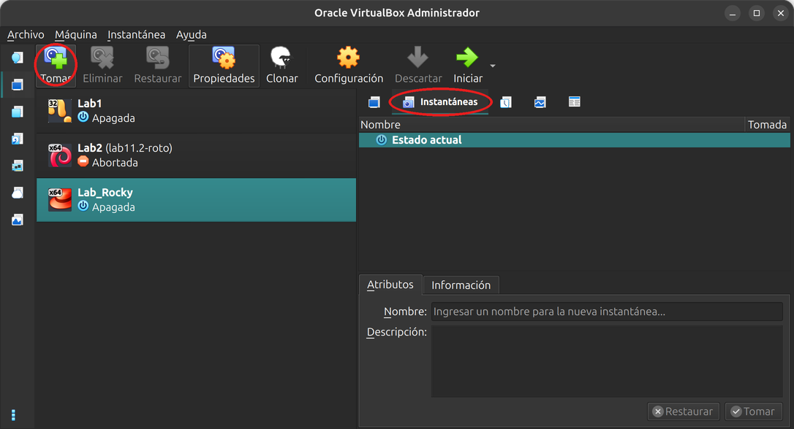
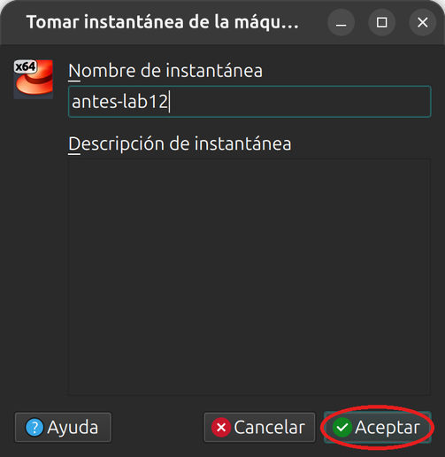
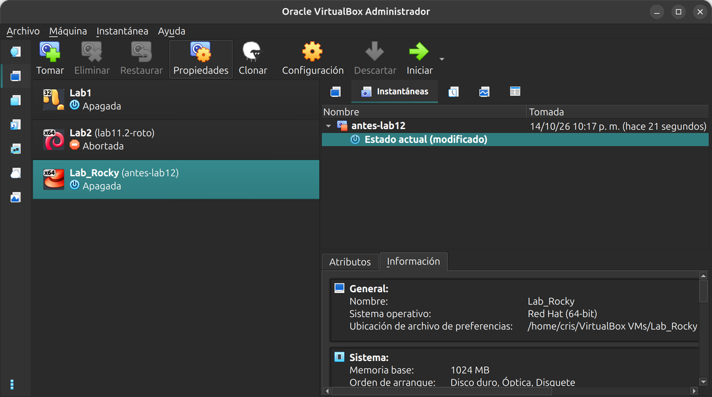
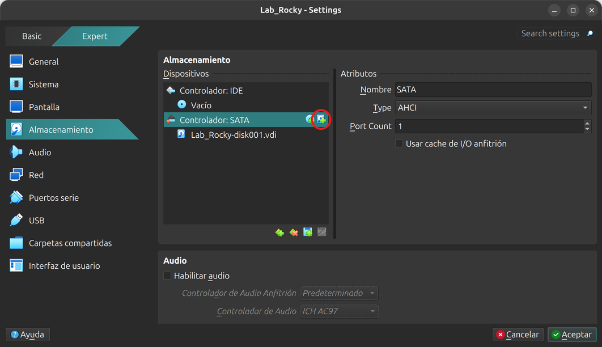
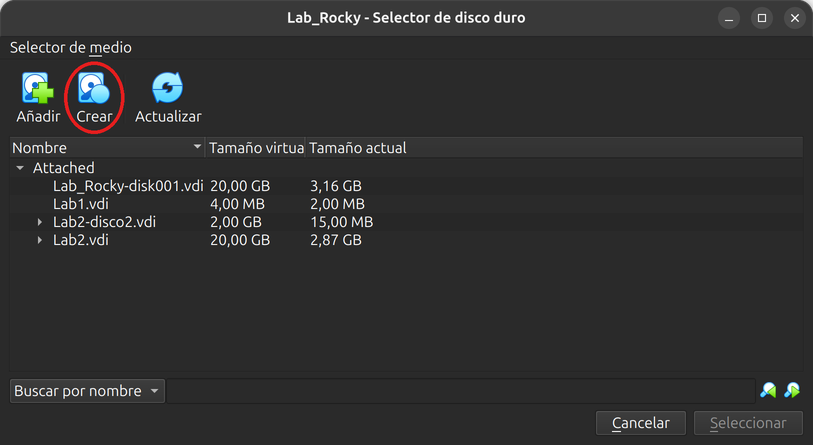
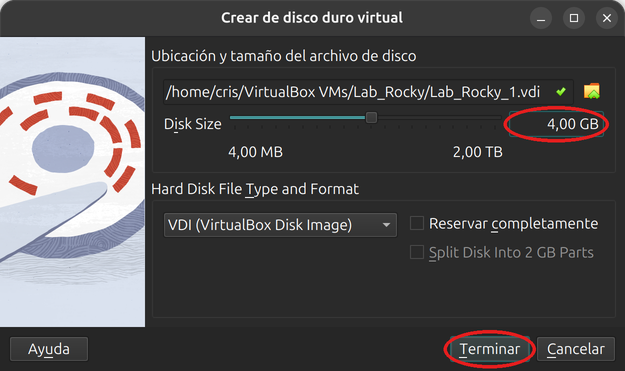
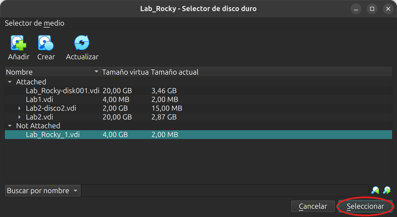
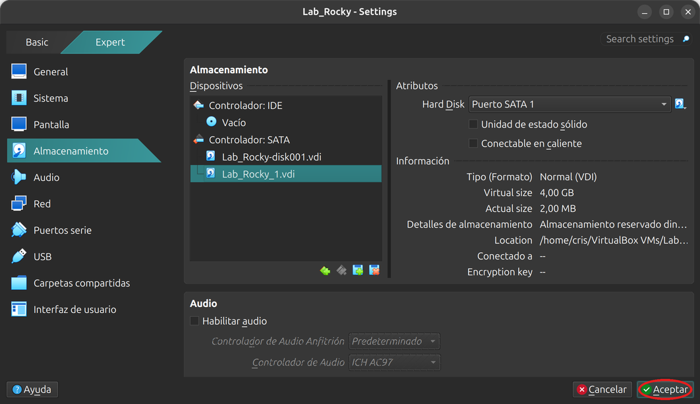

# Laboratorio 12.1 - Ampliar la raíz con LVM

## Objetivo

- Agregar un disco de 4 GB a la VM Rocky Linux y sumarlo al grupo de volúmenes del sistema.
- Ampliar `/` y su sistema de archivos con el sistema en marcha.
- Leer `pvs`, `vgs` y `lvs` para entender en qué estado quedó cada capa.

### Punto de partida

Usamos la VM **Rocky Linux** del [Laboratorio 10.2](../lab10/lab10.2.md), con la cuenta `usuario` (contraseña `linux410`). Su instalador ya usó LVM: es la VM ideal para esta práctica.

> [!IMPORTANT]
> **¿No tenés la VM de Rocky?** Descargá `Lab_Rocky.ova` y `Lab_Rocky.ova.sha256` de [linux-files.idep.atepba.org.ar](https://linux-files.idep.atepba.org.ar/) y seguí los pasos 2 a 4 del [Laboratorio 10.2](../lab10/lab10.2.md): comprobar la descarga, importar la VM e iniciarla. Hacen falta unos 6 GB libres en la anfitriona.

> [!NOTE]
> Este laboratorio y el [12.2](lab12.2.md) usan el mismo disco nuevo. La instantánea que sacamos en el paso 1 sirve para los dos: al terminar el 12.2 la restauramos y la VM vuelve a quedar con un solo disco, lista para los laboratorios que siguen.

## 0. Preparación

Iniciá la VM y conectate desde la máquina anfitriona:

```bash
ssh -p 2223 usuario@localhost
```

Mirá cómo está el disco:

```bash
lsblk
```

```text
NAME        MAJ:MIN RM  SIZE RO TYPE MOUNTPOINTS
sda           8:0    0   20G  0 disk 
├─sda1        8:1    0  600M  0 part /boot/efi
├─sda2        8:2    0    1G  0 part /boot
└─sda3        8:3    0 18,4G  0 part 
  ├─rl-root 253:0    0 16,4G  0 lvm  /
  └─rl-swap 253:1    0    2G  0 lvm  [SWAP]
sr0          11:0    1 1024M  0 rom  
```

`sda3` es el volumen físico. Encima están los dos volúmenes lógicos del grupo `rl`: `root`, montado en `/`, y `swap`. `TYPE` dice `lvm` para los volúmenes lógicos.

## 1. Sacar una instantánea

Apagá la VM:

```bash
sudo poweroff
```

En VirtualBox, seleccioná `Lab_Rocky`, abrí la pestaña **Instantáneas** y apretá **Tomar**.



Poné el nombre `antes-lab12` y apretá **Aceptar**. La descripción es opcional.



La lista muestra la instantánea `antes-lab12` y debajo el **Estado actual**. Al lado del nombre de la VM aparece también `(antes-lab12)`.



> [!TIP]
> Con la VM apagada la instantánea tarda unos segundos. Con la VM encendida, VirtualBox además guarda la memoria y puede tardar mucho más: por eso la tomamos apagada.

> [!WARNING]
> Desde el paso 5, `/` va a ocupar parte del disco nuevo. Si después se borra ese disco sin restaurar la instantánea, el sistema no arranca.

## 2. Agregar un disco de 4 GB

Con la VM apagada, seleccioná `Lab_Rocky` y apretá **Configuración**. Entrá en **Almacenamiento**, seleccioná el **Controlador: SATA** y apretá el segundo ícono a la derecha de su nombre, el de agregar un disco duro.



Se abre el **Selector de disco duro**. Ninguno de los discos de la lista es para este uso: apretá **Crear**.



En el asistente dejá el formato **VDI** y la casilla **Reservar completamente** sin marcar. El nombre que propone, `Lab_Rocky_1.vdi`, está bien. Cambiá **Disk Size** a **4,00 GB**: el valor que aparece al abrir es otro. Después apretá **Terminar**.



Volvés al selector. El disco nuevo aparece en **Not Attached**. Con `Lab_Rocky_1.vdi` seleccionado, apretá **Seleccionar**.



En **Almacenamiento**, el controlador SATA ahora lista los dos discos. Apretá **Aceptar**.



> [!NOTE]
> El controlador SATA de la VM no admite discos en caliente: por eso se agregan con la VM apagada.

Si preferís la línea de comandos, esto hace lo mismo desde la anfitriona (cambiá la ruta si tu VM está en otra carpeta):

```bash
cd "$HOME/VirtualBox VMs/Lab_Rocky"
VBoxManage createmedium disk --filename "$PWD/Lab_Rocky_1.vdi" --size 4096
VBoxManage storageattach Lab_Rocky --storagectl SATA --port 1 --device 0 --type hdd --medium "$PWD/Lab_Rocky_1.vdi"
```

Iniciá la VM, entrá por SSH y mirá:

```bash
lsblk
```

```text
NAME        MAJ:MIN RM  SIZE RO TYPE MOUNTPOINTS
sda           8:0    0   20G  0 disk 
├─sda1        8:1    0  600M  0 part /boot/efi
├─sda2        8:2    0    1G  0 part /boot
└─sda3        8:3    0 18,4G  0 part 
  ├─rl-root 253:0    0 16,4G  0 lvm  /
  └─rl-swap 253:1    0    2G  0 lvm  [SWAP]
sdb           8:16   0    4G  0 disk 
sr0          11:0    1 1024M  0 rom  
```

Apareció `sdb`, de 4G, sin particiones. Si en tu VM tiene otro nombre, usá el tuyo en todos los comandos.

> [!WARNING]
> Antes de cada comando de los pasos 4 y 5, repasá que el disco sea el de **4G**. Si escribís el del sistema, `pvcreate` lo inutiliza.

## 3. Mirar el LVM actual

```bash
sudo pvs
sudo vgs
sudo lvs
df -h /
```

```text
  PV         VG Fmt  Attr PSize  PFree
  /dev/sda3  rl lvm2 a--  18,41g    0 
  VG #PV #LV #SN Attr   VSize  VFree
  rl   1   2   0 wz--n- 18,41g    0 
  LV   VG Attr       LSize  Pool Origin Data%  Meta%  Move Log Cpy%Sync Convert
  root rl -wi-ao---- 16,41g                                                    
  swap rl -wi-ao----  2,00g                                                    
S.ficheros          Tamaño Usados  Disp Uso% Montado en
/dev/mapper/rl-root    17G   1,8G   15G  11% /
```

- `pvs`: un solo volumen físico, `sda3`, del grupo `rl`. `PFree` en 0: no le queda nada libre.
- `vgs`: el grupo `rl` tiene 1 PV y 2 LV. `VFree` en 0: para agrandar `root` primero hay que darle espacio al grupo.
- `lvs`: `root` mide 16,41g. En `Attr`, la `a` es activo y la `o` abierto (en uso).

> [!NOTE]
> `lsblk` y `df` no necesitan `sudo`. Los comandos de LVM sí, porque leen los discos directamente.

## 4. Sumar el disco al grupo

Convertí el disco en un volumen físico:

```bash
sudo pvcreate /dev/sdb
sudo pvs
```

```text
  Physical volume "/dev/sdb" successfully created.
  PV         VG Fmt  Attr PSize  PFree
  /dev/sda3  rl lvm2 a--  18,41g    0 
  /dev/sdb      lvm2 ---   4,00g 4,00g
```

`sdb` ya es un PV, pero todavía no pertenece a ningún grupo: la columna `VG` está vacía. Sumalo al grupo `rl`:

```bash
sudo vgextend rl /dev/sdb
sudo vgs
sudo pvs
```

```text
  Volume group "rl" successfully extended
  VG #PV #LV #SN Attr   VSize   VFree 
  rl   2   2   0 wz--n- <22,41g <4,00g
  PV         VG Fmt  Attr PSize  PFree 
  /dev/sda3  rl lvm2 a--  18,41g     0 
  /dev/sdb   rl lvm2 a--  <4,00g <4,00g
```

El grupo pasó a tener 2 PV y casi 4 GB libres. El `<` quiere decir «un poco menos de»: LVM guarda sus datos al principio del disco y el resto se divide en extensiones de 4 MiB.

## 5. Ampliar `/` en caliente

Sumale 2 GB a `root`:

```bash
sudo lvextend -r -L +2G rl/root
```

```text
  File system xfs found on rl/root mounted at /.
  Size of logical volume rl/root changed from 16,41 GiB (4201 extents) to 18,41 GiB (4713 extents).
  Extending file system xfs to 18,41 GiB (19767754752 bytes) on rl/root...
xfs_growfs /dev/rl/root
...
data blocks changed from 4301824 to 4826112
xfs_growfs done
  Extended file system xfs on rl/root.
  Logical volume rl/root successfully resized.
```

(Recortamos el bloque de datos que imprime `xfs_growfs`.)

- `-L +2G` suma 2 GB al tamaño actual.
- `-r` agranda también el sistema de archivos. LVM detecta que `root` tiene XFS y llama a `xfs_growfs`, con `/` montado y en uso.

Comprobá:

```bash
df -h /
sudo lvs -o lv_name,lv_size,devices rl
sudo pvs
```

```text
S.ficheros          Tamaño Usados  Disp Uso% Montado en
/dev/mapper/rl-root    19G   1,8G   17G  10% /
  LV   LSize  Devices       
  root 18,41g /dev/sda3(512)
  root 18,41g /dev/sdb(0)   
  swap  2,00g /dev/sda3(0)  
  PV         VG Fmt  Attr PSize  PFree 
  /dev/sda3  rl lvm2 a--  18,41g     0 
  /dev/sdb   rl lvm2 a--  <4,00g <2,00g
```

- `df` muestra 19G: el sistema de archivos ya ve el espacio nuevo, sin reiniciar ni desmontar.
- `root` aparece dos veces en la columna `Devices`: tiene extensiones en `sda3` (desde la 512) y en `sdb` (desde la 0). Para el sistema sigue siendo un solo volumen.
- En `sdb` quedan casi 2 GB libres. Los vamos a usar en el [Laboratorio 12.2](lab12.2.md).

`lsblk` también lo muestra: `rl-root` cuelga de los dos discos.

```bash
lsblk
```

```text
NAME        MAJ:MIN RM  SIZE RO TYPE MOUNTPOINTS
sda           8:0    0   20G  0 disk 
├─sda1        8:1    0  600M  0 part /boot/efi
├─sda2        8:2    0    1G  0 part /boot
└─sda3        8:3    0 18,4G  0 part 
  ├─rl-root 253:0    0 18,4G  0 lvm  /
  └─rl-swap 253:1    0    2G  0 lvm  [SWAP]
sdb           8:16   0    4G  0 disk 
└─rl-root   253:0    0 18,4G  0 lvm  /
sr0          11:0    1 1024M  0 rom  
```

> [!IMPORTANT]
> Desde ahora `/` depende de los dos discos. Si `sdb` falla o se borra, se pierde `root` entero. LVM no protege los datos: para eso está RAID, que vimos en la teoría.

## 6. Comprobar después de reiniciar

```bash
sudo reboot
```

Volvé a entrar por SSH:

```bash
df -h /
sudo vgs
```

```text
S.ficheros          Tamaño Usados  Disp Uso% Montado en
/dev/mapper/rl-root    19G   1,8G   17G  10% /
  VG #PV #LV #SN Attr   VSize   VFree 
  rl   2   2   0 wz--n- <22,41g <2,00g
```

`/` sigue midiendo 19G y el grupo `rl` tiene 2 PV y casi 2 GB libres. LVM guarda su configuración en los propios discos, así que no hubo que tocar `/etc/fstab`: sigue montando `/dev/mapper/rl-root`.

## Preguntas

1. Después del paso 4, ¿por qué `lvextend` ya podía agrandar `root`, si `sda3` seguía sin espacio libre?
2. ¿Qué pasaría con `df -h /` si se usara `lvextend -L +2G rl/root` sin `-r`? ¿Cómo se arreglaría?
3. ¿Por qué no se puede achicar `root` después de esta práctica?
4. ¿Qué tendría que hacer para ampliar `root` sin agregar un disco, agrandando el disco existente?

## Resumen del laboratorio

- Un disco nuevo pasa a ser parte del LVM en dos pasos: `pvcreate` lo prepara y `vgextend` lo suma a un grupo.
- `lvextend -r` agranda el volumen lógico y su sistema de archivos a la vez, con el sistema en marcha.
- `pvs`, `vgs` y `lvs` muestran el estado de cada capa; `lvs -o +devices` dice en qué discos está cada volumen.
- Un volumen repartido en dos discos depende de los dos.
- XFS crece en caliente, pero no se puede achicar.

## Enlaces útiles y referencias

- Ayuda en Rocky: `man lvm`, `man pvcreate`, `man vgextend`, `man lvextend`, `man xfs_growfs`.
- Clase 13: [presentación](https://linux.idepba.com.ar/clase13.html).
- Siguiente: [Laboratorio 12.2 - Instantánea de LVM](lab12.2.md).

-----

<p align="center">

</p>
