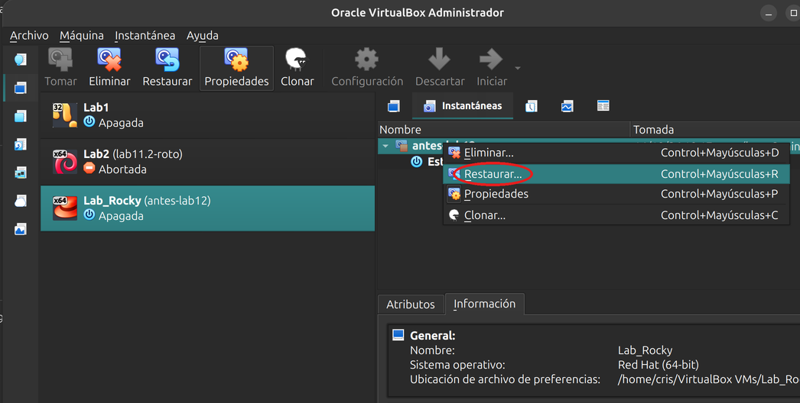
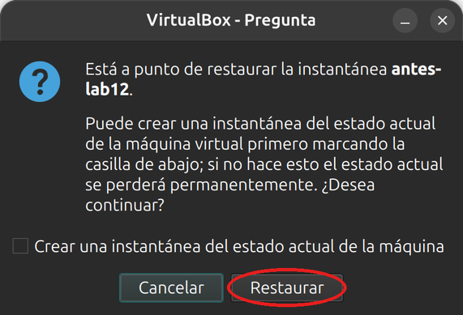

# Laboratorio 12.2 - Instantánea de LVM

## Objetivo

- Crear un volumen lógico de datos con el espacio que quedó libre en el grupo `rl`.
- Tomar una instantánea del volumen, romper los datos a propósito y recuperarlos.
- Recuperar un archivo suelto desde la instantánea y volver atrás el volumen entero con `lvconvert --merge`.
- Dejar la VM como estaba antes del Laboratorio 12.1.

### Punto de partida

Seguimos con la VM Rocky tal como quedó al terminar el [Laboratorio 12.1](lab12.1.md): el disco de 4 GB sumado al grupo `rl` y casi 2 GB libres.

## 0. Preparación

```bash
ssh -p 2223 usuario@localhost
```

```bash
sudo vgs
```

```text
  VG #PV #LV #SN Attr   VSize   VFree 
  rl   2   2   0 wz--n- <22,41g <2,00g
```

Tiene que haber casi 2 GB libres (`VFree`). Si te da 0, volvé al paso 4 del Laboratorio 12.1.

## 1. Crear un volumen de datos

```bash
sudo lvcreate -n datos -L 1G rl
sudo lvs
```

```text
  Logical volume "datos" created.
  LV    VG Attr       LSize  Pool Origin Data%  Meta%  Move Log Cpy%Sync Convert
  datos rl -wi-a-----  1,00g                                                    
  root  rl -wi-ao---- 18,41g                                                    
  swap  rl -wi-ao----  2,00g                                                    
```

`datos` está activo (`a`) pero no abierto: le falta el sistema de archivos. Formatealo en XFS, como el resto de Rocky, y montalo:

```bash
sudo mkfs.xfs /dev/rl/datos
sudo mkdir -p /srv/datos
sudo mount /dev/rl/datos /srv/datos
sudo chown usuario: /srv/datos
df -h /srv/datos
```

```text
S.ficheros           Tamaño Usados  Disp Uso% Montado en
/dev/mapper/rl-datos   960M    39M  922M   5% /srv/datos
```

`mkfs.xfs` imprime un bloque de datos del sistema de archivos nuevo; no hace falta leerlo. El `chown` deja la raíz del volumen a nombre de `usuario`, para trabajar sin `sudo`, como en el Laboratorio 11.2.

> [!NOTE]
> No lo agregamos a `/etc/fstab`: el volumen es para esta práctica y al final lo borramos. Si quisieras dejarlo, la línea sería como la del Laboratorio 11.2, con `/dev/mapper/rl-datos` en lugar del UUID.

## 2. Poner datos

```bash
cd /srv/datos
echo "precio=100" > config.txt
mkdir informes
for m in enero febrero marzo; do echo "Informe de $m" > informes/$m.txt; done
ls -lR /srv/datos
```

```text
/srv/datos:
total 4
-rw-r--r--. 1 usuario usuario 11 oct 14 16:40 config.txt
drwxr-xr-x. 2 usuario usuario 59 oct 14 16:40 informes

/srv/datos/informes:
total 12
-rw-r--r--. 1 usuario usuario 17 oct 14 16:40 enero.txt
-rw-r--r--. 1 usuario usuario 19 oct 14 16:40 febrero.txt
-rw-r--r--. 1 usuario usuario 17 oct 14 16:40 marzo.txt
```

Este es el estado «bueno» que queremos poder recuperar.

## 3. Tomar la instantánea

```bash
sudo lvcreate -s -n datos-antes -L 300M rl/datos
sudo lvs
```

```text
  Logical volume "datos-antes" created.
  LV          VG Attr       LSize   Pool Origin Data%  Meta%  Move Log Cpy%Sync Convert
  datos       rl owi-aos---   1,00g                                                    
  datos-antes rl swi-a-s--- 300,00m      datos  0,00                                   
  root        rl -wi-ao----  18,41g                                                    
  swap        rl -wi-ao----   2,00g                                                    
```

- `-s` crea una instantánea; `rl/datos` es el volumen que se congela.
- `-L 300M` no es el tamaño de la copia: es el lugar reservado para guardar los bloques que cambien desde ahora.
- En `Attr`, la `o` de `datos` lo marca como origen y la `s` de `datos-antes`, como instantánea. `Origin` dice de qué volumen es.
- `Data%` en 0,00: todavía no cambió nada, así que la instantánea no ocupa lugar.

## 4. Romper los datos

Simulamos un error: se borra una carpeta, se pisa un archivo de configuración y se escribe un archivo grande.

```bash
rm -r /srv/datos/informes
echo "precio=999" > /srv/datos/config.txt
dd if=/dev/urandom of=/srv/datos/basura bs=1M count=50 status=none; sync
ls -l /srv/datos
cat /srv/datos/config.txt
```

```text
total 51204
-rw-r--r--. 1 usuario usuario 52428800 oct 14 16:40 basura
-rw-r--r--. 1 usuario usuario       11 oct 14 16:40 config.txt
precio=999
```

Mirá la instantánea:

```bash
sudo lvs rl/datos-antes
```

```text
  LV          VG Attr       LSize   Pool Origin Data%  Meta%  Move Log Cpy%Sync Convert
  datos-antes rl swi-a-s--- 300,00m      datos  16,74                                  
```

`Data%` subió a 16,74: antes de cada escritura en `datos`, LVM guardó en la instantánea el bloque viejo. Si llegara a 100, la instantánea dejaría de servir (lo probamos en la parte opcional).

## 5. Recuperar un archivo suelto

La instantánea se puede montar para mirar cómo estaba todo, sin tocar el volumen original. La montamos de solo lectura en otro directorio:

```bash
sudo mkdir -p /mnt/antes
sudo mount -o ro /dev/rl/datos-antes /mnt/antes
```

```text
mount: /mnt/antes: tipo de sistema de ficheros incorrecto, opción incorrecta, superbloque incorrecto en /dev/mapper/rl-datos--antes, falta la página de códigos o el programa auxiliar, o algún otro error.
```

Falla porque la instantánea es una copia exacta: tiene el mismo UUID que `datos`, que ya está montado, y XFS no monta dos sistemas de archivos con el mismo UUID. La opción `nouuid` le dice que lo ignore:

```bash
sudo mount -o ro,nouuid /dev/rl/datos-antes /mnt/antes
ls -lR /mnt/antes
cat /mnt/antes/config.txt
```

```text
/mnt/antes:
total 4
-rw-r--r--. 1 usuario usuario 11 oct 14 16:40 config.txt
drwxr-xr-x. 2 usuario usuario 59 oct 14 16:40 informes

/mnt/antes/informes:
total 12
-rw-r--r--. 1 usuario usuario 17 oct 14 16:40 enero.txt
-rw-r--r--. 1 usuario usuario 19 oct 14 16:40 febrero.txt
-rw-r--r--. 1 usuario usuario 17 oct 14 16:40 marzo.txt
precio=100
```

Ahí está todo como en el paso 2. Para recuperar un solo archivo alcanza con copiarlo, por ejemplo `cp /mnt/antes/informes/enero.txt /srv/datos/`. No lo hagamos todavía: en el paso siguiente volvemos atrás el volumen entero.

```bash
sudo umount /mnt/antes
```

> [!TIP]
> Montar la instantánea es la forma de respaldar un sistema en uso: se copia desde la instantánea, que no cambia mientras dura la copia. Lo retomamos en la clase de respaldos.

## 6. Volver atrás el volumen entero

`lvconvert --merge` aplica la instantánea sobre el original: `datos` vuelve al estado del paso 3 y la instantánea desaparece. Primero desmontá el volumen (salí de `/srv/datos` si tu terminal está ahí):

```bash
cd /
sudo umount /srv/datos
sudo lvconvert --merge rl/datos-antes
```

```text
  Merging of volume rl/datos-antes started.
  rl/datos: Merged: 86,61%
  rl/datos: Merged: 100,00%
```

Montalo de nuevo y comprobá:

```bash
sudo mount /dev/rl/datos /srv/datos
ls -lR /srv/datos
cat /srv/datos/config.txt
sudo lvs
```

```text
/srv/datos:
total 4
-rw-r--r--. 1 usuario usuario 11 oct 14 16:40 config.txt
drwxr-xr-x. 2 usuario usuario 59 oct 14 16:40 informes

/srv/datos/informes:
total 12
-rw-r--r--. 1 usuario usuario 17 oct 14 16:40 enero.txt
-rw-r--r--. 1 usuario usuario 19 oct 14 16:40 febrero.txt
-rw-r--r--. 1 usuario usuario 17 oct 14 16:40 marzo.txt
precio=100
  LV    VG Attr       LSize  Pool Origin Data%  Meta%  Move Log Cpy%Sync Convert
  datos rl -wi-a-----  1,00g                                                    
  root  rl -wi-ao---- 18,41g                                                    
  swap  rl -wi-ao----  2,00g                                                    
```

Volvieron `informes` y el precio original, y desapareció `basura`. `datos-antes` ya no está en la lista: una instantánea se usa una sola vez para volver atrás.

> [!NOTE]
> Si el volumen no se puede desmontar, como pasa con `/`, `lvconvert --merge` igual acepta la orden y hace la fusión la próxima vez que se active el volumen, es decir, en el próximo arranque.

## 7. Opcional: una instantánea que se llena

¿Qué pasa si cambia más de lo que entra en el espacio reservado? Tomá una instantánea chica y escribí más que eso:

```bash
sudo lvcreate -s -n chica -L 100M rl/datos
dd if=/dev/urandom of=/srv/datos/grande bs=1M count=150 status=none; sync
sudo lvs -o lv_name,lv_attr,data_percent,lv_snapshot_invalid rl/chica
```

```text
  Logical volume "chica" created.
  LV    Attr       Data%  SnapInvalid     
  chica swi-I-s--- 100,00 snapshot invalid
```

Se llenó al 100 % y quedó inválida: la `I` en `Attr` y la columna `SnapInvalid` lo dicen. Ya no se puede montar ni usar para volver atrás:

```bash
sudo mount -o ro,nouuid /dev/rl/chica /mnt/antes
```

```text
mount: /mnt/antes: no se puede leer el superbloque en /dev/mapper/rl-chica.
```

Borrala junto con el archivo grande:

```bash
sudo lvremove -y rl/chica
rm /srv/datos/grande
```

El tamaño de la instantánea tiene que alcanzar para todo lo que cambie mientras exista. Por eso se usa por poco tiempo y se borra cuando cumplió su función.

## 8. Dejar la VM como estaba

Borrá el volumen de datos:

```bash
sudo umount /srv/datos
sudo lvremove -y rl/datos
sudo rmdir /srv/datos /mnt/antes
```

Ahora volvé al estado de antes del Laboratorio 12.1. Apagá la VM:

```bash
sudo poweroff
```

En VirtualBox, abrí la pestaña **Instantáneas** de `Lab_Rocky`. Hacé clic derecho sobre `antes-lab12` y elegí **Restaurar...** (también está el botón **Restaurar** en la barra de arriba).



VirtualBox pregunta si querés guardar antes el estado actual en otra instantánea. Dejá la casilla sin marcar, porque no lo necesitamos, y apretá **Restaurar**.



La instantánea guarda también qué discos estaban conectados, así que la VM vuelve a tener un solo disco y `/` de 16,4G. El archivo `Lab_Rocky_1.vdi` queda suelto en la carpeta de la VM. Para borrarlo, andá a **Herramientas → Medios**, seleccionalo y apretá **Eliminar**; cuando pregunte, elegí borrar también el archivo.

Arrancá la VM y comprobá:

```bash
lsblk
sudo vgs
```

`lsblk` tiene que mostrar solo `sda` y `vgs`, el grupo `rl` con 1 PV y sin espacio libre, como al empezar el Laboratorio 12.1.

> [!WARNING]
> Si no sacaste la instantánea del paso 1 del Laboratorio 12.1, **no borres el disco**: `/` usa parte de él y el sistema no arrancaría. Podés dejar la VM así, con los dos discos, o borrarla e importar de nuevo la OVA siguiendo el [Laboratorio 10.2](../lab10/lab10.2.md).

## Preguntas

1. En el paso 3, ¿por qué una instantánea de un volumen de 1 GB se puede crear con solo 300 MB?
2. ¿Qué hubiera pasado con la instantánea si en el paso 4 escribías 400 MB en lugar de 50?
3. ¿Por qué hizo falta `nouuid` para montar la instantánea?
4. Si el disco `sdb` se rompiera, ¿la instantánea serviría para recuperar `datos`? ¿Por qué una instantánea no es un respaldo?

## Resumen del laboratorio

- `lvcreate -s -L` crea una instantánea; el tamaño es el lugar para los bloques que cambien, no una copia completa.
- `lvs` muestra el origen (`o`), la instantánea (`s`) y cuánto ocupa (`Data%`). Una instantánea llena queda inválida (`I`).
- La instantánea se monta de solo lectura para recuperar archivos sueltos. Con XFS hace falta `nouuid`.
- `lvconvert --merge` devuelve el volumen entero al estado de la instantánea, con el volumen desmontado.
- La instantánea está en los mismos discos que el original: sirve para deshacer cambios, no reemplaza un respaldo.

## Enlaces útiles y referencias

- Ayuda en Rocky: `man lvcreate`, `man lvconvert`, `man lvs`, `man mount` (opción `nouuid` en `man 5 xfs`).
- Clase 13: [presentación](https://linux.idepba.com.ar/clase13.html).
- Anterior: [Laboratorio 12.1 - Ampliar la raíz con LVM](lab12.1.md).

-----

<p align="center">

</p>
