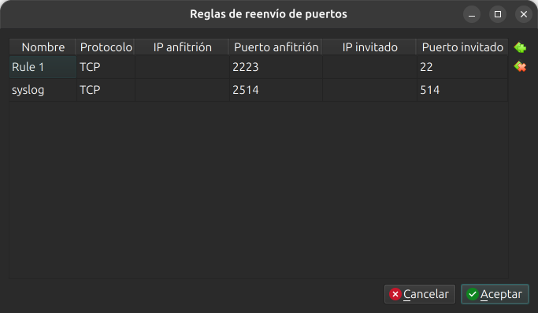

# Laboratorio 13.2 - Logs en otro equipo

## Objetivo

- Configurar la VM Rocky para que reciba logs por la red con rsyslog.
- Configurar la VM Debian para que le mande todos sus logs.
- Comprobar que un intento de acceso a la Debian queda guardado en la Rocky.
- Ver qué pasa con los mensajes cuando el equipo que recibe está caído, y cómo evitar perderlos.

### Punto de partida

- La VM Debian del curso, con la cuenta administradora y el acceso por SSH del [Laboratorio 3](../lab3/lab3.md) (puerto 2222).
- La VM Rocky Linux, con la cuenta `usuario` (contraseña `linux410`) y acceso por SSH en el puerto 2223.
- Las dos VM encendidas a la vez. Cada una usa 1 GB de RAM.

No hace falta haber hecho el [Laboratorio 13.1](lab13.1.md): este laboratorio instala lo que necesita.

> [!IMPORTANT]
> **¿No tenés la VM de Rocky?** Descargá `Lab_Rocky.ova` y `Lab_Rocky.ova.sha256` de [linux-files.idep.atepba.org.ar](https://linux-files.idep.atepba.org.ar/) y seguí los pasos 2 a 4 del [Laboratorio 10.2](../lab10/lab10.2.md): comprobar la descarga, importar la VM e iniciarla. Hacen falta unos 6 GB libres en la anfitriona.

### Por qué hace falta otra regla de reenvío

Las dos VM tienen la red en NAT. Cada una está en su propia red privada de VirtualBox, las dos con la dirección `10.0.2.15`, y no se ven entre sí. Por ahora usamos el mismo recurso del [Laboratorio 3](../lab3/lab3.md): una regla de reenvío de puertos. La Debian manda sus logs a la máquina anfitriona, que dentro de la NAT es `10.0.2.2`, y VirtualBox los pasa a la Rocky:

```text
Debian  →  10.0.2.2:2514 (anfitrión)  →  VirtualBox NAT  →  Rocky:514 (rsyslog)
```

514 es el puerto de syslog. Usamos TCP: con TCP la Debian se entera si la Rocky no responde.

## 1. La regla de reenvío en la VM Rocky

Con la VM Rocky **apagada**:

1. En VirtualBox, seleccioná `Lab_Rocky` y abrí **Configuración**.
2. Entrá en **Red** → **Adaptador 1** → **Reenvío de puertos**. Ya está la regla del puerto 2223 para SSH.
3. Agregá una regla nueva:

| Nombre | Protocolo | IP Anfitrión | Puerto anfitrión | IP invitado | Puerto invitado |
| :--- | :--- | :--- | :--- | :--- | :--- |
| syslog | TCP |  | 2514 |  | 514 |

Los campos **IP anfitrión** e **IP invitado** quedan vacíos. La ventana tiene que quedar con las dos reglas:



4. Aceptá y arrancá la VM.

Desde una terminal de la máquina anfitriona se puede hacer lo mismo con la VM encendida:

```bash
VBoxManage controlvm Lab_Rocky natpf1 "syslog,tcp,,2514,,514"
```

## 2. Dos terminales

Abrí dos terminales en la máquina anfitriona, una para cada VM:

```bash
ssh -p 2222 cristian@localhost
```

```bash
ssh -p 2223 usuario@localhost
```

En cada paso se indica en cuál trabajar. Fijate en el nombre del equipo en el prompt: `lab2-vm` es la Debian y `localhost` es la Rocky.

## 3. Rocky: recibir logs

**En la Rocky.** rsyslog ya viene instalado y en marcha. Le agregamos un archivo en `/etc/rsyslog.d/`, donde va la configuración extra:

```bash
sudo tee /etc/rsyslog.d/10-recibir.conf > /dev/null << "EOF"
module(load="imtcp")
input(type="imtcp" port="514")
template(name="PorEquipo" type="string" string="/var/log/remoto/%HOSTNAME%.log")
if $fromhost-ip != "127.0.0.1" then {
    action(type="omfile" dynaFile="PorEquipo")
    stop
}
EOF
```

Qué hace cada parte:

- `imtcp` es el módulo que recibe por TCP; `input` abre el puerto 514.
- `template` arma el nombre del archivo con el nombre del equipo que manda el mensaje: un archivo por equipo en `/var/log/remoto/`.
- El `if` toma lo que no viene de la propia Rocky (`127.0.0.1`), lo escribe con esa plantilla y `stop` evita que además se mezcle con `/var/log/messages`.

Antes de reiniciar, revisá la sintaxis:

```bash
sudo rsyslogd -N1
```

```text
rsyslogd: version 8.2510.0-2.el9_8.2, config validation run (level 1), master config /etc/rsyslog.conf
rsyslogd: End of config validation run. Bye.
```

Sin errores. Reiniciá y comprobá que escucha:

```bash
sudo systemctl restart rsyslog
sudo ss -tlnp | grep 514
```

```text
LISTEN 0      25           0.0.0.0:514       0.0.0.0:*    users:(("rsyslogd",pid=2061,fd=4))
LISTEN 0      25              [::]:514          [::]:*    users:(("rsyslogd",pid=2061,fd=5))
```

Rocky trae un firewall activo, `firewalld`, que deja pasar solo lo permitido. Abrí el puerto:

```bash
sudo firewall-cmd --add-port=514/tcp
sudo firewall-cmd --list-ports
```

```text
success
514/tcp
```

Así abierto dura hasta que se reinicie la VM o firewalld. 

## 4. Debian: mandar los logs

**En la Debian.** Debian 13 no trae rsyslog. Instalalo; si ya lo instalaste en el Laboratorio 13.1, `apt` avisa que está y no hace nada:

```bash
sudo apt install rsyslog
systemctl is-active rsyslog
```

```text
active
```

Para mandar todo a la Rocky alcanza una línea:

```bash
echo "*.* @@10.0.2.2:2514" | sudo tee /etc/rsyslog.d/90-enviar.conf
sudo rsyslogd -N1
sudo systemctl restart rsyslog
```

`*.*` es todo, como en las reglas de la clase. `@@` quiere decir «mandar por TCP» (con una sola `@` sería UDP). Comprobá la conexión:

```bash
sudo ss -tnp | grep 2514
```

```text
ESTAB 0      0          10.0.2.15:54184     10.0.2.2:2514  users:(("rsyslogd",pid=1522,fd=7))
```

`ESTAB`: la Debian está conectada al puerto 2514 del anfitrión, que VirtualBox pasa a la Rocky.

## 5. Probar

**En la Debian**, escribí un mensaje:

```bash
logger -t lab13 "Hola Rocky, soy la Debian"
```

Desde una **tercera terminal en el anfitrión**, intentá entrar a la Debian como `invitado` con cualquier contraseña:

```bash
ssh -p 2222 invitado@localhost
```

**En la Rocky**, buscá los dos:

```bash
sudo ls -l /var/log/remoto/
sudo grep -E "lab13|Failed password" /var/log/remoto/lab2-vm.log
```

```text
total 4
-rw-------. 1 root root 2391 oct 18 22:11 lab2-vm.log
Oct 18 22:11:19 lab2-vm lab13: Hola Rocky, soy la Debian
Oct 18 22:11:23 lab2-vm sshd-session[1536]: Failed password for invalid user invitado from 10.0.2.2 port 54298 ssh2
```

El intento de entrar a la Debian quedó guardado en la Rocky. Aunque alguien con root borrara los logs de la Debian, esta copia queda.

`grep -E` acepta varios patrones separados por `|`. La fecha está en el formato clásico, sin año, porque es el que usa Rocky para escribir.

Comprobá que los mensajes de la Debian no se mezclaron con los de la Rocky:

```bash
sudo grep -c lab2-vm /var/log/messages
```

```text
0
```

> [!NOTE]
> Si probás `sudo tail /var/log/remoto/*.log`, falla con «No existe el fichero o el directorio». El `*` lo expande tu shell, como vimos en la clase 6, y tu usuario no puede leer el directorio `/var/log/remoto`. Escribí el nombre completo del archivo.

## 6. ¿Y si la Rocky se cae?

**En la Rocky**, detené rsyslog:

```bash
sudo systemctl stop rsyslog
```

**En la Debian**, mandá dos mensajes:

```bash
logger -t lab13 "Mensaje 1, Rocky apagado"
logger -t lab13 "Mensaje 2, Rocky apagado"
```

**En la Rocky**, volvé a arrancarlo:

```bash
sudo systemctl start rsyslog
```

**En la Debian**, mandá uno más:

```bash
logger -t lab13 "Mensaje 3, Rocky de vuelta"
```

**En la Rocky**, mirá qué llegó:

```bash
sudo grep lab13 /var/log/remoto/lab2-vm.log
```

```text
Oct 18 22:11:19 lab2-vm lab13: Hola Rocky, soy la Debian
Oct 18 22:11:44 lab2-vm lab13: Mensaje 3, Rocky de vuelta
```

**Los mensajes 1 y 2 se perdieron.** La Debian se dio cuenta y lo dejó en su propio journal (líneas recortadas):

```bash
sudo journalctl -u rsyslog -n 3
```

```text
oct 18 22:11:44 lab2-vm rsyslogd[1522]: omfwd: [wrkr 0] target 10.0.2.2:2514 became unavailable during buffer flush. Remaining messages will be sent when it is online again. ...
oct 18 22:11:44 lab2-vm rsyslogd[1522]: action 'action-0-builtin:omfwd' suspended (module 'builtin:omfwd'), retry 0. ...
oct 18 22:11:44 lab2-vm rsyslogd[1522]: action 'action-0-builtin:omfwd' resumed (module 'builtin:omfwd') ...
```

Aunque el mensaje dice que el resto se mandará cuando vuelva, lo que se escribió mientras el destino estaba caído no llegó. Si justo en ese momento alguien intentaba entrar, no tendríamos la copia.

### Una cola para no perder mensajes

**En la Debian**, reemplazá la línea por una versión con cola:

```bash
sudo tee /etc/rsyslog.d/90-enviar.conf > /dev/null << "EOF"
*.* action(type="omfwd" target="10.0.2.2" port="2514" protocol="tcp"
           queue.type="LinkedList" queue.filename="enviar"
           queue.saveOnShutdown="on" action.resumeRetryCount="-1")
EOF
sudo rsyslogd -N1
sudo systemctl restart rsyslog
```

- `omfwd` es el módulo que reenvía; `target`, `port` y `protocol` dicen lo mismo que `@@10.0.2.2:2514`.
- `queue.type="LinkedList"` le da una cola propia: los mensajes esperan ahí mientras el destino no responde.
- `action.resumeRetryCount="-1"` reintenta sin límite.
- `queue.filename` y `queue.saveOnShutdown` hacen que, si la Debian se apaga con mensajes en la cola, los guarde en disco y los mande después.

Repetí la prueba: **en la Rocky** `sudo systemctl stop rsyslog`, **en la Debian** dos `logger` con «Mensaje 5» y «Mensaje 6», y **en la Rocky** `sudo systemctl start rsyslog`. Esperá unos segundos y mirá:

```bash
sudo grep lab13 /var/log/remoto/lab2-vm.log
```

```text
Oct 18 22:11:19 lab2-vm lab13: Hola Rocky, soy la Debian
Oct 18 22:11:44 lab2-vm lab13: Mensaje 3, Rocky de vuelta
Oct 18 22:12:18 lab2-vm lab13: Mensaje 4
Oct 18 22:12:24 lab2-vm lab13: Mensaje 5, Rocky apagado
Oct 18 22:12:27 lab2-vm lab13: Mensaje 6, Rocky apagado
```

Llegaron con la hora en que se escribieron, aunque la Rocky los recibió después. El «Mensaje 4» de la salida es uno que se mandó entre las dos pruebas; en tu lista no aparece.

## 7. Dejar las VM como estaban

**En la Rocky:**

```bash
sudo rm /etc/rsyslog.d/10-recibir.conf
sudo rm -r /var/log/remoto
sudo systemctl restart rsyslog
sudo firewall-cmd --reload
sudo firewall-cmd --list-ports
```

`--reload` vuelve a la configuración guardada del cortafuegos, sin el puerto 514. `--list-ports` tiene que salir vacío.

**En la Debian:**

```bash
sudo rm /etc/rsyslog.d/90-enviar.conf
sudo systemctl restart rsyslog
```

rsyslog queda instalado. Si querés sacarlo, `sudo apt purge rsyslog`.

**En VirtualBox**, borrá la regla `syslog` de la Rocky desde **Configuración → Red → Reenvío de puertos**, o desde el anfitrión:

```bash
VBoxManage controlvm Lab_Rocky natpf1 delete syslog
```

## Preguntas

1. ¿Por qué la Debian manda a `10.0.2.2` y no a la dirección de la Rocky?
2. Si alguien entra a la Debian con root y borra `/var/log/auth.log` y el journal, ¿qué queda para investigar?
3. ¿Qué hubiera pasado en el paso 5 si no abrías el puerto en firewalld?

## Resumen del laboratorio

- rsyslog recibe por TCP con el módulo `imtcp` y guarda un archivo por equipo con una plantilla.
- Para mandar todo: `*.* @@destino:puerto`. `@@` es TCP.
- `rsyslogd -N1` revisa la sintaxis antes de reiniciar.
- Sin cola, lo que se manda con el destino caído se pierde. Con `queue.type="LinkedList"` y `action.resumeRetryCount="-1"` espera y llega después.
- Los logs en otro equipo siguen ahí aunque alguien borre los del servidor.

## Enlaces útiles y referencias

- Ayuda: `man rsyslog.conf`, `man rsyslogd`, `man firewall-cmd`.
- [Documentación de rsyslog: reenvío de mensajes (omfwd)](https://www.rsyslog.com/doc/configuration/modules/omfwd.html).
- [Documentación de rsyslog: recepción por TCP (imtcp)](https://www.rsyslog.com/doc/configuration/modules/imtcp.html).
- Clase 14: [presentación](https://linux.idepba.com.ar/clase14.html).
- Anterior: [Laboratorio 13.1 - Logs del sistema](lab13.1.md).

-----

<p align="center">

</p>
