# Laboratorio 16 - Redes

## Objetivo

- Conectar la VM Debian y la VM Rocky entre sí con una segunda placa de red.
- Dejar una dirección fija en cada una: en Debian con un archivo de `interfaces.d`, en Rocky con `nmtui`.
- Probar la comunicación por dirección y por nombre.
- Provocar tres fallas de red y diagnosticarlas en el orden de la clase.
- Ver qué servicios escuchan y en qué interfaz.

### Punto de partida

- La VM Debian del curso, con la cuenta administradora (por ejemplo `cristian`) y el acceso por SSH del [Laboratorio 3](../lab3/lab3.md) (puerto 2222).
- La VM Rocky Linux, con la cuenta `usuario` (contraseña `linux410`) y acceso por SSH en el puerto 2223.

No hace falta haber hecho otros laboratorios: todo lo que se configura acá se crea en el laboratorio y se deshace al final.

> [!IMPORTANT]
> **¿No tenés la VM de Rocky?** Descargá `Lab_Rocky.ova` y `Lab_Rocky.ova.sha256` de [linux-files.idep.atepba.org.ar](https://linux-files.idep.atepba.org.ar/) y seguí los pasos 2 a 4 del [Laboratorio 10.2](../lab10/lab10.2.md): comprobar la descarga, importar la VM e iniciarla. Hacen falta unos 6 GB libres en la anfitriona. Si la VM Rocky ya tiene reglas de reenvío de otros laboratorios, no las toques.

> [!NOTE]
> Reemplazá `cristian` por tu usuario. Las direcciones MAC, los números de proceso, los tiempos de `ping` y los UUID de tus salidas van a ser otros.

### Qué vamos a armar

Hasta ahora cada VM tenía una sola placa, en NAT. Con eso alcanza para salir a Internet y entrar por SSH, pero las dos VM tienen la misma dirección (`10.0.2.15`) en redes que no se tocan, y no se ven entre sí. Les vamos a agregar una segunda placa conectada a una red interna de VirtualBox, que llamamos `redcurso`. Ahí no hay DHCP, así que cada VM lleva una dirección fija.

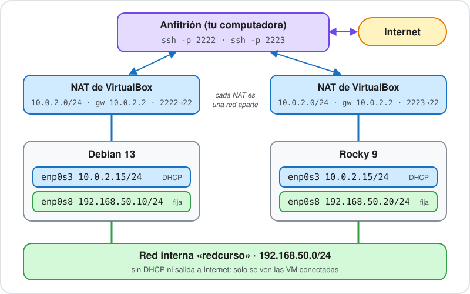

Es el diseño de la [clase 17](https://linux.idepba.com.ar/clase17.html#/diseno_de_red_de_labs). La NAT sigue como estaba, con el reenvío del SSH. La red interna es nueva:

| VM | Placa | Red | Dirección |
| :--- | :--- | :--- | :--- |
| Debian | `enp0s3` | NAT | `10.0.2.15/24` por DHCP |
| Debian | `enp0s8` | `redcurso` | `192.168.50.10/24` fija |
| Rocky | `enp0s3` | NAT | `10.0.2.15/24` por DHCP |
| Rocky | `enp0s8` | `redcurso` | `192.168.50.20/24` fija |

## 1. La segunda placa en VirtualBox

Con las dos VM **apagadas** (`sudo poweroff` desde cada una), hacé esto con cada VM. Con la Debian primero:

1. En VirtualBox, seleccioná la VM y abrí **Configuración**. Si ves el modo **Basic**, pasá a **Expert**.
2. Entrá en **Red** (1).
3. Elegí la pestaña **Adaptador 2** (2).
4. Tildá **Habilitar adaptador de red** (3).
5. En **Conectar a**, elegí **Red interna** (4).
6. En **Nombre**, escribí `redcurso` (5). Tiene que ser el mismo nombre en las dos VM, porque es lo que las pone en la misma red.

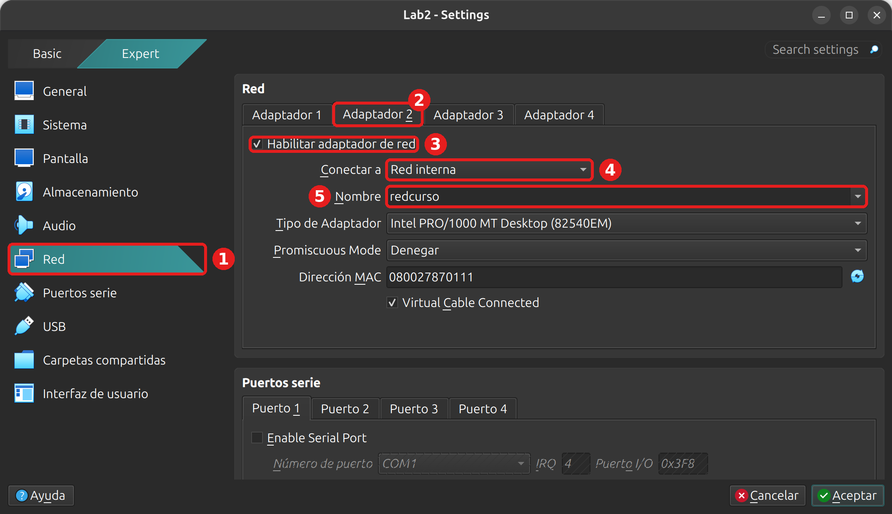

Aceptá y repetí lo mismo en la VM Rocky (`Lab_Rocky`). No toques el **Adaptador 1**: ahí están las reglas de reenvío de puertos.

Si preferís la línea de comandos, con las VM apagadas se hace en la anfitriona (cambiá `Lab2` y `Lab_Rocky` por los nombres de tus VM):

```bash
VBoxManage modifyvm Lab2 --nic2 intnet --intnet2 redcurso
VBoxManage modifyvm Lab_Rocky --nic2 intnet --intnet2 redcurso
```

Encendé las dos VM y entrá a cada una por SSH. Abrí dos terminales en la anfitriona:

```bash
ssh -p 2222 cristian@localhost
```

```bash
ssh -p 2223 usuario@localhost
```

En cada paso se indica en cuál trabajar. Fijate en el nombre del equipo en el prompt: `lab2-vm` es la Debian y `localhost` es la Rocky.

## 2. Apagar IPv6

Las VM tienen direcciones IPv6 que llenan las salidas de `ip a` y en el curso no las usamos. Las apagamos y quedan apagadas: así las salidas de este laboratorio y de los siguientes son más cortas. En un servidor real, antes de apagar IPv6 hay que comprobar que ningún servicio lo use.

### 2.1. En Debian

**En la Debian.** El kernel tiene un parámetro por cada opción de red, y [`sysctl`](https://manpages.debian.org/trixie/systemd/sysctl.d.5.en.html) los lee de archivos en `/etc/sysctl.d/`. Un archivo ahí queda aunque se reinicie la VM:

```bash
sudo tee /etc/sysctl.d/90-sin-ipv6.conf > /dev/null << "EOF"
net.ipv6.conf.all.disable_ipv6 = 1
net.ipv6.conf.default.disable_ipv6 = 1
EOF
sudo sysctl --system
```

La última línea de la salida son los dos valores nuevos:

```text
net.ipv6.conf.all.disable_ipv6 = 1
net.ipv6.conf.default.disable_ipv6 = 1
```

Comprobá que quedó sin IPv6 y que el SSH sigue andando (la sesión no se cortó):

```bash
ip -br a
```

```text
lo               UNKNOWN        127.0.0.1/8 
enp0s3           UP             10.0.2.15/24 
enp0s8           DOWN           
```

`enp0s8` es la placa nueva. Está apagada (`DOWN`) y sin dirección: todavía nadie la configuró.

> [!NOTE]
> Con `sudo journalctl -n 20` vas a ver que dhcpcd, el cliente DHCP de la Debian, anota `deleted address ...` y un `if_route (ADD): Permission denied`: está intentando mantener la ruta de una red IPv6 que ya no existe. Es un único aviso y no afecta a nada.

### 2.2. En Rocky

**En la Rocky.** El archivo de `sysctl` también funciona acá, pero NetworkManager, que maneja la red en Rocky, no se entera: al intentar poner direcciones IPv6 recibe `Permiso denegado` y llena el journal de avisos `<warn>`. Por eso en Rocky se lo decimos a NetworkManager, en el perfil de la placa:

```bash
sudo nmcli con mod enp0s3 ipv6.method disabled
sudo nmcli con up enp0s3
```

```text
Conexión activada con éxito (ruta activa D-Bus: /org/freedesktop/NetworkManager/ActiveConnection/5)
```

`enp0s3` es la placa con la que entraste por SSH. La sesión sobrevive: la dirección IPv4 no cambia y la reconexión dura un par de segundos. El cambio queda guardado en el perfil y se mantiene después de reiniciar, sin avisos. Comprobalo:

```bash
ip -br a
```

```text
lo               UNKNOWN        127.0.0.1/8 ::1/128 
enp0s3           UP             10.0.2.15/24 
enp0s8           UP             fe80::bce5:955c:c61c:eb74/64 
```

En `lo` queda `::1`, que es la dirección de la propia máquina. `enp0s8` todavía tiene una dirección IPv6 de enlace local (`fe80::`), porque esa placa no tiene perfil: lo vamos a resolver más abajo.

Desde acá, para que las salidas sean cortas, usamos `ip -br -4 a`, que muestra solo IPv4.

## 3. Debian: dirección fija

**En la Debian.** Mirá primero cómo está la placa nueva. Con `-4` ni aparece, porque no tiene dirección IPv4; sin `-4` se ve:

```bash
ip -br -4 a
ip -br a
```

```text
lo               UNKNOWN        127.0.0.1/8 
enp0s3           UP             10.0.2.15/24 
lo               UNKNOWN        127.0.0.1/8 
enp0s3           UP             10.0.2.15/24 
enp0s8           DOWN           
```

La red de la Debian la arma `ifupdown`, y lee `/etc/network/interfaces` y los archivos de `interfaces.d/`. Creamos uno para `enp0s8`, como en la [clase 17](https://linux.idepba.com.ar/clase17.html#/levantar_y_bajar_interfaces). Las líneas están explicadas en [`interfaces(5)`](https://manpages.debian.org/trixie/ifupdown/interfaces.5.es.html):

```bash
sudo tee /etc/network/interfaces.d/enp0s8 > /dev/null << "EOF"
auto enp0s8
iface enp0s8 inet static
    address 192.168.50.10/24
EOF
cat /etc/network/interfaces.d/enp0s8
```

```text
auto enp0s8
iface enp0s8 inet static
    address 192.168.50.10/24
```

- `auto` hace que la interfaz se levante al arrancar.
- `inet static` dice que la dirección es fija, no por DHCP.
- `address` lleva la dirección y la máscara (`/24`).

Todavía no pasó nada: el archivo es solo la receta. [`ifup`](https://manpages.debian.org/trixie/ifupdown/ifup.8.es.html) la aplica:

```bash
sudo ifup enp0s8
ip -br -4 a
ip route
```

`ifup` no imprime nada si anda bien. Después:

```text
lo               UNKNOWN        127.0.0.1/8 
enp0s3           UP             10.0.2.15/24 
enp0s8           UP             192.168.50.10/24 
default via 10.0.2.2 dev enp0s3 proto dhcp src 10.0.2.15 metric 1002 
10.0.2.0/24 dev enp0s3 proto dhcp scope link src 10.0.2.15 metric 1002 
192.168.50.0/24 dev enp0s8 proto kernel scope link src 192.168.50.10 
```

Dos cosas para fijarse. La ruta `192.168.50.0/24` apareció sola: la crea la dirección con su máscara. Y la ruta por defecto sigue siendo una sola, por la NAT (`10.0.2.2`). La red interna no tiene salida a Internet, así que no lleva puerta de enlace.

> [!NOTE]
> A veces, justo después de `ifup`, `enp0s8` se ve `DOWN` y la ruta dice `linkdown`. El enlace sube dos o tres segundos después. Repetí `ip -br -4 a` antes de pensar que falló. Si querés cambiar la dirección más adelante, el orden es `sudo ifdown enp0s8`, editar el archivo y `sudo ifup enp0s8`; si editás antes de `ifdown`, da `Error: ipv4: Address not found.`

Reiniciá para comprobar que la dirección sobrevive:

```bash
sudo reboot
```

Esperá un minuto, volvé a entrar por SSH y mirá:

```bash
ip -br -4 a
ip route
```

```text
lo               UNKNOWN        127.0.0.1/8 
enp0s3           UP             10.0.2.15/24 
enp0s8           UP             192.168.50.10/24 
default via 10.0.2.2 dev enp0s3 proto dhcp src 10.0.2.15 metric 1002 
10.0.2.0/24 dev enp0s3 proto dhcp scope link src 10.0.2.15 metric 1002 
192.168.50.0/24 dev enp0s8 proto kernel scope link src 192.168.50.10 
```

> [!NOTE]
> Si después de `sudo reboot` la VM no vuelve (en la consola de VirtualBox queda un mensaje de error y el SSH no responde), apagala desde el menú **Máquina → Reiniciar** de VirtualBox o con `VBoxManage controlvm Lab2 reset`. No se pierde nada: la configuración ya estaba guardada en el disco.

## 4. Rocky: dirección fija con nmtui

**En la Rocky.** Antes de configurar nada, mirá cómo ve NetworkManager la placa nueva:

```bash
nmcli con show
nmcli device
```

```text
NAME                 UUID                                  TYPE      DEVICE 
enp0s3               40d60793-b4ec-3586-96cb-ec38ede00ed7  ethernet  enp0s3 
Conexión cableada 1  bf346091-1291-3990-b17b-f3dafc4cd2fb  ethernet  enp0s8 
lo                   92ccc810-4068-4732-bca4-173c70d65efc  loopback  lo     
DEVICE  TYPE      STATE                                     CONNECTION          
enp0s3  ethernet  conectado                                 enp0s3              
enp0s8  ethernet  conectando (obteniendo configuración IP)  Conexión cableada 1 
lo      loopback  connected (externally)                    lo                  
```

NetworkManager armó solo un perfil para la placa, «Conexión cableada 1», con DHCP. En la red interna no hay quien reparta direcciones, así que se queda en `conectando` y no consigue nada. Lo vamos a reemplazar por un perfil propio, con la dirección fija. Es lo que explica la [clase 17](https://linux.idepba.com.ar/clase17.html#/rocky_configuracion_con_menus).

[`nmtui`](https://manpages.debian.org/trixie/network-manager/nmtui.1.en.html) arma el perfil con menús en la terminal. Se maneja con el teclado: las flechas para moverse en las listas, `Tab` para pasar de un campo o botón al siguiente (`Shift+Tab` para volver), `Enter` para elegir. Hace falta `sudo`: sin él, al aceptar da `No se pudo añadir una nueva conexión: Insufficient privileges` y no guarda nada.

```bash
sudo nmtui
```

**1. Menú principal.** `Modificar una conexión` ya está elegida. Apretá `Enter`.

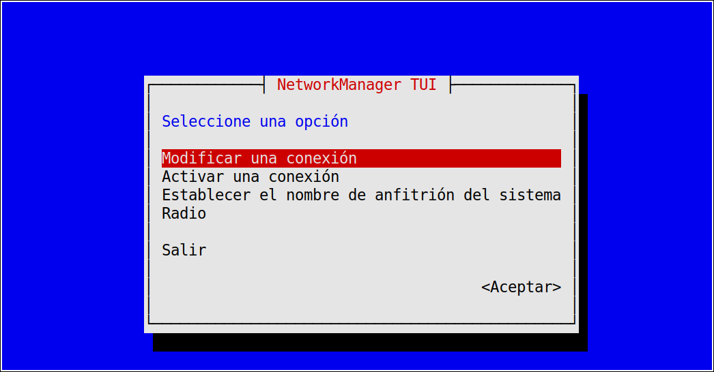

**2. Lista de conexiones.** Están `enp0s3`, «Conexión cableada 1» y `lo`. Con `Tab` pasá a `<Añadir>` y apretá `Enter`.

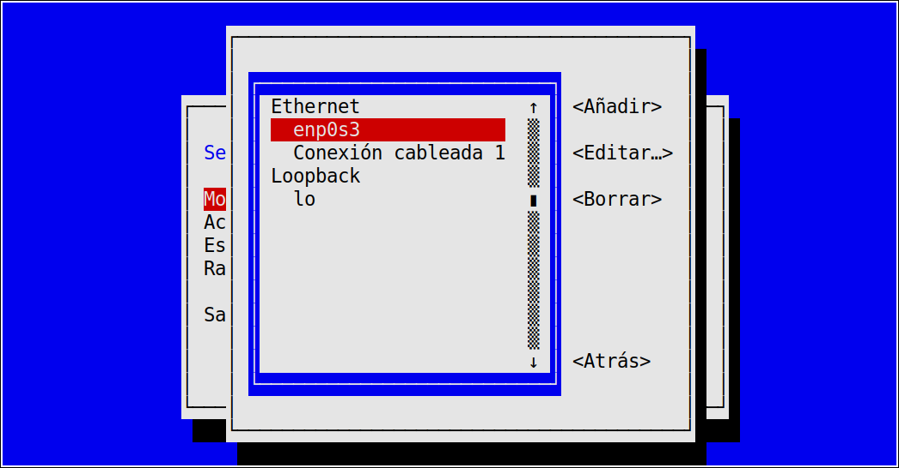

**3. Tipo de conexión.** Bajá con la flecha hasta `Ethernet`, pasá con `Tab` dos veces a `<Crear>` y `Enter`.

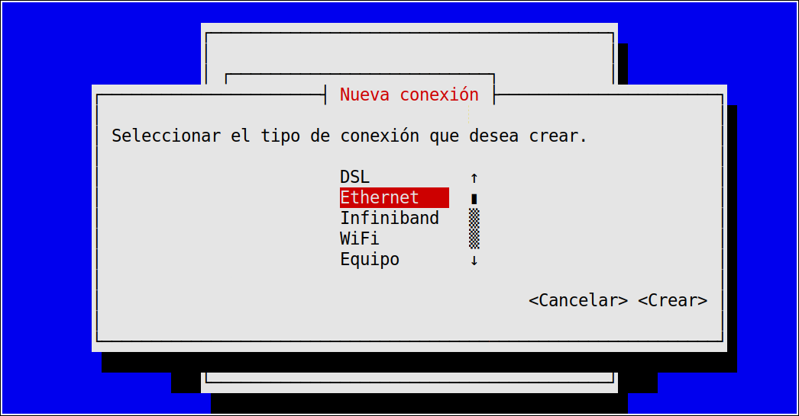

**4. Formulario.** Aparece con un nombre y sin dispositivo.

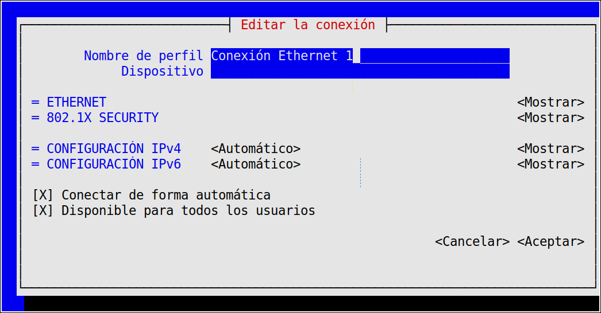

Borrá el nombre (con `Retroceso`) y escribí `interna`. Con `Tab` pasá a `Dispositivo` y escribí `enp0s8`. Ese campo ata el perfil a la placa `enp0s8` y no a otra.

**5. Método de IPv4.** Con `Tab` llegá a `CONFIGURACIÓN IPv4` (pasás antes por los botones `<Mostrar>` de ETHERNET y 802.1X, sin abrirlos), apretá `Enter` y elegí `Manual`.

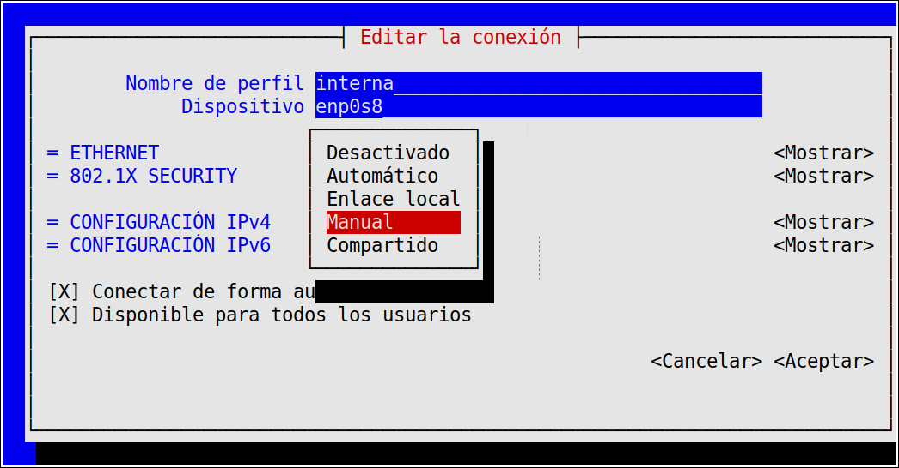

**6. Dirección.** Con `Manual` se muestran las opciones. Pasá con `Tab` al botón `<Mostrar>` de IPv4 (ahora dice `<Ocultar>`), y de ahí a `Direcciones <Añadir…>` con `Enter`. Escribí `192.168.50.20/24`. La máscara va pegada a la dirección. Dejá vacía la `Puerta de enlace`: la red interna no sale a ningún lado, y una puerta de enlace acá competiría con la de la NAT.

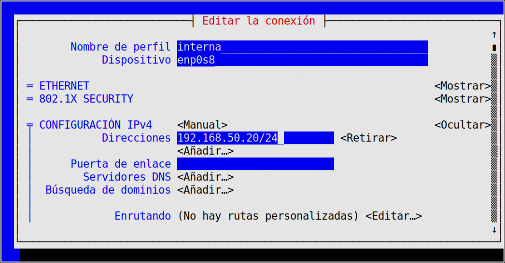

**7. IPv6.** Ocultá la sección de IPv4 con `<Ocultar>` y pasá con `Tab` a `CONFIGURACIÓN IPv6`. Las opciones son `Ignorar`, `Automático`, `Automático (sólo DHCP)`, `Enlace local`, `Manual`, `Compartido` y `Desactivado`. Elegí `Desactivado`. `Ignorar` deja a NetworkManager sin tocar IPv6, pero el kernel igual le pone una dirección `fe80::` a la placa; `Desactivado` la deja sin ninguna.

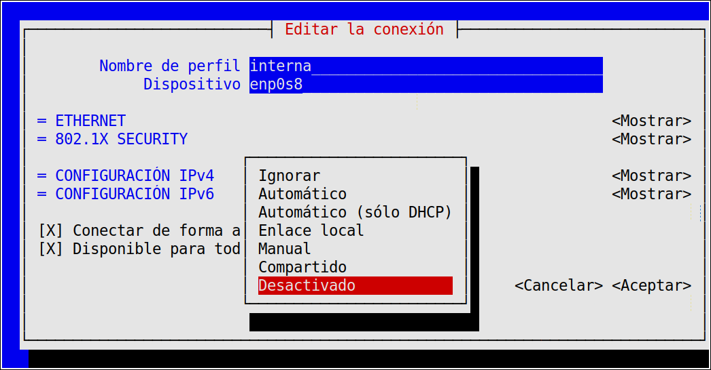

**8. Aceptar.** Con `Tab` llegá a `<Aceptar>` (pasás por dos casillas marcadas, `Conectar de forma automática` y `Disponible para todos los usuarios`, que se dejan así) y apretá `Enter`.

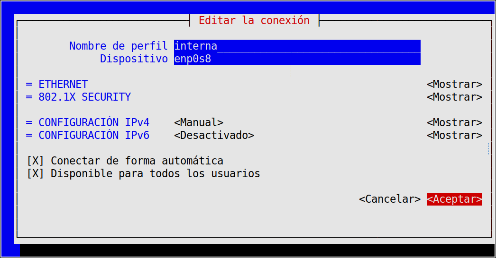

**9. Lista.** Volvés a la lista de conexiones, ahora con `interna`. Salí con `<Atrás>`.

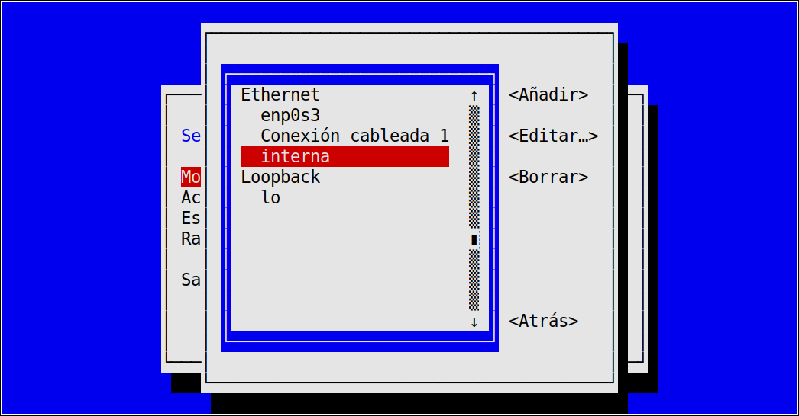

**10. Activar.** Con el perfil guardado, NetworkManager a veces lo activa solo y a veces no: «Conexión cableada 1» sigue ocupando la placa mientras intenta el DHCP. Mirá en otra terminal o después de salir de `nmtui`:

```bash
nmcli device
```

Si `enp0s8` dice `interna`, ya está. Si sigue en `conectando` con «Conexión cableada 1», en el menú principal elegí `Activar una conexión`, ubicate en `interna` y apretá `<Activar>`.

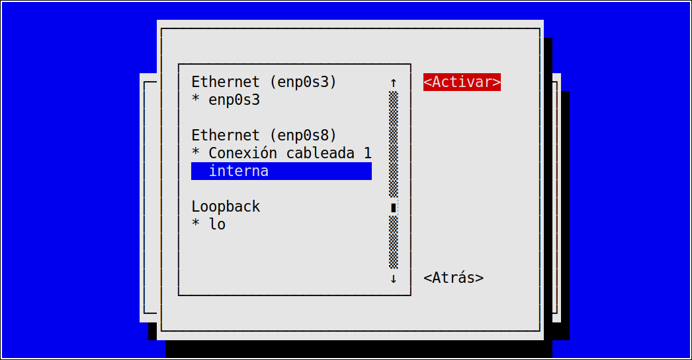

> [!WARNING]
> No apretes `<Desactivar>` sobre `enp0s3`: es la placa por la que entrás a la VM por SSH, y la sesión se corta. Si pasa, apagá y volvé a encender la VM (`VBoxManage controlvm Lab_Rocky acpipowerbutton`); el perfil `interna` ya está guardado.

Con `interna` activa, la lista la marca con un asterisco (`*`) y «Conexión cableada 1» queda sin marca.

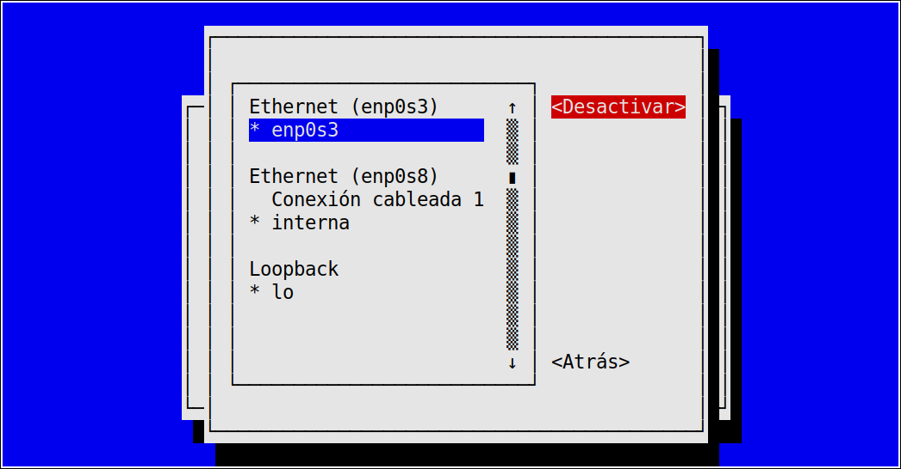

Salí con `<Atrás>` y `Salir`.

### Verificar

```bash
nmcli con show
nmcli device
ip -br -4 a
ip route
```

```text
NAME                 UUID                                  TYPE      DEVICE 
enp0s3               40d60793-b4ec-3586-96cb-ec38ede00ed7  ethernet  enp0s3 
interna              ff64d38e-60a3-4884-b5f8-81da78b8dc7f  ethernet  enp0s8 
lo                   92ccc810-4068-4732-bca4-173c70d65efc  loopback  lo     
Conexión cableada 1  bf346091-1291-3990-b17b-f3dafc4cd2fb  ethernet  --     
DEVICE  TYPE      STATE                   CONNECTION 
enp0s3  ethernet  conectado               enp0s3     
enp0s8  ethernet  conectado               interna    
lo      loopback  connected (externally)  lo         
lo               UNKNOWN        127.0.0.1/8 
enp0s3           UP             10.0.2.15/24 
enp0s8           UP             192.168.50.20/24 
default via 10.0.2.2 dev enp0s3 proto dhcp src 10.0.2.15 metric 100 
10.0.2.0/24 dev enp0s3 proto kernel scope link src 10.0.2.15 metric 100 
192.168.50.0/24 dev enp0s8 proto kernel scope link src 192.168.50.20 metric 101 
```

- `interna` está en `enp0s8`, y «Conexión cableada 1» quedó sin dispositivo (`--`).
- La ruta `192.168.50.0/24` salió de la dirección, y la ruta por defecto sigue siendo una sola, por la NAT.

Reiniciá para comprobar que sobrevive (`sudo reboot`, un minuto de espera y volver a entrar). Después del reinicio, «Conexión cableada 1» ya no aparece, porque nunca se guardó en el disco:

```bash
nmcli con show
ip -br -4 a
```

```text
NAME     UUID                                  TYPE      DEVICE 
enp0s3   40d60793-b4ec-3586-96cb-ec38ede00ed7  ethernet  enp0s3 
interna  ff64d38e-60a3-4884-b5f8-81da78b8dc7f  ethernet  enp0s8 
lo       6ff817bd-bfe4-4f9f-b83b-05807299a3b0  loopback  lo     
lo               UNKNOWN        127.0.0.1/8 
enp0s3           UP             10.0.2.15/24 
enp0s8           UP             192.168.50.20/24 
```

### Alternativa: el mismo perfil con nmcli

Todo lo que hizo `nmtui` se resume en un comando. Si preferís escribirlo, borrá antes el perfil si ya lo creaste (`sudo nmcli con delete interna`) y ejecutá:

```bash
sudo nmcli con add type ethernet ifname enp0s8 con-name interna \
  ipv4.method manual ipv4.addresses 192.168.50.20/24 ipv6.method disabled
```

```text
Conexión «interna» (2a36fc12-ec76-4517-87fa-0ee7a327c475) añadida con éxito.
```

[`nmcli`](https://manpages.debian.org/trixie/network-manager/nmcli.1.es.html) guarda el perfil en `/etc/NetworkManager/system-connections/interna.nmconnection` y lo activa en el momento. Con `sudo cat` ese archivo se lee:

```text
[connection]
id=interna
uuid=2a36fc12-ec76-4517-87fa-0ee7a327c475
type=ethernet
interface-name=enp0s8

[ethernet]

[ipv4]
address1=192.168.50.20/24
method=manual

[ipv6]
addr-gen-mode=default
method=disabled

[proxy]
```

## 5. Comunicación entre las VM

### 5.1. Por dirección

**En la Debian:**

```bash
ping -c 3 192.168.50.20
```

```text
PING 192.168.50.20 (192.168.50.20) 56(84) bytes of data.
64 bytes from 192.168.50.20: icmp_seq=1 ttl=64 time=1.69 ms
64 bytes from 192.168.50.20: icmp_seq=2 ttl=64 time=1.82 ms
64 bytes from 192.168.50.20: icmp_seq=3 ttl=64 time=1.89 ms

--- 192.168.50.20 ping statistics ---
3 packets transmitted, 3 received, 0% packet loss, time 2004ms
rtt min/avg/max/mdev = 1.685/1.797/1.885/0.083 ms
```

**En la Rocky**, el camino de vuelta:

```bash
ping -c 3 192.168.50.10
```

```text
PING 192.168.50.10 (192.168.50.10) 56(84) bytes of data.
64 bytes from 192.168.50.10: icmp_seq=1 ttl=64 time=1.64 ms
64 bytes from 192.168.50.10: icmp_seq=2 ttl=64 time=1.54 ms
64 bytes from 192.168.50.10: icmp_seq=3 ttl=64 time=1.84 ms

--- 192.168.50.10 ping statistics ---
3 packets transmitted, 3 received, 0% packet loss, time 2003ms
rtt min/avg/max/mdev = 1.542/1.675/1.844/0.125 ms
```

Las dos VM se ven. El tiempo es de 1 a 2 milisegundos porque el tráfico no sale de la anfitriona. Que `ping` ande en un sentido no garantiza el otro, por eso se prueban los dos.

### 5.2. Por nombre

Para llamarlas por nombre, cada VM necesita saber quién es quién. En la clase vimos que [`/etc/hosts`](https://manpages.debian.org/trixie/manpages-es/hosts.5.es.html) se consulta antes que el DNS, y es lo más simple para dos equipos.

**En la Debian:**

```bash
echo "192.168.50.20 rocky" | sudo tee -a /etc/hosts
getent hosts rocky
ping -c 2 rocky
```

```text
192.168.50.20 rocky
192.168.50.20   rocky
PING rocky (192.168.50.20) 56(84) bytes of data.
64 bytes from rocky (192.168.50.20): icmp_seq=1 ttl=64 time=1.04 ms
64 bytes from rocky (192.168.50.20): icmp_seq=2 ttl=64 time=1.56 ms

--- rocky ping statistics ---
2 packets transmitted, 2 received, 0% packet loss, time 1001ms
rtt min/avg/max/mdev = 1.044/1.304/1.564/0.260 ms
```

La primera línea es lo que escribe `tee`; la segunda es la respuesta de [`getent hosts`](https://manpages.debian.org/trixie/manpages/getent.1.es.html), que pregunta al sistema por un nombre como lo hacen los programas. **En la Rocky**, con el nombre de la Debian:

```bash
echo "192.168.50.10 debian" | sudo tee -a /etc/hosts
getent hosts debian
ping -c 2 debian
```

```text
192.168.50.10 debian
192.168.50.10   debian
PING debian (192.168.50.10) 56(84) bytes of data.
64 bytes from debian (192.168.50.10): icmp_seq=1 ttl=64 time=0.859 ms
64 bytes from debian (192.168.50.10): icmp_seq=2 ttl=64 time=1.36 ms

--- debian ping statistics ---
2 packets transmitted, 2 received, 0% packet loss, time 1002ms
rtt min/avg/max/mdev = 0.859/1.111/1.363/0.252 ms
```

## 6. Tres fallas para diagnosticar

Seguimos en la **Debian**, pingueando a la Rocky. En cada falla el desafío es el mismo: provocarla, ver los síntomas, encontrar la causa con los comandos de la clase y arreglarla. Usamos el [orden de abajo hacia arriba](https://linux.idepba.com.ar/clase17.html#/el_orden_de_abajo_hacia_arriba): ¿la interfaz está arriba?, ¿tiene la dirección correcta?, ¿por dónde sale el paquete?, ¿resuelve el nombre? Intentá resolverlas antes de abrir la solución.

### Falla 1: la interfaz caída

Apagá la placa:

```bash
sudo ifdown enp0s8
ping -c 3 -W 2 192.168.50.20
```

```text
PING 192.168.50.20 (192.168.50.20) 56(84) bytes of data.

--- 192.168.50.20 ping statistics ---
3 packets transmitted, 0 received, 100% packet loss, time 2030ms
```

No responde, y tampoco dice por qué. Según de dónde estés, puede aparecer un `From ... Destination Port Unreachable`: esa dirección es del router de tu red, no de las VM, y no apunta a la causa. Buscá la causa:

```bash
ip -br a
ip route
ip route get 192.168.50.20
```

<details>
<summary>Solución</summary>

```text
lo               UNKNOWN        127.0.0.1/8 
enp0s3           UP             10.0.2.15/24 
enp0s8           DOWN           
default via 10.0.2.2 dev enp0s3 proto dhcp src 10.0.2.15 metric 1002 
10.0.2.0/24 dev enp0s3 proto dhcp scope link src 10.0.2.15 metric 1002 
192.168.50.20 via 10.0.2.2 dev enp0s3 src 10.0.2.15 uid 1000 
    cache 
```

`enp0s8` está `DOWN` y sin dirección, y la ruta `192.168.50.0/24` desapareció de `ip route`. Sin esa ruta, `ip route get` muestra que el paquete saldría `via 10.0.2.2 dev enp0s3`, por la NAT, que no sabe qué hacer con una dirección de red interna. Ese `dev enp0s3` en lugar de `dev enp0s8` es la pista. Se arregla levantando la interfaz:

```bash
sudo ifup enp0s8
ip -br -4 a
ping -c 2 192.168.50.20
ip route get 192.168.50.20
```

```text
lo               UNKNOWN        127.0.0.1/8 
enp0s3           UP             10.0.2.15/24 
enp0s8           UP             192.168.50.10/24 
PING 192.168.50.20 (192.168.50.20) 56(84) bytes of data.
64 bytes from 192.168.50.20: icmp_seq=1 ttl=64 time=1.93 ms
64 bytes from 192.168.50.20: icmp_seq=2 ttl=64 time=1.34 ms

--- 192.168.50.20 ping statistics ---
2 packets transmitted, 2 received, 0% packet loss, time 1002ms
192.168.50.20 dev enp0s8 src 192.168.50.10 uid 1000 
    cache 
```

Ahora el paquete sale por `dev enp0s8`.

</details>

### Falla 2: la red equivocada

Cambiá la dirección por una de otra red, en el orden correcto (`ifdown`, editar, `ifup`):

```bash
sudo ifdown enp0s8
sudo sed -i "s/192.168.50.10/192.168.51.10/" /etc/network/interfaces.d/enp0s8
sudo ifup enp0s8
ping -c 3 -W 2 192.168.50.20
```

```text
PING 192.168.50.20 (192.168.50.20) 56(84) bytes of data.
From 172.16.10.12 icmp_seq=3 Destination Port Unreachable
From 172.16.10.12 icmp_seq=2 Destination Port Unreachable
From 172.16.10.12 icmp_seq=1 Destination Port Unreachable

--- 192.168.50.20 ping statistics ---
3 packets transmitted, 0 received, +3 errors, 100% packet loss, time 2024ms
```

La respuesta viene de una dirección que no es ninguna de las VM, y sigue sin decir qué anda mal. Esta vez la interfaz está arriba. ¿Qué cambió?

<details>
<summary>Solución</summary>

```bash
ip -br -4 a
ip route
ip route get 192.168.50.20
```

```text
lo               UNKNOWN        127.0.0.1/8 
enp0s3           UP             10.0.2.15/24 
enp0s8           UP             192.168.51.10/24 
default via 10.0.2.2 dev enp0s3 proto dhcp src 10.0.2.15 metric 1002 
10.0.2.0/24 dev enp0s3 proto dhcp scope link src 10.0.2.15 metric 1002 
192.168.51.0/24 dev enp0s8 proto kernel scope link src 192.168.51.10 
192.168.50.20 via 10.0.2.2 dev enp0s3 src 10.0.2.15 uid 1000 
    cache 
```

La diferencia con la falla 1 se ve en `ip -br -4 a`: la placa está `UP`, pero con `192.168.51.10`, otra red. La ruta que se creó es a `192.168.51.0/24`, y para `192.168.50.20` otra vez no hay ruta directa: el paquete sale por la NAT. Se arregla corrigiendo el archivo:

```bash
sudo ifdown enp0s8
sudo sed -i "s/192.168.51.10/192.168.50.10/" /etc/network/interfaces.d/enp0s8
cat /etc/network/interfaces.d/enp0s8
sudo ifup enp0s8
ping -c 2 192.168.50.20
```

```text
auto enp0s8
iface enp0s8 inet static
    address 192.168.50.10/24
PING 192.168.50.20 (192.168.50.20) 56(84) bytes of data.
64 bytes from 192.168.50.20: icmp_seq=1 ttl=64 time=1.43 ms
64 bytes from 192.168.50.20: icmp_seq=2 ttl=64 time=1.33 ms

--- 192.168.50.20 ping statistics ---
2 packets transmitted, 2 received, 0% packet loss, time 1002ms
```

</details>

### Falla 3: el nombre que no resuelve

Ahora la red está bien, pero el nombre apunta mal. Cambiá la entrada de `rocky` en `/etc/hosts` por una dirección con un error de tipeo:

```bash
sudo sed -i "s/^192.168.50.20 rocky/192.168.50.21 rocky/" /etc/hosts
ping -c 3 -W 2 rocky
ping -c 2 192.168.50.20
```

```text
PING rocky (192.168.50.21) 56(84) bytes of data.
From 192.168.50.10 icmp_seq=1 Destination Host Unreachable
From 192.168.50.10 icmp_seq=2 Destination Host Unreachable
From 192.168.50.10 icmp_seq=3 Destination Host Unreachable

--- rocky ping statistics ---
3 packets transmitted, 0 received, +3 errors, 100% packet loss, time 2055ms
PING 192.168.50.20 (192.168.50.20) 56(84) bytes of data.
64 bytes from 192.168.50.20: icmp_seq=1 ttl=64 time=1.20 ms
64 bytes from 192.168.50.20: icmp_seq=2 ttl=64 time=1.34 ms
```

Por nombre falla y por dirección anda. Entonces la red está bien y el problema está más arriba. ¿Qué dirección está usando el nombre?

<details>
<summary>Solución</summary>

```bash
getent hosts rocky
tail -2 /etc/hosts
```

```text
192.168.50.21   rocky
ff02::2 ip6-allrouters
192.168.50.21 rocky
```

`getent hosts` muestra qué dirección le toca al nombre: `192.168.50.21`, no la `.20`. Mirando el `ping` ya se veía: el encabezado dice `PING rocky (192.168.50.21)`. Es el orden de la clase: si la dirección responde y el nombre no, el error está en la resolución. Se corrige la línea:

```bash
sudo sed -i "s/^192.168.50.21 rocky/192.168.50.20 rocky/" /etc/hosts
getent hosts rocky
ping -c 2 rocky
```

```text
192.168.50.20   rocky
PING rocky (192.168.50.20) 56(84) bytes of data.
64 bytes from rocky (192.168.50.20): icmp_seq=1 ttl=64 time=1.32 ms
64 bytes from rocky (192.168.50.20): icmp_seq=2 ttl=64 time=1.58 ms
```

Si en lugar de una dirección equivocada la línea faltara, `getent hosts rocky` no imprimiría nada (sale con código 2) y `ping rocky` diría `Fallo temporal en la resolución del nombre`. Probalo si querés: borrá la línea con `sudo sed -i "/ rocky$/d" /etc/hosts`, mirá los mensajes y volvé a agregarla con `echo "192.168.50.20 rocky" | sudo tee -a /etc/hosts`.

</details>

## 7. Qué escucha y dónde

Una red que anda no quiere decir que sea segura: cada servicio que escucha en una interfaz es una puerta. [`ss -tlnp`](https://manpages.debian.org/trixie/iproute2/ss.8.es.html) las lista: `-t` TCP, `-l` los que escuchan, `-n` números en vez de nombres y `-p` el proceso. Hace falta `sudo` para ver el proceso. Mirá en las dos VM:

```bash
sudo ss -tlnp
```

```text
State  Recv-Q Send-Q Local Address:Port Peer Address:PortProcess                       
LISTEN 0      128          0.0.0.0:22        0.0.0.0:*    users:(("sshd",pid=731,fd=6))
LISTEN 0      128             [::]:22           [::]:*    users:(("sshd",pid=731,fd=7))
```

Solo `sshd`, en `0.0.0.0:22`: todas las interfaces, es decir, también por la red interna. La línea `[::]:22` es la misma escucha en el formato de IPv6; el socket sigue ahí aunque hayamos apagado IPv6 en las interfaces. (Rocky muestra lo mismo, con otro número de proceso.)

Ahora levantemos un servicio de prueba. Para tener a mano una página web sin instalar nada, usamos el servidor web que trae Python, [`python3 -m http.server`](https://docs.python.org/3/library/http.server.html), que muestra el contenido de un directorio. Lo corremos en `/tmp`, para no mostrar tus archivos.

### 7.1. Solo en esta máquina

**En la Debian**, en una terminal que dejás ocupada:

```bash
cd /tmp
python3 -m http.server 8080 --bind 127.0.0.1
```

En otra terminal de la Debian (o desde la Rocky más abajo) mirá cómo escucha:

```bash
sudo ss -tlnp
```

```text
State  Recv-Q Send-Q Local Address:Port Peer Address:PortProcess                           
LISTEN 0      128          0.0.0.0:22        0.0.0.0:*    users:(("sshd",pid=731,fd=6))    
LISTEN 0      5          127.0.0.1:8080      0.0.0.0:*    users:(("python3",pid=1242,fd=3))
LISTEN 0      128             [::]:22           [::]:*    users:(("sshd",pid=731,fd=7))    
```

El servidor escucha en `127.0.0.1:8080`: solo atiende a la propia máquina. **En la Rocky**, probá llegar con [`curl`](https://manpages.debian.org/trixie/curl/curl.1.es.html):

```bash
curl -sS -m 5 -o /dev/null -w "%{http_code}\n" http://192.168.50.10:8080/
```

```text
curl: (7) Failed to connect to 192.168.50.10 port 8080: Conexión rehusada
000
```

La conexión se rehúsa: nadie escucha en esa dirección. (`-m 5` limita la espera a cinco segundos, `-o /dev/null` descarta la página y `-w` imprime solo el código de respuesta.) La Debian no trae `curl`, por eso las pruebas se hacen desde la Rocky.

### 7.2. En todas las interfaces

En la terminal de la Debian donde corre el servidor, cortalo con `Ctrl+C` y levantalo escuchando en todas las interfaces:

```bash
python3 -m http.server 8080 --bind 0.0.0.0
```

```bash
sudo ss -tlnp
```

```text
State  Recv-Q Send-Q Local Address:Port Peer Address:PortProcess                           
LISTEN 0      128          0.0.0.0:22        0.0.0.0:*    users:(("sshd",pid=731,fd=6))    
LISTEN 0      5            0.0.0.0:8080      0.0.0.0:*    users:(("python3",pid=1297,fd=3))
LISTEN 0      128             [::]:22           [::]:*    users:(("sshd",pid=731,fd=7))    
```

Ahora aparece `0.0.0.0:8080`. **En la Rocky**:

```bash
curl -sS -m 5 -o /dev/null -w "%{http_code}\n" http://192.168.50.10:8080/
curl -sS -m 5 http://debian:8080/ | head -4
```

```text
200
<!DOCTYPE HTML>
<html lang="en">
<head>
<meta charset="utf-8">
```

Responde `200`, también por el nombre. El servidor de Python va anotando los pedidos en la terminal donde corre:

```text
192.168.50.20 - - [02/Nov/2026 00:59:40] "GET / HTTP/1.1" 200 -
```

La dirección `192.168.50.20` es la de la Rocky. La diferencia entre las dos pruebas es una sola palabra, `127.0.0.1` o `0.0.0.0`, y cambia quién puede llegar. Es lo que mira la clase en [local o todas las interfaces](https://linux.idepba.com.ar/clase17.html#/local_o_todas_las_interfaces).

Cortá el servidor con `Ctrl+C` y comprobá que ya no escucha:

```bash
sudo ss -tlnp
```

## 8. Limpieza

Deshacemos la red interna. IPv6 queda apagado, como lo dejamos en el paso 2.

**En la Debian.** Bajamos la interfaz y borramos su archivo y la entrada de `/etc/hosts`:

```bash
sudo ifdown enp0s8
sudo rm /etc/network/interfaces.d/enp0s8
sudo sed -i "/ rocky$/d" /etc/hosts
```

El archivo `/etc/sysctl.d/90-sin-ipv6.conf` queda: es el que mantiene IPv6 apagado.

**En la Rocky.** Borramos el perfil `interna` y la entrada de `/etc/hosts`:

```bash
sudo nmcli con delete interna
sudo sed -i "/ debian$/d" /etc/hosts
ip -br a
nmcli con show
```

```text
La conexión «interna» (966bb252-7316-4c4e-b4fd-5a96fcb73205) se ha borrado correctamente.
lo               UNKNOWN        127.0.0.1/8 ::1/128 
enp0s3           UP             10.0.2.15/24 
enp0s8           UP             fe80::bce5:955c:c61c:eb74/64 
NAME                 UUID                                  TYPE      DEVICE 
enp0s3               40d60793-b4ec-3586-96cb-ec38ede00ed7  ethernet  enp0s3 
Conexión cableada 1  bf346091-1291-3990-b17b-f3dafc4cd2fb  ethernet  enp0s8 
lo                   3cbd701d-f93d-4a72-a54b-fdb898f32b9f  loopback  lo     
```

`enp0s3` sigue sin IPv6, porque el cambio del paso 2 está guardado en su perfil. Al borrar `interna`, NetworkManager vuelve a armar «Conexión cableada 1» para `enp0s8`, con su dirección `fe80::`; desaparece en el paso siguiente, cuando quitamos la placa.

## 9. Quitar la segunda placa

Apagá las dos VM (`sudo poweroff`). En VirtualBox, en **Configuración → Red → Adaptador 2** de cada una, destildá **Habilitar adaptador de red**. O en la anfitriona:

```bash
VBoxManage modifyvm Lab2 --nic2 none
VBoxManage modifyvm Lab_Rocky --nic2 none
```

Elegimos quitarla y no dejarla desconectada para que las VM queden con una sola placa, como antes. Si más adelante el curso te pide las dos VM conectadas, se vuelve a agregar con el paso 1 en un minuto. La red NAT (Adaptador 1) y sus reglas de reenvío no se tocaron.

Al arrancar de nuevo, las dos VM tienen solo la placa NAT y siguen sin IPv6.

## Preguntas

1. ¿Por qué las dos VM pueden tener la misma dirección `10.0.2.15` sin que se pisen, y por qué eso no alcanza para que se vean entre sí?
2. En el perfil de la Rocky dejaste vacía la puerta de enlace. ¿Qué pasaría si pusieras `192.168.50.10`?
3. En las fallas 1 y 2 el `ping` no dice qué está mal. ¿Qué te mostró `ip route get`, y por qué es mejor pregunta que `ping`?
4. Con `ping 192.168.50.20` andando y `ping rocky` fallando, ¿en qué parte del orden de la clase está el problema?
5. ¿Qué cambia en `ss -tlnp` entre `--bind 127.0.0.1` y `--bind 0.0.0.0`, y por qué `curl` falla en un caso?
6. ¿Por qué en Rocky se apagó IPv6 con `nmcli` y no con el archivo de `sysctl`?

## Resumen del laboratorio

- La red interna `redcurso` conecta las dos VM por una segunda placa (`enp0s8`). Sin DHCP, cada VM lleva una dirección fija en `192.168.50.0/24`.
- En Debian, la dirección fija va en un archivo de `/etc/network/interfaces.d/` y se aplica con `ifup`. Sobrevive al reinicio.
- En Rocky, `nmtui` (o `nmcli con add`) crea un perfil de NetworkManager asociado a la placa. NetworkManager arma solo un perfil con DHCP para la placa nueva, y hay que reemplazarlo o activar el propio.
- `/etc/hosts` permite usar nombres. `getent hosts` muestra qué dirección recibe un nombre.
- Cuando algo no llega: `ip -br a` (¿arriba y con la dirección correcta?), `ip route get` (¿por dónde sale?), `ping` por dirección y `getent hosts` por nombre.
- `ss -tlnp` muestra qué escucha y en qué dirección. `127.0.0.1` es solo la propia máquina; `0.0.0.0` es cualquier interfaz.

## Enlaces útiles y referencias

- Ayuda: `man ip`, `man 5 interfaces`, `man ifup`, `man nmcli`, `man nmtui`, `man 5 hosts`, `man ss`. En línea, en [manpages.debian.org](https://manpages.debian.org/).
- Clase 17: [presentación](https://linux.idepba.com.ar/clase17.html).
- Anterior: [Laboratorio 15.1 - Tareas programadas](../lab15/lab15.1.md).

-----

<p align="center">

</p>
