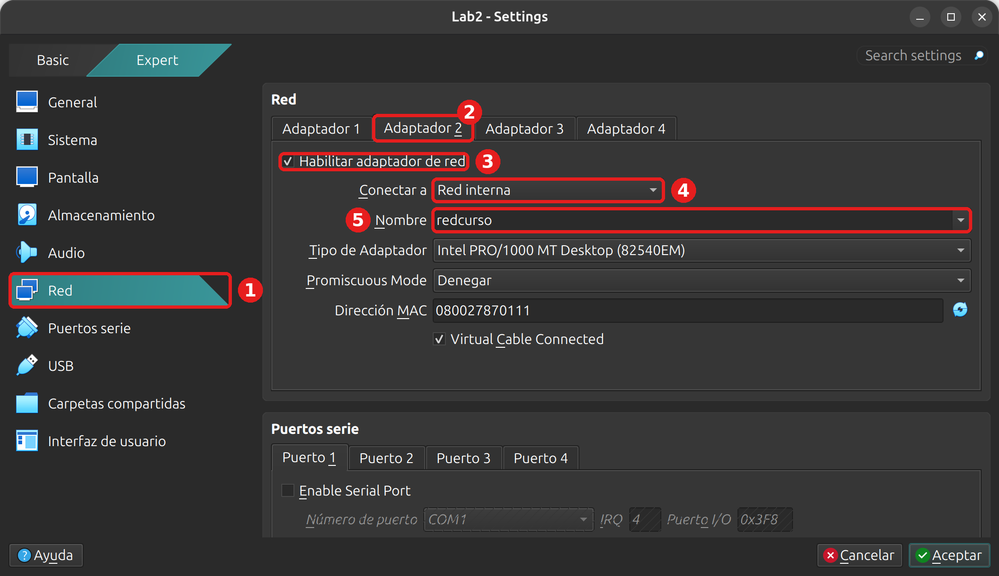
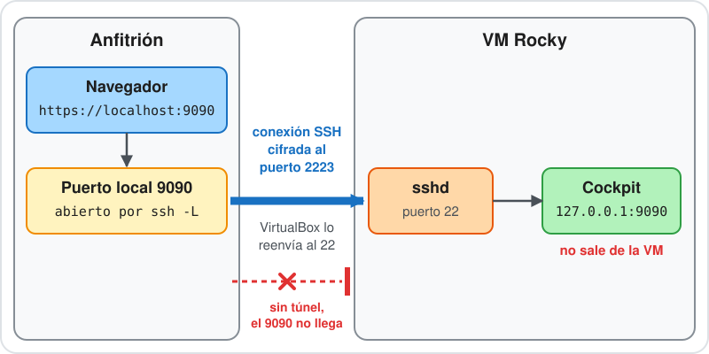
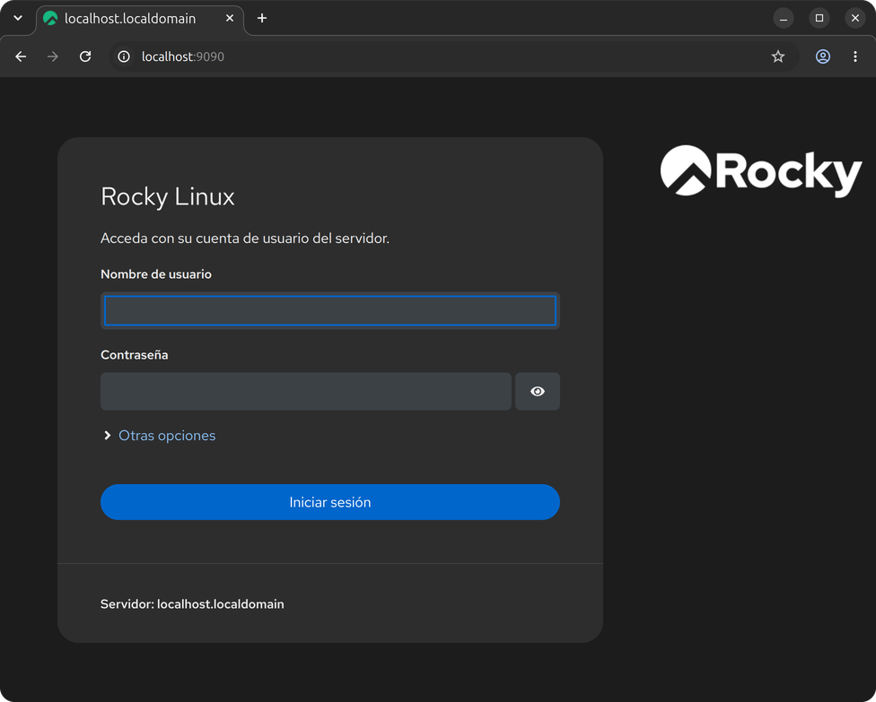

# Laboratorio 17 - Acceso remoto seguro

## Objetivo

- Armar la red interna entre la VM Debian y la VM Rocky con un script.
- Entrar a Rocky desde Debian con una clave SSH protegida por passphrase, en lugar de la contraseña.
- Copiar archivos entre las dos VM con `scp`.
- Llegar a Cockpit, que escucha solo en `127.0.0.1`, por un túnel SSH.

### Punto de partida

- La VM Debian del curso, con la cuenta administradora (por ejemplo `cristian`) y el acceso por SSH del [Laboratorio 3](../lab3/lab3.md) (puerto 2222).
- La VM Rocky Linux, con la cuenta `usuario` (contraseña `linux410`) y acceso por SSH en el puerto 2223.

No hace falta haber hecho otros laboratorios: todo lo que se configura acá se crea en el laboratorio y se deshace al final.

> [!IMPORTANT]
> **¿No tenés la VM de Rocky?** Descargá `Lab_Rocky.ova` y `Lab_Rocky.ova.sha256` de [linux-files.idep.atepba.org.ar](https://linux-files.idep.atepba.org.ar/) y seguí los pasos 2 a 4 del [Laboratorio 10.2](../lab10/lab10.2.md): comprobar la descarga, importar la VM e iniciarla. Hacen falta unos 6 GB libres en la anfitriona. Si la VM Rocky ya tiene reglas de reenvío de otros laboratorios, no las toques.

> [!NOTE]
> Reemplazá `cristian` por tu usuario. Las huellas de las claves, los números de proceso, los puertos de origen, las fechas y los tiempos de `ping` de tus salidas van a ser otros. Si la salida de un comando no se muestra, es porque no imprime nada cuando anda bien.

### Qué vamos a armar

Hasta ahora entramos a las VM por SSH con usuario y contraseña. En este laboratorio la Debian hace de cliente y la Rocky de servidor, y las conectamos por la red interna `redcurso`, que ya conocés de la [clase 17](https://linux.idepba.com.ar/clase17.html#/diseno_de_red_de_labs):

| VM | Papel | Placa | Dirección |
| :--- | :--- | :--- | :--- |
| Debian | cliente | `enp0s8` (red `redcurso`) | `192.168.50.10/24` |
| Rocky | servidor | `enp0s8` (red `redcurso`) | `192.168.50.20/24` |

La teoría de este laboratorio está en la [clase 18](https://linux.idepba.com.ar/clase18.html).

Vas a necesitar varias terminales abiertas en la anfitriona. Para no perderte, cada paso dice dónde se trabaja:

- **En la Debian.** Una terminal con `ssh -p 2222 cristian@localhost`. El prompt dice `cristian@lab2-vm`.
- **En la Rocky.** Una terminal con `ssh -p 2223 usuario@localhost`. El prompt dice `[usuario@localhost ~]$` (después del paso 1, `[usuario@rocky ~]$`).
- **En la anfitriona.** La terminal de tu equipo (PowerShell en Windows).

## 1. La red interna

Este paso es igual al paso 1 del [Laboratorio 16](../lab16/lab16.md#1-la-segunda-placa-en-virtualbox). Si todavía tenés el Adaptador 2 de ese laboratorio en las dos VM, salteá la parte de VirtualBox y andá a «El script».

### La segunda placa en VirtualBox

Con las dos VM **apagadas** (`sudo poweroff` desde cada una), hacé esto con cada VM. Con la Debian primero:

1. En VirtualBox, seleccioná la VM y abrí **Configuración**. Si ves el modo **Basic**, pasá a **Expert**.
2. Entrá en **Red** (1).
3. Elegí la pestaña **Adaptador 2** (2).
4. Tildá **Habilitar adaptador de red** (3).
5. En **Conectar a**, elegí **Red interna** (4).
6. En **Nombre**, escribí `redcurso` (5). Tiene que ser el mismo nombre en las dos VM, porque es lo que las pone en la misma red.



Aceptá y repetí lo mismo en la VM Rocky (`Lab_Rocky`). No toques el **Adaptador 1**: ahí están las reglas de reenvío de puertos.

Si preferís la línea de comandos, con las VM apagadas se hace en la anfitriona (cambiá `Lab2` y `Lab_Rocky` por los nombres de tus VM):

```bash
VBoxManage modifyvm Lab2 --nic2 intnet --intnet2 redcurso
VBoxManage modifyvm Lab_Rocky --nic2 intnet --intnet2 redcurso
```

Encendé las dos VM y entrá a cada una por SSH, en dos terminales de la anfitriona:

```bash
ssh -p 2222 cristian@localhost
```

```bash
ssh -p 2223 usuario@localhost
```

### El script

Configurar la dirección de la segunda placa en cada VM lleva varios comandos distintos según la distribución. Para no repetirlos a mano, el laboratorio trae un script, `red-interna.sh`, que detecta si está en Debian o en Rocky y hace lo que corresponde.

**En la Debian.** Descargalo y leelo antes de ejecutarlo. Conviene mirar siempre qué hace un script que bajaste de Internet:

```bash
wget https://raw.githubusercontent.com/kity-linuxero/linux410-labs/main/lab17/red-interna.sh
cat red-interna.sh
```

Si tu Debian no tiene `wget`, usá la sección de comandos a mano que está más abajo. Ejecutalo con `sudo`, porque cambia la red y `/etc/hosts`:

```bash
sudo bash red-interna.sh
```

```text
Distribución: debian. Segunda placa: enp0s8, dirección 192.168.50.10/24.
Agregada la dirección 192.168.50.10/24 a enp0s8.
Agregado a /etc/hosts: 192.168.50.10 debian
Agregado a /etc/hosts: 192.168.50.20 rocky

enp0s8           UP             192.168.50.10/24 
```

**En la Rocky.** Lo mismo, con `curl`, que Rocky sí trae:

```bash
curl -fsSLO https://raw.githubusercontent.com/kity-linuxero/linux410-labs/main/lab17/red-interna.sh
cat red-interna.sh
sudo bash red-interna.sh
```

```text
Distribución: rocky. Segunda placa: enp0s8, dirección 192.168.50.20/24.
Conexión «redcurso» (b0060989-c21a-4159-8b5b-6ef5323d1c27) añadida con éxito.
Conexión activada con éxito (ruta activa D-Bus: /org/freedesktop/NetworkManager/ActiveConnection/4)
Agregado a /etc/hosts: 192.168.50.10 debian
Agregado a /etc/hosts: 192.168.50.20 rocky

enp0s8           UP             192.168.50.20/24 
```

El script se puede ejecutar de nuevo sin problema: si la dirección, la conexión o las líneas de `/etc/hosts` ya están, avisa y sigue. Si la VM no tiene `enp0s8`, te explica que falta el Adaptador 2 y se detiene.

<details>
<summary>Los mismos comandos a mano, por si no podés descargar el script</summary>

**En la Debian.** El comando [`ip`](https://manpages.debian.org/trixie/iproute2/ip.8.en.html) pone la dirección en la placa. Es temporal: se pierde al reiniciar la VM, y para este laboratorio alcanza.

```bash
sudo ip addr add 192.168.50.10/24 dev enp0s8
sudo ip link set enp0s8 up
echo "192.168.50.10 debian # lab17" | sudo tee -a /etc/hosts
echo "192.168.50.20 rocky # lab17" | sudo tee -a /etc/hosts
```

**En la Rocky.** En Rocky la red la maneja NetworkManager, así que se crea una conexión que ata la dirección a la placa (es el mismo comando del Laboratorio 16, con otro nombre):

```bash
sudo nmcli con add type ethernet ifname enp0s8 con-name redcurso ipv4.method manual ipv4.addresses 192.168.50.20/24 ipv6.method disabled
echo "192.168.50.10 debian # lab17" | sudo tee -a /etc/hosts
echo "192.168.50.20 rocky # lab17" | sudo tee -a /etc/hosts
```

</details>

### Comprobar

**En la Debian.** Las dos VM tienen que verse:

```bash
ping -c 2 192.168.50.20
```

```text
PING 192.168.50.20 (192.168.50.20) 56(84) bytes of data.
64 bytes from 192.168.50.20: icmp_seq=1 ttl=64 time=1.04 ms
64 bytes from 192.168.50.20: icmp_seq=2 ttl=64 time=1.56 ms

--- 192.168.50.20 ping statistics ---
2 packets transmitted, 2 received, 0% packet loss, time 1001ms
rtt min/avg/max/mdev = 1.044/1.304/1.564/0.260 ms
```

Si no responde, revisá con `ip -br -4 a` que `enp0s8` tenga su dirección en las dos VM y que el nombre de la red interna sea `redcurso` en las dos.

## 2. Una clave en la Debian

Entrar con contraseña tiene un problema: se puede adivinar probando una y otra vez. La autenticación por clave usa un par de archivos. La clave pública es el candado, y se copia a los servidores. La clave privada es la llave, y no sale de tu equipo.

**En la Debian.** [`ssh-keygen`](https://manpages.debian.org/trixie/openssh-client/ssh-keygen.1.en.html) crea el par. `-t ed25519` elige el algoritmo, que es el actual, y `-C` agrega un comentario al final de la clave pública. Con usuario y equipo en el comentario se reconoce la clave después:

```bash
ssh-keygen -t ed25519 -C "cristian@debian"
```

Te pregunta dos cosas. Dejá vacío el nombre del archivo (apretá `Enter`) para que use `~/.ssh/id_ed25519`, y escribí una passphrase dos veces. La passphrase es una contraseña que cifra el archivo de la clave privada: si alguien se lleva el archivo, sin la passphrase no lo puede usar. Elegí una que puedas recordar, y que no sea una que uses en otros lados.

```text
Generating public/private ed25519 key pair.
Enter file in which to save the key (/home/cristian/.ssh/id_ed25519): 
Enter passphrase (empty for no passphrase): 
Enter same passphrase again: 
Your identification has been saved in /home/cristian/.ssh/id_ed25519
Your public key has been saved in /home/cristian/.ssh/id_ed25519.pub
The key fingerprint is:
SHA256:fL6C0Jg/5k1XZeEvtLHu/SvGSi5+lFWf87S88nVAEMU cristian@debian
```

Después se imprime un dibujo (el randomart) que no usamos. Si ya tenés un `id_ed25519` de otro uso, `ssh-keygen` pregunta si lo sobrescribe: contestá `n` y no lo pises. En ese caso generá la clave con otro nombre (`-f ~/.ssh/id_lab17`) y poné ese nombre en `IdentityFile` en el paso 4.

Mirá los dos archivos:

```bash
ls -l ~/.ssh/id_ed25519*
cat ~/.ssh/id_ed25519.pub
ssh-keygen -lf ~/.ssh/id_ed25519.pub
```

```text
-rw------- 1 cristian cristian 464 nov  5 23:27 /home/cristian/.ssh/id_ed25519
-rw-r--r-- 1 cristian cristian  97 nov  5 23:27 /home/cristian/.ssh/id_ed25519.pub
ssh-ed25519 AAAAC3NzaC1lZDI1NTE5AAAAIPBKec1yCIdTnqRFOgMsu9UjD0eC/qu08T6yeOXFIMhb cristian@debian
256 SHA256:fL6C0Jg/5k1XZeEvtLHu/SvGSi5+lFWf87S88nVAEMU cristian@debian (ED25519)
```

- La privada tiene permisos `600`: solo tuya. La pública, `644`, se puede mostrar.
- La pública es una sola línea: el tipo de clave, la clave y el comentario.
- La última línea es la huella, que sirve para reconocer una clave sin leerla entera.

## 3. Copiar la clave a Rocky

El servidor guarda las claves públicas permitidas en el archivo `~/.ssh/authorized_keys` de cada cuenta. [`ssh-copy-id`](https://manpages.debian.org/trixie/openssh-client/ssh-copy-id.1.en.html) lo agrega con una sola orden. Necesita entrar una vez con la contraseña.

**En la Debian:**

```bash
ssh-copy-id usuario@192.168.50.20
```

La primera vez, `ssh` muestra la huella del servidor y pregunta si confiás en ella. Escribí `yes`. Después puede pedirte la passphrase, porque primero prueba si la clave ya está instalada, y por último la contraseña de `usuario`, que es `linux410`:

```text
/usr/bin/ssh-copy-id: INFO: Source of key(s) to be installed: "/home/cristian/.ssh/id_ed25519.pub"
The authenticity of host '192.168.50.20 (192.168.50.20)' can't be established.
ED25519 key fingerprint is SHA256:pshUkZcfZkXzkkYClG1QzzmvyQx4Ifk/stW0YXMwjV4.
This key is not known by any other names.
Are you sure you want to continue connecting (yes/no/[fingerprint])? yes
/usr/bin/ssh-copy-id: INFO: attempting to log in with the new key(s), to filter out any that are already installed
/usr/bin/ssh-copy-id: INFO: 1 key(s) remain to be installed -- if you are prompted now it is to install the new keys
usuario@192.168.50.20's password: 

Number of key(s) added: 1

Now try logging into the machine, with:   "ssh 'usuario@192.168.50.20'"
and check to make sure that only the key(s) you wanted were added.
```

**En la Rocky.** Mirá qué quedó en el servidor y con qué permisos:

```bash
stat -c "%a %U %n" ~/.ssh ~/.ssh/authorized_keys
cat ~/.ssh/authorized_keys
```

```text
700 usuario /home/usuario/.ssh
600 usuario /home/usuario/.ssh/authorized_keys
ssh-ed25519 AAAAC3NzaC1lZDI1NTE5AAAAIPBKec1yCIdTnqRFOgMsu9UjD0eC/qu08T6yeOXFIMhb cristian@debian
```

`ssh-copy-id` dejó `~/.ssh` con permisos `700` (lo crea si no existe), agregó tu línea a `authorized_keys` con permisos `600` y no tocó las que ya había. Si el archivo tiene más líneas, es que ya había otras claves permitidas.

**En la Debian.** Entrá a Rocky. Esta vez el servidor te acepta la clave, y lo que te pide es la passphrase, no la contraseña:

```bash
ssh usuario@192.168.50.20
```

```text
Enter passphrase for key '/home/cristian/.ssh/id_ed25519': 
[usuario@rocky ~]$ 
```

Salí con `exit`. El prompt dice `rocky` porque el script agregó esa línea a `/etc/hosts` y la OVA no tiene nombre de equipo propio (antes decía `localhost`). Al quitar la red interna en el paso 7, vuelve a decir `localhost`.

> [!NOTE]
> Lo que sigue abre muchas conexiones, y escribir la passphrase en cada una cansa. `ssh-agent` guarda la clave ya desbloqueada en la memoria de la terminal: la cargás una vez y las conexiones siguientes no la piden. En la Debian:
>
> ```bash
> eval "$(ssh-agent)"
> ssh-add
> ```
>
> ```text
> Agent pid 1062
> Enter passphrase for /home/cristian/.ssh/id_ed25519: 
> Identity added: /home/cristian/.ssh/id_ed25519 (cristian@debian)
> ```
>
> El agente vale solo para esa terminal y se va cuando la cerrás. En cada terminal nueva de la Debian hay que repetir los dos comandos (o escribir la passphrase cuando la pida). Al final del laboratorio se detiene con `ssh-agent -k`.

## 4. El archivo `~/.ssh/config`

Para no repetir el usuario y la dirección en cada comando, el cliente SSH lee el archivo `~/.ssh/config`. Cada bloque `Host` es un alias.

**En la Debian:**

```bash
cat >> ~/.ssh/config << "EOF"
Host rocky
    HostName 192.168.50.20
    User usuario
    IdentityFile ~/.ssh/id_ed25519
EOF
chmod 600 ~/.ssh/config
cat ~/.ssh/config
```

```text
Host rocky
    HostName 192.168.50.20
    User usuario
    IdentityFile ~/.ssh/id_ed25519
```

- `Host` es el alias que escribís después de `ssh`.
- `HostName`, `User` e `IdentityFile` reemplazan a las opciones que antes escribías en la línea de comandos.
- `chmod 600` deja el archivo legible solo por vos. No lo confundas con `ssh_config`, que está en `/etc/ssh/`.

Entrá con el alias:

```bash
ssh rocky
```

```text
[usuario@rocky ~]$ 
```

Es la misma VM de siempre. Salí con `exit`. Los alias también sirven para `scp`, como vas a ver.

## 5. Copiar archivos

Las mismas conexiones que abren una terminal sirven para copiar archivos, cifrados de punta a punta y sin instalar nada más en el servidor. [`scp`](https://manpages.debian.org/trixie/openssh-client/scp.1.en.html) copia como `cp`, pero entre equipos.

**En la Debian.** Creá un archivo y mandalo al directorio personal de Rocky. En `scp origen destino`, el lado remoto lleva `alias:ruta`:

```bash
cd ~
echo "informe de prueba del laboratorio 17" > informe.txt
scp informe.txt rocky:/home/usuario/
```

`scp` no imprime nada si anda bien. Comprobá que llegó, sin abrir una sesión: `ssh` acepta un comando al final, lo ejecuta en el servidor y vuelve.

```bash
ssh rocky ls -l informe.txt
```

```text
-rw-r--r--. 1 usuario usuario 37 nov  5 23:30 informe.txt
```

Ahora al revés. Creá un archivo en Rocky con otro comando remoto y traelo, poniéndole otro nombre:

```bash
ssh rocky 'echo "archivo de Rocky" > desde-rocky.txt'
scp rocky:desde-rocky.txt ./traido.txt
cat traido.txt
```

```text
archivo de Rocky
```

Para copiar una carpeta se agrega `-r`. Si el servidor usara otro puerto, se indica con `-P` en mayúscula (`scp -P 2223 ...`), a diferencia de `ssh`, que usa `-p`. Cuidado: `scp` sobrescribe el destino sin preguntar.

## 6. Cockpit y un túnel local

Cockpit es la consola de administración web de Rocky: muestra servicios, almacenamiento y logs desde el navegador, en el puerto 9090. Lo usamos para ver cómo se llega a un servicio que no está publicado. Primero lo instalamos y después hacemos que escuche solo dentro de la VM.

### 6.1. Instalar Cockpit

**En la Rocky.** La OVA no lo trae. El comando baja unos 65 paquetes, así que tarda un rato:

```bash
sudo dnf install -y cockpit
```

Al final aparece `¡Listo!`. Comprobá la versión instalada:

```bash
rpm -q cockpit
```

```text
cockpit-356.4-1.el9_8.rocky.0.1.x86_64
```

La versión puede ser otra, porque los repositorios se actualizan. Cockpit se activa con un socket de systemd: `systemd` escucha en el puerto y arranca el servicio cuando llega alguien.

```bash
sudo systemctl enable --now cockpit.socket
sudo ss -tlnp | grep 9090
```

```text
Created symlink /etc/systemd/system/sockets.target.wants/cockpit.socket → /usr/lib/systemd/system/cockpit.socket.
LISTEN 0      4096               *:9090            *:*    users:(("systemd",pid=1,fd=41))
```

El `*:9090` significa que escucha en todas las interfaces. Es lo que vimos en la [clase 17](https://linux.idepba.com.ar/clase17.html#/local_o_todas_las_interfaces): cualquiera que llegue a la VM puede probar suerte en el 9090.

### 6.2. Dejarlo solo en 127.0.0.1

Un servicio que escucha en `127.0.0.1` solo lo ven los procesos del propio equipo. Se lo indicamos al socket con un ajuste propio, sin tocar el archivo original. El ajuste va en un directorio `.d` junto a la unidad:

```bash
sudo mkdir -p /etc/systemd/system/cockpit.socket.d
sudo tee /etc/systemd/system/cockpit.socket.d/listen.conf > /dev/null << "EOF"
[Socket]
ListenStream=
ListenStream=127.0.0.1:9090
EOF
```

La primera línea `ListenStream=`, vacía, borra el valor de fábrica. Sin ella se sumarían los dos y Cockpit seguiría escuchando en todas partes. Hacemos que systemd lea el cambio y reiniciamos el socket:

```bash
sudo systemctl daemon-reload
sudo systemctl restart cockpit.socket
sudo ss -tlnp | grep 9090
```

```text
LISTEN 0      4096       127.0.0.1:9090      0.0.0.0:*    users:(("systemd",pid=1,fd=37))
```

Ahora escucha en `127.0.0.1:9090`. Desde la Debian ya no se llega por la red interna.

### 6.3. Abrir el túnel

Un túnel local abre un puerto en tu equipo y lleva todo lo que llegue ahí, por dentro de la conexión SSH, hasta una dirección que el servidor sí ve.



**En la anfitriona**, en una terminal nueva (en Windows 10 y 11, PowerShell ya trae `ssh`):

```bash
ssh -N -L 9090:localhost:9090 -p 2223 usuario@localhost
```

Pide la contraseña de `usuario`, `linux410`, y después no imprime nada: se queda esperando. Eso es lo esperado. Dejala abierta.

- `-L 9090:localhost:9090` dice que lo que llegue al puerto 9090 de tu equipo sale por el servidor hacia `localhost:9090`. Ese segundo `localhost` se resuelve en Rocky, así que es el `127.0.0.1` de la VM, justo donde escucha Cockpit.
- `-N` no abre una shell: solo mantiene el túnel.
- `-p 2223` es el reenvío de VirtualBox hacia el puerto 22 de Rocky.

> [!NOTE]
> Si el puerto 9090 de tu equipo ya está en uso, `ssh` avisa `Address already in use`. Cambiá el primer número: `ssh -N -L 9091:localhost:9090 -p 2223 usuario@localhost`, y en el navegador usá `https://localhost:9091`.

En el navegador de la anfitriona abrí `https://localhost:9090`.

1. El navegador avisa que la conexión no es privada. Cockpit generó un certificado autofirmado la primera vez que lo usaste, y ningún navegador lo conoce. Es esperable en este laboratorio: aceptá continuar.
2. Aparece la pantalla de inicio de sesión de Cockpit. Abajo dice «Servidor: localhost.localdomain» porque la captura es de una Rocky sin la línea de `/etc/hosts` que agrega el script. En la tuya puede decir `rocky`.



3. Entrá con usuario `usuario` y contraseña `linux410`.
4. Mirá la pantalla **Resumen del sistema** y, en el menú de la izquierda, la lista de **Servicios**. Ahí ves los mismos servicios que administraste con `systemctl`.

Todo el tramo entre tu equipo y Rocky viaja cifrado por SSH, y Cockpit nunca queda expuesto: lo ve `sshd`, que está en la misma máquina.

### 6.4. Cerrar el túnel

En la terminal donde corre el túnel, apretá `Ctrl+C`. Actualizá la página del navegador: ya no carga, porque no hay nada escuchando en el 9090 de tu equipo. Cockpit sigue vivo en la VM, pero ya no tenés cómo llegar.

## 7. Limpieza

Deshacemos todo en orden.

**En la Rocky.** Primero Cockpit. Apagamos el socket, borramos nuestro ajuste y desinstalamos el paquete:

```bash
sudo systemctl disable --now cockpit.socket
sudo rm -r /etc/systemd/system/cockpit.socket.d
sudo systemctl daemon-reload
sudo dnf remove -y cockpit
sudo rm -rf /etc/cockpit
```

`dnf remove` desinstala Cockpit y también los paquetes que se instalaron solo para él (los 65 de antes). No corras `dnf autoremove` acá: en la OVA quita además paquetes que no son de Cockpit, como `grub2-tools-efi`. La carpeta `/etc/cockpit` conserva los certificados que se generaron, y por eso se borra aparte.

Después sacamos tu clave de Rocky. Primero una copia, por si el patrón de `sed` borrara de más:

```bash
cp ~/.ssh/authorized_keys ~/.ssh/authorized_keys.bak
sed -i '/ cristian@debian$/d' ~/.ssh/authorized_keys
```

El patrón busca el comentario que pusiste con `-C` al crear la clave. Si usaste otro, cambialo. Comprobá desde la Debian que la clave ya no entra (el servidor sigue aceptando contraseña, así que apagamos esa opción en el cliente solo para esta prueba):

**En la Debian:**

```bash
ssh -o PasswordAuthentication=no rocky
```

```text
usuario@192.168.50.20: Permission denied (publickey,gssapi-keyex,gssapi-with-mic,password).
```

Cuando esté confirmado, borrá la copia en Rocky (`rm ~/.ssh/authorized_keys.bak`) y los archivos de prueba de las dos VM. **En la Rocky**:

```bash
rm ~/.ssh/authorized_keys.bak ~/informe.txt ~/desde-rocky.txt
```

**En la Debian**:

```bash
rm ~/informe.txt ~/traido.txt
```

### La red interna

Ahora la red. Cuidado con el orden: si entraste a Rocky desde la Debian con `ssh rocky`, esa sesión usa la red interna y, si borrás la conexión desde ahí, te cortás vos mismo. Cerrala (`exit`) y trabajá en Rocky desde su propia terminal, la del puerto 2223 (si la cerraste, abrila de nuevo):

**En la anfitriona:**

```bash
ssh -p 2223 usuario@localhost
```

**En la Rocky:**

```bash
sudo bash red-interna.sh quitar
```

```text
Distribución: rocky. Segunda placa: enp0s8, dirección 192.168.50.20/24.
La conexión «redcurso» (b9190ea3-36a1-4c60-ba8c-df2c85b80d4b) se ha borrado correctamente.
Quitadas de /etc/hosts las líneas marcadas con # lab17.

enp0s8 sin dirección IPv4.
```

**En la Debian:**

```bash
sudo bash red-interna.sh quitar
```

```text
Distribución: debian. Segunda placa: enp0s8, dirección 192.168.50.10/24.
Quitada la dirección 192.168.50.10/24 de enp0s8.
Quitadas de /etc/hosts las líneas marcadas con # lab17.

enp0s8 sin dirección IPv4.
```

Si querés, sacá también el script (`rm red-interna.sh`) de las dos VM.

### Lo que dejó el cliente (opcional)

**En la Debian.** Detené el agente de esta terminal (si lo usaste) y, si no vas a usar la clave en los próximos laboratorios, borrá el par y el alias:

```bash
ssh-agent -k
rm ~/.ssh/id_ed25519 ~/.ssh/id_ed25519.pub
```

Para el alias, abrí `~/.ssh/config` con `nano` y borrá el bloque `Host rocky`, o borrá el archivo entero con `rm ~/.ssh/config` si lo creaste en este laboratorio. En `~/.ssh/known_hosts` queda la huella de Rocky de la red interna: no molesta.

### La segunda placa

Quitá el Adaptador 2 solo si no lo vas a usar en los próximos laboratorios. Con las VM apagadas, en **Configuración → Red → Adaptador 2** destildá **Habilitar adaptador de red**, o en la anfitriona:

```bash
VBoxManage modifyvm Lab2 --nic2 none
VBoxManage modifyvm Lab_Rocky --nic2 none
```

## Resumen del laboratorio

- El script `red-interna.sh` pone la dirección fija en la placa `enp0s8` de cada VM y las líneas de `/etc/hosts`. Con `quitar` lo deshace.
- `ssh-keygen -t ed25519` crea el par de claves. La privada queda en `~/.ssh` con permisos `600` y se protege con una passphrase. `ssh-agent` evita escribirla en cada conexión.
- `ssh-copy-id` agrega la pública a `~/.ssh/authorized_keys` del servidor. `~/.ssh/config` guarda alias para no repetir usuario, dirección y clave.
- `scp` copia archivos por la misma conexión SSH, con los mismos alias. `ssh alias comando` ejecuta un comando en el servidor y vuelve, sin abrir una sesión.
- Cockpit queda escuchando solo en `127.0.0.1:9090` con un ajuste en `cockpit.socket.d`, y se llega a él desde el navegador con un túnel `ssh -L`.

## Enlaces útiles y referencias

- Ayuda: `man ssh`, `man ssh-keygen`, `man ssh-copy-id`, `man scp`, `man ssh_config`. En línea (en inglés), en [manpages.debian.org](https://manpages.debian.org/trixie/openssh-client/ssh.1.en.html): [`ssh`](https://manpages.debian.org/trixie/openssh-client/ssh.1.en.html), [`ssh-keygen`](https://manpages.debian.org/trixie/openssh-client/ssh-keygen.1.en.html), [`ssh-copy-id`](https://manpages.debian.org/trixie/openssh-client/ssh-copy-id.1.en.html), [`scp`](https://manpages.debian.org/trixie/openssh-client/scp.1.en.html) y [`ssh_config`](https://manpages.debian.org/trixie/openssh-client/ssh_config.5.en.html).
- Cockpit: [documentación del proyecto](https://cockpit-project.org/documentation.html) y [`man cockpit-ws`](https://manpages.debian.org/trixie/cockpit-ws/cockpit-ws.8.en.html).
- Clase 18: [presentación](https://linux.idepba.com.ar/clase18.html).
- Anterior: [Laboratorio 16 - Redes](../lab16/lab16.md).

-----

<p align="center">

</p>
