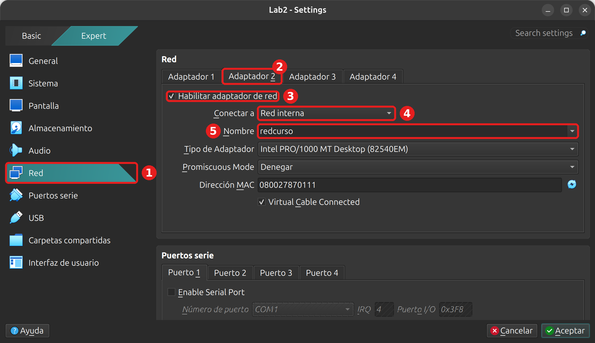

# Laboratorio 18 - Resolución de nombres y DNS

## Objetivo

- Armar la red interna entre la VM Debian y la VM Rocky.
- Instalar BIND en la Debian, con reenvío y respuestas solo para la red del laboratorio.
- Crear la zona `curso.internal`, probarla con `dig` y usarla desde la Rocky.
- Encontrar un error en la zona siguiendo un orden de diagnóstico.

### Punto de partida

- La VM Debian del curso, con la cuenta administradora (por ejemplo `cristian`) y el acceso por SSH del [Laboratorio 3](../lab3/lab3.md) (puerto 2222).
- La VM Rocky Linux, con la cuenta `usuario` (contraseña `linux410`) y acceso por SSH en el puerto 2223.

No hace falta haber hecho otros laboratorios: todo lo que se configura acá se crea en el laboratorio y se deshace al final.

> [!IMPORTANT]
> **¿No tenés la VM de Rocky?** Descargá `Lab_Rocky.ova` y `Lab_Rocky.ova.sha256` de [linux-files.idep.atepba.org.ar](https://linux-files.idep.atepba.org.ar/) y seguí los pasos 2 a 4 del [Laboratorio 10.2](../lab10/lab10.2.md): comprobar la descarga, importar la VM e iniciarla. Hacen falta unos 6 GB libres en la anfitriona. Si la VM Rocky ya tiene reglas de reenvío de otros laboratorios, no las toques.

> [!WARNING]
> Al final se desinstala BIND y se borra `/etc/bind`. Si en tu Debian ya usás BIND para otra cosa, no hagas este laboratorio en esa VM.

> [!NOTE]
> Reemplazá `cristian` por tu usuario. Las direcciones de los sitios de Internet, los TTL, los tiempos de respuesta, los números de proceso y las fechas de tus salidas van a ser otros. Si la salida de un comando no se muestra, es porque no imprime nada cuando anda bien.

### Qué vamos a armar

La Debian va a ser el servidor DNS de la red interna `redcurso`, que ya conocés de la [clase 17](https://linux.idepba.com.ar/clase17.html#/diseno_de_red_de_labs), y la Rocky, el cliente:

| VM | Papel | Placa | Dirección | Nombres en el DNS |
| :--- | :--- | :--- | :--- | :--- |
| Debian | servidor DNS | `enp0s8` (red `redcurso`) | `192.168.50.10/24` | `debian`, `ns` y el alias `www` |
| Rocky | cliente | `enp0s8` (red `redcurso`) | `192.168.50.20/24` | `rocky` |

La zona es `curso.internal`. Lo que sea de esa zona lo responde nuestro servidor, y el resto lo reenvía al DNS que ya usa la VM. La teoría de este laboratorio está en la [clase 19](https://linux.idepba.com.ar/clase19.html).

Cada paso dice dónde se trabaja:

- **En la Debian.** Una terminal con `ssh -p 2222 cristian@localhost`. El prompt dice `cristian@lab2-vm`.
- **En la Rocky.** Una terminal con `ssh -p 2223 usuario@localhost`. El prompt dice `[usuario@localhost ~]$`.
- **En la anfitriona.** La terminal de tu equipo (PowerShell en Windows), solo para VirtualBox.

## 1. La red interna

La segunda placa se agrega igual que en el paso 1 del [Laboratorio 17](../lab17/lab17.md#1-la-red-interna). Si todavía tenés el Adaptador 2 en las dos VM, salteá la parte de VirtualBox y andá a «La dirección de cada VM».

### La segunda placa en VirtualBox

Con las dos VM **apagadas** (`sudo poweroff` desde cada una), hacé esto con cada VM. Con la Debian primero:

1. En VirtualBox, seleccioná la VM y abrí **Configuración**. Si ves el modo **Basic**, pasá a **Expert**.
2. Entrá en **Red** (1).
3. Elegí la pestaña **Adaptador 2** (2).
4. Tildá **Habilitar adaptador de red** (3).
5. En **Conectar a**, elegí **Red interna** (4).
6. En **Nombre**, escribí `redcurso` (5). Tiene que ser el mismo nombre en las dos VM.



Aceptá y repetí lo mismo en la VM Rocky (`Lab_Rocky`). No toques el **Adaptador 1**: ahí están las reglas de reenvío de puertos.

Si preferís la línea de comandos, con las VM apagadas se hace en la anfitriona (cambiá `Lab2` y `Lab_Rocky` por los nombres de tus VM):

```bash
VBoxManage modifyvm Lab2 --nic2 intnet --intnet2 redcurso
VBoxManage modifyvm Lab_Rocky --nic2 intnet --intnet2 redcurso
```

Encendé las dos VM y entrá a cada una por SSH, en dos terminales de la anfitriona:

```bash
ssh -p 2222 cristian@localhost
```

```bash
ssh -p 2223 usuario@localhost
```

### La dirección de cada VM

**En la Debian.** Ponemos la dirección fija en `enp0s8` y levantamos la placa:

```bash
sudo ip addr add 192.168.50.10/24 dev enp0s8
sudo ip link set enp0s8 up
ip -br -4 a show enp0s8
```

```text
enp0s8           UP             192.168.50.10/24 
```

Si la primera vez dice `DOWN`, esperá un segundo y repetí el último comando.

> [!NOTE]
> Con `ip` la dirección se pierde al reiniciar la VM. Si reiniciás en medio del laboratorio, repetí los dos primeros comandos.

**En la Rocky.** La dirección va en una conexión de NetworkManager que llamamos `redcurso`:

```bash
sudo nmcli con add type ethernet ifname enp0s8 con-name redcurso ipv4.method manual ipv4.addresses 192.168.50.20/24 ipv6.method disabled
sudo nmcli con up redcurso
ip -br -4 a show enp0s8
```

```text
Conexión «redcurso» (b906ae3b-f0f1-4c37-8967-c4ac6cca7777) añadida con éxito.
Conexión activada con éxito (ruta activa D-Bus: /org/freedesktop/NetworkManager/ActiveConnection/4)
enp0s8           UP             192.168.50.20/24 
```

### `/etc/hosts`

**En las dos.** Mirá si `/etc/hosts` tiene nombres de la red interna:

```bash
grep "^192.168.50." /etc/hosts
```

Si no imprime nada, seguí. Si aparecen líneas de un laboratorio anterior, como `192.168.50.10 debian` o `192.168.50.20 rocky`, hay que borrarlas: `/etc/hosts` se consulta antes que el DNS, y con esas líneas las pruebas del cliente nunca llegarían a nuestro servidor. Abrí el archivo con `sudo nano /etc/hosts`, borrá esas líneas y guardá.

### Comprobar

**En la Debian.** Las dos VM tienen que verse por dirección, y la Debian todavía no sabe quién es `rocky`:

```bash
ping -c 2 192.168.50.20
getent hosts rocky; echo "código de salida: $?"
```

```text
PING 192.168.50.20 (192.168.50.20) 56(84) bytes of data.
64 bytes from 192.168.50.20: icmp_seq=1 ttl=64 time=2.02 ms
64 bytes from 192.168.50.20: icmp_seq=2 ttl=64 time=0.899 ms

--- 192.168.50.20 ping statistics ---
2 packets transmitted, 2 received, 0% packet loss, time 1002ms
rtt min/avg/max/mdev = 0.899/1.457/2.015/0.558 ms
código de salida: 2
```

`getent hosts` no imprime nada y sale con código 2: el nombre no está en `/etc/hosts` ni en el DNS. Si el `ping` no responde, revisá con `ip -br -4 a` que `enp0s8` tenga su dirección en las dos VM y que la red interna se llame `redcurso` en las dos.

## 2. Instalar BIND en la Debian

**En la Debian:**

```bash
sudo apt install -y bind9
```

Se instalan tres paquetes nuevos: `bind9`, `bind9-utils` y `dns-root-data`. Anotalos, porque en la limpieza se quitan los tres. Comprobá la versión y el servicio:

```bash
sudo named -v
systemctl status named --no-pager
```

```text
BIND 9.20.30-1~deb13u1-Debian (Stable Release) <id:>
● named.service - BIND Domain Name Server
     Loaded: loaded (/usr/lib/systemd/system/named.service; enabled; preset: enabled)
     Active: active (running) since Fri 2026-11-13 00:30:54 -03; 2s ago
 Invocation: 1ec7097ad92641bb8104d2943eaed5e9
       Docs: man:named(8)
   Main PID: 1166 (named)
     Status: "running"
      Tasks: 5 (limit: 1041)
     Memory: 9.6M (peak: 9.9M)
        CPU: 37ms
     CGroup: /system.slice/named.service
             └─1166 /usr/sbin/named -f -u bind
```

- `named` está en `/usr/sbin`, que no está en el `PATH` de un usuario común, por eso el `sudo`.
- El servicio se llama `named`, quedó `active (running)` y `enabled`: arranca solo con la VM.
- La última línea muestra el proceso y la opción `-u bind`: `named` corre con el usuario `bind`, que creó el paquete.

```bash
id bind
sudo ss -4tuln | grep ':53 '
```

```text
uid=101(bind) gid=104(bind) grupos=104(bind)
udp   UNCONN 0      0      192.168.50.10:53        0.0.0.0:*   
udp   UNCONN 0      0          10.0.2.15:53        0.0.0.0:*   
udp   UNCONN 0      0          127.0.0.1:53        0.0.0.0:*   
tcp   LISTEN 0      10     192.168.50.10:53        0.0.0.0:*   
tcp   LISTEN 0      10         10.0.2.15:53        0.0.0.0:*   
tcp   LISTEN 0      10         127.0.0.1:53        0.0.0.0:*   
```

Recién instalado, `named` escucha en el puerto 53, en UDP y TCP, en todas las direcciones IPv4 de la VM: la de la placa NAT (`10.0.2.15`), la de la red interna y la local. `-4` deja afuera las líneas de IPv6, para que la salida sea más corta.

La configuración está en `/etc/bind`:

```bash
ls -l /etc/bind
cat /etc/bind/named.conf.options
```

```text
-rw-r--r-- 1 root bind 455 oct 20 12:22 named.conf
-rw-r--r-- 1 root bind  42 oct 20 12:22 named.conf.local
-rw-r--r-- 1 root bind  43 oct 20 12:22 named.conf.options
-rw-r--r-- 1 root bind 116 oct 20 12:22 named.conf.root-hints
-rw-r----- 1 bind bind 100 nov 13 00:30 rndc.key
options {
	directory "/var/cache/bind";
};
```

`named.conf` incluye a los otros y no se toca. En `named.conf.options` van las opciones del servidor (paso 3) y en `named.conf.local`, nuestras zonas (paso 4).

## 3. Reenvío y a quién le responde

Vamos a escribir `named.conf.options` con dos cosas: a quién le pasa el servidor las preguntas que no son de nuestra zona, y a quiénes les responde.

**En la Debian.** El reenviador es el servidor DNS que ya usa la VM. Miralo en `/etc/resolv.conf`:

```bash
cat /etc/resolv.conf
```

```text
# Generated by dhcpcd from enp0s3.dhcp, enp0s3.ra
# /etc/resolv.conf.head can replace this line
domain lan
nameserver 10.0.2.3
nameserver fd17:625c:f037:2::3
# /etc/resolv.conf.tail can replace this line
```

`10.0.2.3` es el DNS de VirtualBox, que le pasa las preguntas al de tu equipo. La segunda línea es lo mismo por IPv6. Usá la dirección IPv4 del primer `nameserver`. Si la tuya no es `10.0.2.3` (pasa con algunas anfitrionas Windows), cambiala en el bloque que sigue. El archivo se reemplaza entero:

```bash
sudo tee /etc/bind/named.conf.options > /dev/null << "EOF"
options {
    directory "/var/cache/bind";
    forwarders { 10.0.2.3; };

    allow-query { 127.0.0.1; 192.168.50.0/24; };
    allow-recursion { 127.0.0.1; 192.168.50.0/24; };
    allow-transfer { none; };
    listen-on { 127.0.0.1; 192.168.50.10; };
};
EOF
```

- `forwarders`: lo que no es de nuestra zona se lo preguntamos a `10.0.2.3`, y guardamos la respuesta en la caché.
- `allow-query` y `allow-recursion`: le responde a la propia VM y a la red interna, y solo para ellas sale a buscar afuera. Así no queda como resolutor abierto.
- `allow-transfer { none; }`: nadie se puede copiar la zona entera.
- `listen-on`: escucha solo en la dirección local y en la de la red interna.

Cada instrucción termina en punto y coma, también las que cierran con llave. Comprobá antes de recargar, como con `sshd -t` en la [clase 18](https://linux.idepba.com.ar/clase18.html#/comprobar_y_recargar):

```bash
sudo named-checkconf
```

Si no imprime nada, está bien. Si falta un punto y coma o una llave, dice el archivo y la línea, por ejemplo `/etc/bind/named.conf.options:5: missing ';' before 'allow-query'`, si se olvidó el punto y coma de `forwarders`. Corregilo y volvé a comprobar. Después recargá y mirá dónde escucha:

```bash
sudo systemctl reload named
sudo ss -4tuln | grep ':53 '
```

```text
udp   UNCONN 0      0      192.168.50.10:53        0.0.0.0:*   
udp   UNCONN 0      0          127.0.0.1:53        0.0.0.0:*   
tcp   LISTEN 0      10     192.168.50.10:53        0.0.0.0:*   
tcp   LISTEN 0      10         127.0.0.1:53        0.0.0.0:*   
```

Ya no está `10.0.2.15`: por la placa NAT nadie llega al DNS. Si tu VM tiene IPv6, `sudo ss -6tuln | grep ':53 '` todavía muestra direcciones IPv6, porque `listen-on` es solo para IPv4. No es un problema: `allow-query` solo acepta clientes de `127.0.0.1` y de la red interna, así que una consulta que llegue por IPv6 recibe `REFUSED`.

## 4. La zona `curso.internal`

### Declarar la zona

**En la Debian.** En `named.conf.local` le decimos a BIND que tiene una zona propia y en qué archivo están sus registros. El archivo trae solo comentarios, así que lo reemplazamos:

```bash
sudo tee /etc/bind/named.conf.local > /dev/null << "EOF"
zone "curso.internal" {
    type primary;
    file "/etc/bind/db.curso.internal";
};
EOF
```

`type primary` quiere decir que este servidor tiene la copia original de la zona.

### El archivo de zona

```bash
sudo tee /etc/bind/db.curso.internal > /dev/null << "EOF"
$TTL 3600
@       IN  SOA  ns.curso.internal. admin.curso.internal. (
                 2026111001 ; serial
                 3600       ; refresh
                 900        ; retry
                 604800     ; expire
                 3600 )     ; TTL negativo

@       IN  NS     ns.curso.internal.
ns      IN  A      192.168.50.10
debian  IN  A      192.168.50.10
rocky   IN  A      192.168.50.20
www     IN  CNAME  debian
EOF
```

- `@` es el nombre de la zona, `curso.internal`. `$TTL` es el TTL de los registros que no dicen uno.
- `SOA` abre la zona: el servidor principal, el correo del administrador (con punto en lugar de arroba) y el serial, que es el número de versión.
- `NS` dice qué servidor atiende la zona. Después va un registro por nombre.
- Los nombres sin punto final se completan con la zona: `debian` es `debian.curso.internal.`. Los nombres completos (`ns.curso.internal.`) llevan el punto.

### Comprobar y recargar

```bash
sudo named-checkconf
sudo named-checkzone curso.internal /etc/bind/db.curso.internal
sudo systemctl reload named
sudo journalctl -u named --no-pager | grep curso.internal
```

```text
zone curso.internal/IN: loaded serial 2026111001
OK
nov 13 00:31:04 lab2-vm named[1166]: zone curso.internal/IN: loaded serial 2026111001
```

`named-checkzone` revisa el archivo de zona y muestra el serial que leyó. La última línea es del journal de `named`: después de recargar, cargó la zona con ese serial. Si ya hiciste este laboratorio antes en la misma VM, el journal conserva también las líneas de aquella vez, con otras fechas: fijate en las últimas.

### Probar el servidor

`dig @servidor` le pregunta a ese servidor en lugar de al de `/etc/resolv.conf`:

```bash
dig @192.168.50.10 rocky.curso.internal
```

```text

; <<>> DiG 9.20.30-1~deb13u1-Debian <<>> @192.168.50.10 rocky.curso.internal
; (1 server found)
;; global options: +cmd
;; Got answer:
;; ->>HEADER<<- opcode: QUERY, status: NOERROR, id: 26348
;; flags: qr aa rd ra; QUERY: 1, ANSWER: 1, AUTHORITY: 0, ADDITIONAL: 1

;; OPT PSEUDOSECTION:
; EDNS: version: 0, flags:; udp: 1232
; COOKIE: a49dc3b688f49eb5010000006af68479c773bac0c021caf8 (good)
;; QUESTION SECTION:
;rocky.curso.internal.		IN	A

;; ANSWER SECTION:
rocky.curso.internal.	3600	IN	A	192.168.50.20

;; Query time: 0 msec
;; SERVER: 192.168.50.10#53(192.168.50.10) (UDP)
;; WHEN: Fri Nov 13 00:31:05 -03 2026
;; MSG SIZE  rcvd: 93
```

En `flags` está `aa` (*authoritative answer*): el servidor contesta con datos propios. `SERVER` confirma que contestó el nuestro. Ahora el alias y un nombre que no está en la zona:

```bash
dig @192.168.50.10 +short www.curso.internal
dig @192.168.50.10 noexiste.curso.internal | grep -E "status|;; flags"
```

```text
debian.curso.internal.
192.168.50.10
;; ->>HEADER<<- opcode: QUERY, status: NXDOMAIN, id: 38625
;; flags: qr aa rd ra; QUERY: 1, ANSWER: 0, AUTHORITY: 1, ADDITIONAL: 1
```

`www` lleva a `debian`, y de ahí sale la dirección. `noexiste` da `NXDOMAIN` con `aa`: el servidor sabe que no existe porque la zona es suya.

### Lo que no es de la zona

Un nombre de Internet pasa por el reenviador. Preguntá dos veces, con cinco segundos entre una y otra:

```bash
dig @192.168.50.10 debian.org | grep -E ";; flags|^debian|Query time"
sleep 5; dig @192.168.50.10 debian.org | grep -E ";; flags|^debian|Query time"
```

```text
;; flags: qr rd ra ad; QUERY: 1, ANSWER: 4, AUTHORITY: 0, ADDITIONAL: 1
debian.org.		300	IN	A	151.101.2.132
debian.org.		300	IN	A	151.101.130.132
debian.org.		300	IN	A	151.101.66.132
debian.org.		300	IN	A	151.101.194.132
;; Query time: 108 msec
;; flags: qr rd ra ad; QUERY: 1, ANSWER: 4, AUTHORITY: 0, ADDITIONAL: 1
debian.org.		294	IN	A	151.101.66.132
debian.org.		294	IN	A	151.101.194.132
debian.org.		294	IN	A	151.101.2.132
debian.org.		294	IN	A	151.101.130.132
;; Query time: 0 msec
```

- No está `aa`: la respuesta no es nuestra, vino del reenviador. La marca `ad` dice que BIND comprobó las firmas DNSSEC de la respuesta.
- La segunda vez tarda menos y el TTL bajó unos cinco segundos: salió de la caché de nuestro servidor.

> [!NOTE]
> Si los nombres de Internet dan `status: SERVFAIL` y los de `curso.internal` andan, el problema está en el reenvío. Revisá que la dirección de `forwarders` sea la de tu `/etc/resolv.conf`. Si está bien, puede ser que el reenviador no entregue las firmas DNSSEC que BIND quiere comprobar: agregá la línea `dnssec-validation no;` dentro de `options`, comprobá con `named-checkconf` y recargá.

## 5. La Rocky como cliente

### Preguntarle al servidor

**En la Rocky.** La OVA no trae `dig` ni `host`. Vienen en el paquete `bind-utils`:

```bash
sudo dnf install -y bind-utils
```

Al final aparece `¡Listo!`. Preguntale directamente al servidor de la Debian:

```bash
dig @192.168.50.10 +short rocky.curso.internal
host www.curso.internal 192.168.50.10
```

```text
192.168.50.20
Using domain server:
Name: 192.168.50.10
Address: 192.168.50.10#53
Aliases: 

www.curso.internal is an alias for debian.curso.internal.
debian.curso.internal has address 192.168.50.10
```

`host` acepta el servidor como segundo argumento. El servidor le contesta a la Rocky porque `192.168.50.20` está dentro de `192.168.50.0/24`, la red de `allow-query`.

Pero la Rocky todavía no lo usa por su cuenta:

```bash
cat /etc/resolv.conf
getent hosts debian; echo "código de salida: $?"
```

```text
# Generated by NetworkManager
search lan
nameserver 10.0.2.3
nameserver fd17:625c:f037:2::3
código de salida: 2
```

### Configurar el DNS con `nmcli`

En Rocky, `/etc/resolv.conf` lo escribe NetworkManager, así que un cambio a mano se pierde. El DNS se pone en una conexión, y NetworkManager junta en ese archivo los servidores de todas las conexiones activas. Hay dos, `enp0s3` (la placa NAT) y `redcurso`.

Lo ponemos en `redcurso`, porque el servidor está en esa red, y al borrar la conexión en la limpieza el cambio se va con ella. Si solo agregáramos nuestro servidor, quedaría después de `10.0.2.3`: la conexión con la ruta por defecto va primero. Como vimos en la clase, el segundo `nameserver` solo se consulta cuando el primero no contesta. `10.0.2.3` contesta que `debian.curso.internal` no existe, y nuestro servidor nunca se enteraría de la pregunta. Para que quede solo, le damos a `redcurso` una prioridad de DNS negativa: con un valor negativo, NetworkManager usa los servidores de esa conexión y deja afuera los de las demás.

**En la Rocky.** Ponemos el servidor, el dominio de búsqueda y la prioridad. Después se reactiva la conexión para que tome los cambios (es la de la red interna, así que tu sesión SSH, que entra por la placa NAT, no se corta):

```bash
sudo nmcli connection modify redcurso ipv4.dns 192.168.50.10 ipv4.dns-search curso.internal ipv4.dns-priority -10
sudo nmcli connection up redcurso
cat /etc/resolv.conf
```

```text
Conexión activada con éxito (ruta activa D-Bus: /org/freedesktop/NetworkManager/ActiveConnection/5)
# Generated by NetworkManager
search curso.internal
nameserver 192.168.50.10
```

- `ipv4.dns` es el `nameserver`: a quién se le pregunta.
- `ipv4.dns-search` es el `search`: el dominio que se agrega a los nombres cortos. `debian` pasa a ser `debian.curso.internal`.
- `ipv4.dns-priority -10` deja nuestro servidor solo. Ya no están `10.0.2.3`, el de IPv6 ni `search lan`.

Si en tu `resolv.conf` sigue apareciendo `10.0.2.3`, y además primero, los nombres de `curso.internal` no van a resolver. Revisá con `nmcli -f ipv4.dns-priority connection show redcurso` que la prioridad haya quedado en `-10`.

### Probar desde el cliente

```bash
getent hosts debian
getent hosts www
host rocky
getent hosts debian.org
```

```text
192.168.50.10   debian.curso.internal
192.168.50.10   debian.curso.internal www.curso.internal
rocky.curso.internal has address 192.168.50.20
151.101.194.132 debian.org
151.101.66.132  debian.org
151.101.2.132   debian.org
151.101.130.132 debian.org
```

- `getent hosts` y `host` completan los nombres cortos con `search`.
- `www` es un alias, y `getent` muestra los dos nombres.
- `debian.org` también se resuelve a través de la Debian, que lo reenvía. Ahora todo lo que resuelve la Rocky pasa por nuestro servidor, también `dnf`.

`dig`, en cambio, no usa `search` salvo con `+search`, así que con él hay que escribir el nombre completo:

```bash
dig debian.curso.internal | grep -E "status|;; flags|SERVER"
```

```text
;; ->>HEADER<<- opcode: QUERY, status: NOERROR, id: 22978
;; flags: qr aa rd ra; QUERY: 1, ANSWER: 1, AUTHORITY: 0, ADDITIONAL: 1
;; SERVER: 192.168.50.10#53(192.168.50.10)
```

Sin `@`, `dig` le preguntó al `nameserver` de `/etc/resolv.conf`, que ahora es la Debian.

## 6. Un nombre que no resuelve

Vamos a romper la zona a propósito y a buscar el error como lo haríamos si no supiéramos dónde está. Supongamos que agregás una impresora en `192.168.50.30`, te equivocás al tipear la dirección y recargás sin comprobar.

**En la Debian:**

```bash
echo "impresora IN  A      192.168.50.300" | sudo tee -a /etc/bind/db.curso.internal
sudo systemctl reload named
```

`systemctl reload` no muestra ningún error. Del lado del cliente, la impresora no aparece.

**En la Rocky:**

```bash
getent hosts impresora; echo "código de salida: $?"
```

```text
código de salida: 2
```

El diagnóstico va del cliente hacia el servidor. Cada paso descarta una parte.

### En el cliente

¿Llego al servidor por la red? ¿Le estoy preguntando a él?

```bash
ping -c 1 192.168.50.10
grep nameserver /etc/resolv.conf
```

```text
PING 192.168.50.10 (192.168.50.10) 56(84) bytes of data.
64 bytes from 192.168.50.10: icmp_seq=1 ttl=64 time=0.816 ms

--- 192.168.50.10 ping statistics ---
1 packets transmitted, 1 received, 0% packet loss, time 0ms
rtt min/avg/max/mdev = 0.816/0.816/0.816/0.000 ms
nameserver 192.168.50.10
```

La red anda y el cliente le pregunta a nuestro servidor. Ahora, qué contesta el servidor:

```bash
dig @192.168.50.10 impresora.curso.internal | grep -E "status|;; flags"
```

```text
;; ->>HEADER<<- opcode: QUERY, status: NXDOMAIN, id: 2745
;; flags: qr aa rd ra; QUERY: 1, ANSWER: 0, AUTHORITY: 1, ADDITIONAL: 1
```

El servidor contesta, y con `aa`: responde por su zona y dice que `impresora` no existe. Si no contestara, `dig` diría `connection refused` o `timed out`, y habría que mirar si el servicio está andando. Si contestara `REFUSED`, habría que mirar `allow-query`. Con `NXDOMAIN` y `aa`, el problema está en la zona que tiene cargada el servidor.

### En el servidor

**En la Debian.** El servicio, sus mensajes y la configuración:

```bash
systemctl status named --no-pager
```

```text
● named.service - BIND Domain Name Server
     Loaded: loaded (/usr/lib/systemd/system/named.service; enabled; preset: enabled)
     Active: active (running) since Fri 2026-11-13 00:30:54 -03; 1min 19s ago
...
```

El servicio está `active (running)`, así que no se cayó. Debajo del `status` suelen aparecer las últimas líneas del journal (con `sudo` se ven siempre), pero el error no tiene por qué estar entre ellas: `named` también registra las consultas que no pudo resolver afuera, y esos mensajes lo tapan. Conviene buscarlo en el journal, filtrando por la zona:

```bash
sudo journalctl -u named --no-pager | grep curso.internal
```

```text
nov 13 00:31:04 lab2-vm named[1166]: zone curso.internal/IN: loaded serial 2026111001
nov 13 00:31:53 lab2-vm named[1166]: dns_rdata_fromtext: /etc/bind/db.curso.internal:14: near '192.168.50.300': bad dotted quad
nov 13 00:31:53 lab2-vm named[1166]: zone curso.internal/IN: loading from master file /etc/bind/db.curso.internal failed: bad dotted quad
nov 13 00:31:53 lab2-vm named[1166]: zone curso.internal/IN: not loaded due to errors.
```

La primera línea es la carga buena de antes. Las otras tres son del `reload` con el error. La línea 14 del archivo de zona tiene una dirección que no es válida (*bad dotted quad*): `300` no entra en un número de 0 a 255. Como la zona nueva no cargó, `named` siguió sirviendo la anterior, la que no tenía `impresora`. Por eso `rocky` y `www` siguen andando.

`named-checkconf -z` revisa la configuración y todas las zonas de una vez, sin tocar el servicio. Es lo que tendríamos que haber corrido antes de recargar:

```bash
sudo named-checkconf -z; echo "código de salida: $?"
```

```text
dns_rdata_fromtext: /etc/bind/db.curso.internal:14: near '192.168.50.300': bad dotted quad
zone curso.internal/IN: loading from master file /etc/bind/db.curso.internal failed: bad dotted quad
zone curso.internal/IN: not loaded due to errors.
_default/curso.internal/IN: bad dotted quad
código de salida: 1
```

### Corregir

Arreglamos la dirección y subimos el serial, porque la zona cambió. Abrí el archivo:

```bash
sudo nano /etc/bind/db.curso.internal
```

En la línea 14, la que marcó `named-checkconf -z`, corregí la dirección:

```diff
-impresora IN  A      192.168.50.300
+impresora IN  A      192.168.50.30
```

En la línea 3 subí el serial:

```diff
-                 2026111001 ; serial
+                 2026111002 ; serial
```

Guardá, comprobá y recargá:

```bash
sudo named-checkzone curso.internal /etc/bind/db.curso.internal
sudo systemctl reload named
```

```text
zone curso.internal/IN: loaded serial 2026111002
OK
```

`named-checkzone` dice `OK` y muestra el serial nuevo. **En la Rocky:**

```bash
getent hosts impresora
```

```text
192.168.50.30   impresora.curso.internal
```

En un servidor solo como este, la zona se carga aunque te olvides del serial (el journal avisa `zone serial (2026111001) unchanged`). Los servidores secundarios, en cambio, miran el serial para saber si tienen que copiar la zona de nuevo, así que se sube siempre.

> [!NOTE]
> El `reload` con error deja funcionando la versión anterior de la zona. Si en lugar de recargar se reinicia el servicio (`systemctl restart named`) o se reinicia la VM, la zona con error no carga y todos sus nombres dan `SERVFAIL`. Por eso se comprueba antes con `named-checkconf -z`.

## 7. Limpieza

Deshacemos todo en orden: primero el cliente, después el servidor y al final la red. Trabajá en cada VM desde su propia terminal, la del puerto 2222 o 2223, y no desde una sesión abierta por la red interna.

### La Rocky

**En la Rocky.** Al borrar la conexión `redcurso` se van juntas la dirección de la red interna y el DNS que le pusimos en el paso 5:

```bash
sudo nmcli con delete redcurso
ip -br -4 a show enp0s8
cat /etc/resolv.conf
```

```text
La conexión «redcurso» (b906ae3b-f0f1-4c37-8967-c4ac6cca7777) se ha borrado correctamente.
# Generated by NetworkManager
search lan
nameserver 10.0.2.3
nameserver fd17:625c:f037:2::3
```

`ip` no imprime nada porque `enp0s8` ya no tiene dirección IPv4. `/etc/resolv.conf` vuelve a ser el del principio del paso 5, con el DNS de VirtualBox. NetworkManager tarda unos segundos en aplicar el cambio: si `ip` todavía muestra la dirección o `resolv.conf` sigue con `curso.internal`, esperá un momento y repetí esos dos comandos. Después de borrar `redcurso`, `nmcli con show` puede listar una conexión `Conexión cableada 1` para `enp0s8`. NetworkManager la crea sola, no queda guardada y desaparece al reiniciar.

Comprobá que se resuelve Internet sin la Debian y quitá `bind-utils`:

```bash
getent hosts debian.org > /dev/null && echo "resuelve"
sudo dnf remove -y bind-utils
rpm -q bind-utils
```

```text
resuelve
el paquete bind-utils no está instalado
```

`dnf remove` quita también las dependencias que se instalaron solo para `bind-utils`. No corras `dnf autoremove`: en la OVA quita además paquetes que no tienen que ver con este laboratorio.

### BIND en la Debian

**En la Debian.** `apt purge` desinstala los tres paquetes del paso 2 y borra sus archivos de configuración:

```bash
sudo apt purge -y bind9 bind9-utils dns-root-data
ls /etc/bind /var/cache/bind
```

```text
/etc/bind:
db.curso.internal

/var/cache/bind:
managed-keys.bind
managed-keys.bind.jnl
```

`purge` borra los archivos que trajo el paquete, pero no los que creamos nosotros (el archivo de zona) ni los que generó `named` mientras andaba (a veces aparecen también archivos `tmp-` en `/var/cache/bind`). Los borramos a mano:

```bash
sudo rm -rf /etc/bind /var/cache/bind /var/lib/bind
```

Comprobá que no queda nada:

```bash
systemctl status named --no-pager
getent passwd bind; getent group bind
sudo ss -4tuln | grep ':53 '
```

```text
Unit named.service could not be found.
```

- El servicio ya no existe.
- `getent` no imprime nada: el `purge` borró el usuario `bind` y su grupo. Si quedó el grupo (`getent group bind` muestra una línea), borralo con `sudo groupdel bind`.
- Nadie escucha en el puerto 53.

### La dirección de la Debian

**En la Debian:**

```bash
sudo ip addr del 192.168.50.10/24 dev enp0s8
ip -br -4 a show enp0s8
```

Los dos comandos no imprimen nada: `enp0s8` ya no tiene dirección IPv4.

### La segunda placa

Quitá el Adaptador 2 solo si no lo vas a usar en los próximos laboratorios. Con las VM apagadas, en **Configuración → Red → Adaptador 2** destildá **Habilitar adaptador de red**, o en la anfitriona:

```bash
VBoxManage modifyvm Lab2 --nic2 none
VBoxManage modifyvm Lab_Rocky --nic2 none
```

## Resumen del laboratorio

- En Debian la dirección de la segunda placa se pone con `ip addr add` y se pierde al reiniciar. En Rocky va en una conexión de NetworkManager, que se crea con `nmcli con add` y se borra con `nmcli con delete`. Las líneas de la red interna en `/etc/hosts` taparían al DNS.
- `getent hosts` resuelve como los programas, mirando primero `/etc/hosts`. `host` y `dig` le preguntan directo al DNS. En `dig` se mira `status`, `flags`, `ANSWER` y `SERVER`. `dig @servidor` elige a quién preguntarle.
- BIND (`bind9`) corre como `named`, con el usuario `bind`. En `named.conf.options` van el reenvío y a quién le responde (`allow-query`, `allow-recursion`, `allow-transfer` y `listen-on`). En `named.conf.local` se declara la zona, y sus registros van en un archivo aparte.
- `named-checkconf -z` y `named-checkzone` se corren antes de `systemctl reload named`. Si la zona tiene un error, el `reload` deja la versión anterior y el error queda en `journalctl -u named`.
- En Rocky el DNS se configura con `nmcli`, en la conexión: `ipv4.dns`, `ipv4.dns-search` y, para que nuestro servidor quede solo, `ipv4.dns-priority` negativa.
- Para diagnosticar se va del cliente al servidor: `getent hosts`, `ping` por dirección, `/etc/resolv.conf`, `dig @servidor` y su `status`, y en el servidor `systemctl status named`, `journalctl -u named` y `named-checkconf -z`.

## Enlaces útiles y referencias

- Ayuda: `man dig`, `man host`, `man named.conf`, `man named-checkconf`, `man named-checkzone`, `man resolv.conf`, `man nmcli`. En línea (en inglés): [`dig`](https://manpages.debian.org/trixie/bind9-dnsutils/dig.1.en.html), [`host`](https://manpages.debian.org/trixie/bind9-host/host.1.en.html), [`named.conf`](https://manpages.debian.org/trixie/bind9/named.conf.5.en.html), [`named-checkconf`](https://manpages.debian.org/trixie/bind9-utils/named-checkconf.1.en.html) y [`named-checkzone`](https://manpages.debian.org/trixie/bind9-utils/named-checkzone.1.en.html). En español, [`resolv.conf`](https://manpages.debian.org/trixie/manpages/resolv.conf.5.es.html).
- BIND 9: [manual de referencia del administrador](https://bind9.readthedocs.io/en/stable/).
- NetworkManager: [opciones de las conexiones](https://networkmanager.dev/docs/api/latest/nm-settings-nmcli.html), entre ellas `ipv4.dns-priority`.
- Debian: [servidores de nombres de dominio](https://www.debian.org/doc/manuals/debian-handbook/sect.domain-name-servers.es.html), en el manual del administrador de Debian.
- Clase 19: [presentación](https://linux.idepba.com.ar/clase19.html).
- Anterior: [Laboratorio 17 - Acceso remoto seguro](../lab17/lab17.md).

-----

<p align="center">

</p>
