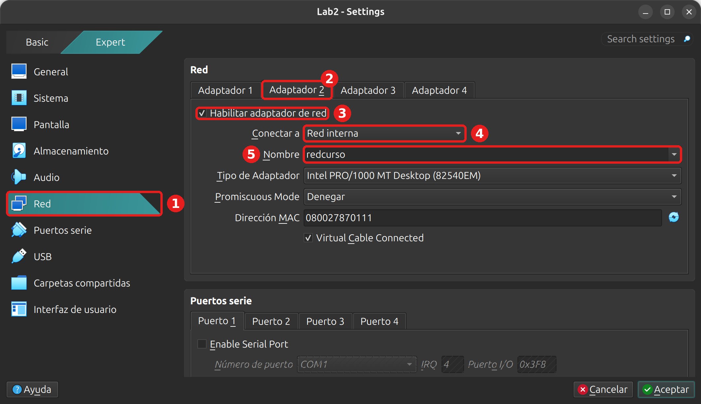

# Laboratorio 20.1 - NFS y SSHFS

## Objetivo

- Armar la red interna entre la VM Debian y la VM Rocky.
- Exportar un directorio de la Debian con NFS y montarlo desde la Rocky.
- Ver quién es el dueño de los archivos que se crean por NFS y qué le pasa a `root` del cliente (`root_squash`).
- Montar por SSH, con SSHFS, el directorio personal de la Rocky en la Debian.
- Dejar las dos VM como estaban.

### Punto de partida

- La VM Debian del curso, con la cuenta administradora (por ejemplo `cristian`) y el acceso por SSH del [Laboratorio 3](../lab3/lab3.md) (puerto 2222).
- La VM Rocky Linux, con la cuenta `usuario` (contraseña `linux410`) y acceso por SSH en el puerto 2223.

No hace falta haber hecho otros laboratorios, ni el 20.2: todo lo que se instala y se configura acá se crea en el laboratorio y se deshace al final. La teoría está en la [clase 21](https://linux.idepba.com.ar/clase21.html).

> [!IMPORTANT]
> **¿No tenés la VM de Rocky?** Descargá `Lab_Rocky.ova` y `Lab_Rocky.ova.sha256` de [linux-files.idep.atepba.org.ar](https://linux-files.idep.atepba.org.ar/) y seguí los pasos 2 a 4 del [Laboratorio 10.2](../lab10/lab10.2.md): comprobar la descarga, importar la VM e iniciarla. Hacen falta unos 6 GB libres en la anfitriona. Si la VM Rocky ya tiene reglas de reenvío de otros laboratorios, no las toques.

> [!WARNING]
> En la limpieza se desinstalan `nfs-kernel-server`, `nfs-common`, `sshfs` y `fuse3` de la Debian, y `nfs-utils` de la Rocky, aunque ya los tuvieras de antes. Si en tus VM ya usás NFS o SSHFS para otra cosa, no hagas este laboratorio ahí.

> [!NOTE]
> Reemplazá `cristian` por tu usuario. Las fechas, los tiempos de respuesta, los identificadores y la huella de tu clave en las salidas van a ser otros. Las salidas de `apt` y `dnf` están recortadas: se muestra lo que se instala y se omite el progreso. Si la salida de un comando no se muestra, es porque no imprime nada cuando anda bien.

### Qué vamos a armar

Primero la Debian hace de servidor NFS y la Rocky de cliente. Al final se invierten los papeles: la Rocky es el servidor SSH y la Debian monta su directorio personal con SSHFS.

| VM | Papel | Placa | Dirección | Nombre |
| :--- | :--- | :--- | :--- | :--- |
| Debian | servidor NFS y cliente SSHFS | `enp0s8` (red `redcurso`) | `192.168.50.10/24` | `debian` |
| Rocky | cliente NFS y servidor SSH | `enp0s8` (red `redcurso`) | `192.168.50.20/24` | `rocky` |

Cada paso dice dónde se trabaja:

- **En la Debian.** Una terminal con `ssh -p 2222 cristian@localhost`. El prompt dice `cristian@lab2-vm`.
- **En la Rocky.** Una terminal con `ssh -p 2223 usuario@localhost`. El prompt dice `[usuario@localhost ~]$`.
- **En la anfitriona.** La terminal de tu equipo (PowerShell en Windows), solo para VirtualBox.

## 0. Preparación: la red interna

La segunda placa se agrega igual que en el paso 1 del [Laboratorio 17](../lab17/lab17.md#1-la-red-interna). Si todavía tenés el Adaptador 2 en las dos VM, salteá la parte de VirtualBox y andá a «La dirección de cada VM».

### La segunda placa en VirtualBox

Con las dos VM **apagadas** (`sudo poweroff` desde cada una), hacé esto con cada VM. Con la Debian primero:

1. En VirtualBox, seleccioná la VM y abrí **Configuración**. Si ves el modo **Basic**, pasá a **Expert**.
2. Entrá en **Red** (1).
3. Elegí la pestaña **Adaptador 2** (2).
4. Tildá **Habilitar adaptador de red** (3).
5. En **Conectar a**, elegí **Red interna** (4).
6. En **Nombre**, escribí `redcurso` (5). Tiene que ser el mismo nombre en las dos VM.



Aceptá y repetí lo mismo en la VM Rocky (`Lab_Rocky`). No toques el **Adaptador 1**: ahí están las reglas de reenvío de puertos.

Si preferís la línea de comandos, con las VM apagadas se hace en la anfitriona (cambiá `Lab2` y `Lab_Rocky` por los nombres de tus VM):

```bash
VBoxManage modifyvm Lab2 --nic2 intnet --intnet2 redcurso
VBoxManage modifyvm Lab_Rocky --nic2 intnet --intnet2 redcurso
```

Encendé las dos VM y entrá a cada una por SSH, en dos terminales de la anfitriona:

```bash
ssh -p 2222 cristian@localhost
```

```bash
ssh -p 2223 usuario@localhost
```

### La dirección de cada VM

**En la Debian.** Ponemos la dirección fija en `enp0s8` y levantamos la placa:

```bash
sudo ip addr add 192.168.50.10/24 dev enp0s8
sudo ip link set enp0s8 up
ip -br -4 a show enp0s8
```

```text
enp0s8           UP             192.168.50.10/24 
```

Si la primera vez dice `DOWN`, esperá un segundo y repetí el último comando.

> [!NOTE]
> Con `ip` la dirección se pierde al reiniciar la VM. Si reiniciás en medio del laboratorio, repetí los dos primeros comandos.

**En la Rocky.** La dirección va en una conexión de NetworkManager que llamamos `redcurso`:

```bash
sudo nmcli con add type ethernet ifname enp0s8 con-name redcurso ipv4.method manual ipv4.addresses 192.168.50.20/24 ipv6.method disabled
sudo nmcli con up redcurso
ip -br -4 a show enp0s8
```

```text
Conexión «redcurso» (3a824de4-cef9-42f9-ab5f-4559f3292626) añadida con éxito.
Conexión activada con éxito (ruta activa D-Bus: /org/freedesktop/NetworkManager/ActiveConnection/4)
enp0s8           UP             192.168.50.20/24 
```

### Los nombres `debian` y `rocky`

Para escribir `debian` y `rocky` en lugar de las direcciones, los agregamos a `/etc/hosts`, el archivo donde cada VM anota nombres a mano. Es lo mismo que hace un DNS, pero en un archivo local.

**En las dos.** Primero mirá que no estén ya:

```bash
grep "^192.168.50." /etc/hosts
```

Si no imprime nada, seguí. Si aparecen líneas de otro laboratorio, borralas con `sudo sed -i '/^192.168.50.[12]0 /d' /etc/hosts` y volvé a mirar. Después agregá las dos líneas, en las dos VM:

```bash
printf '192.168.50.10 debian\n192.168.50.20 rocky\n' | sudo tee -a /etc/hosts
```

```text
192.168.50.10 debian
192.168.50.20 rocky
```

`tee -a` muestra lo que agrega al final del archivo.

### Comprobar

**En la Debian:**

```bash
ping -c 2 rocky
```

```text
PING rocky (192.168.50.20) 56(84) bytes of data.
64 bytes from rocky (192.168.50.20): icmp_seq=1 ttl=64 time=0.561 ms
64 bytes from rocky (192.168.50.20): icmp_seq=2 ttl=64 time=1.24 ms

--- rocky ping statistics ---
2 packets transmitted, 2 received, 0% packet loss, time 1003ms
rtt min/avg/max/mdev = 0.561/0.901/1.241/0.340 ms
```

**En la Rocky:**

```bash
ping -c 2 debian
```

```text
PING debian (192.168.50.10) 56(84) bytes of data.
64 bytes from debian (192.168.50.10): icmp_seq=1 ttl=64 time=0.317 ms
64 bytes from debian (192.168.50.10): icmp_seq=2 ttl=64 time=1.02 ms

--- debian ping statistics ---
2 packets transmitted, 2 received, 0% packet loss, time 1004ms
rtt min/avg/max/mdev = 0.317/0.667/1.017/0.350 ms
```

Se ve el nombre entre paréntesis junto a la dirección: el `ping` usó `/etc/hosts`. Si no responde, revisá con `ip -br -4 a` que `enp0s8` tenga su dirección en las dos VM y que la red interna se llame `redcurso` en las dos.

## 1. El servidor NFS en la Debian

NFS publica un directorio del servidor para que otros equipos lo monten como si fuera local. El servidor decide qué directorios exporta y a quién, en el archivo `/etc/exports`.

**En la Debian.** Instalamos el servidor:

```bash
sudo apt install -y nfs-kernel-server
```

```text
Installing:
  nfs-kernel-server

Installing dependencies:
  keyutils                libnfsidmap1  nfs-common    rpcbind
  libevent-core-2.1-7t64  libyaml-0-2   python3-yaml

Summary:
  Upgrading: 0, Installing: 8, Removing: 0, Not Upgrading: 8
  Download size: 943 kB
  Space needed: 3.630 kB / 16,7 GB available
```

Son ocho paquetes nuevos: `nfs-kernel-server` y siete dependencias. Anotalos, porque en la limpieza se quitan. Comprobá que el servicio quedó activo:

```bash
systemctl status nfs-server --no-pager
```

```text
● nfs-server.service - NFS server and services
     Loaded: loaded (/usr/lib/systemd/system/nfs-server.service; enabled; preset: enabled)
     Active: active (exited) since Fri 2026-11-20 00:03:29 -03; 1s ago
 Invocation: fad8310d50a345e4b75469282bbcf631
       Docs: man:rpc.nfsd(8)
             man:exportfs(8)
   Main PID: 1635 (code=exited, status=0/SUCCESS)
   Mem peak: 1.8M
        CPU: 10ms
```

El servicio se llama `nfs-server` y está `enabled`: arranca solo con la VM. Dice `active (exited)` y no `running` porque no hay un proceso propio: NFS lo atiende el kernel, y systemd solo lo activa y sigue de largo. El servicio está activo igual.

Creamos el directorio que vamos a compartir, con un archivo de prueba. Lo hacemos con `sudo`, así que va a ser de `root`:

```bash
sudo mkdir -p /srv/nfs/compartido
echo "hola desde Debian" | sudo tee /srv/nfs/compartido/hola.txt
ls -ld /srv/nfs/compartido
ls -l /srv/nfs/compartido
```

```text
hola desde Debian
drwxr-xr-x 2 root root 4096 nov 20 00:03 /srv/nfs/compartido
total 4
-rw-r--r-- 1 root root 18 nov 20 00:03 hola.txt
```

Ahora lo exportamos. La línea de `/etc/exports` tiene el directorio, la dirección del cliente que puede montarlo (solo la Rocky) y las opciones entre paréntesis: `rw` (lectura y escritura), `sync` (el servidor confirma cuando ya escribió en disco) y `no_subtree_check`.

```bash
echo '/srv/nfs/compartido 192.168.50.20(rw,sync,no_subtree_check)' | sudo tee -a /etc/exports
sudo exportfs -ra
sudo exportfs -v
```

```text
/srv/nfs/compartido 192.168.50.20(rw,sync,no_subtree_check)
/srv/nfs/compartido
		192.168.50.20(sync,wdelay,hide,no_subtree_check,sec=sys,rw,secure,root_squash,no_all_squash)
```

`exportfs -ra` vuelve a leer `/etc/exports` y aplica los cambios sin reiniciar el servicio. `exportfs -v` muestra lo que está exportado con todas las opciones, no solo las que escribimos. Fijate en `root_squash`: no lo pusimos, es el valor por defecto. Lo usamos en el paso 4.

## 2. El cliente NFS en la Rocky

**En la Rocky.** La OVA no trae las herramientas de cliente NFS:

```bash
sudo dnf install -y nfs-utils
```

```text
Instalando:
 nfs-utils              x86_64       1:2.5.4-45.el9          baseos       434 k
Actualizando:
 libsss_certmap         x86_64       2.9.9-3.el9             baseos        87 k
 libsss_idmap           x86_64       2.9.9-3.el9             baseos        38 k
 libsss_nss_idmap       x86_64       2.9.9-3.el9             baseos        42 k
 libsss_sudo            x86_64       2.9.9-3.el9             baseos        32 k
 sssd-client            x86_64       2.9.9-3.el9             baseos       152 k
 sssd-common            x86_64       2.9.9-3.el9             baseos       1.6 M
 sssd-kcm               x86_64       2.9.9-3.el9             baseos       106 k
Instalando dependencias:
 gssproxy               x86_64       0.8.4-7.el9             baseos       108 k
 libev                  x86_64       4.33-6.el9              baseos        51 k
 libicu                 x86_64       67.1-10.el9_6           baseos       9.6 M
 libnfsidmap            x86_64       1:2.5.4-45.el9          baseos        60 k
 libtirpc               x86_64       1.3.3-9.el9             baseos        93 k
 libverto-libev         x86_64       0.3.2-3.el9             baseos        13 k
 python3-pyyaml         x86_64       5.4.1-6.el9             baseos       191 k
 quota                  x86_64       1:4.09-4.el9            baseos       188 k
 quota-nls              noarch       1:4.09-4.el9            baseos        76 k
 rpcbind                x86_64       1.2.6-7.el9_8.1         baseos        55 k
 samba-common           noarch       4.24.5-2.el9            baseos       180 k
 samba-core-libs        x86_64       4.24.5-2.el9            baseos       483 k
 samba-ndr-libs         x86_64       4.24.5-2.el9            baseos       1.2 M
 sssd-nfs-idmap         x86_64       2.9.9-3.el9             baseos        36 k

Resumen de la transacción
================================================================================
Instalar    15 Paquetes
Actualizar   7 Paquetes
```

Instala `nfs-utils` con sus dependencias y, de paso, actualiza siete paquetes de `sssd`, porque la OVA tiene versiones más viejas que las que pide `nfs-utils`. Esas actualizaciones no se deshacen al final.

Creamos un directorio vacío para montar y montamos el de la Debian. El origen se escribe `servidor:directorio`:

```bash
sudo mkdir -p /mnt/nfs
sudo mount -t nfs debian:/srv/nfs/compartido /mnt/nfs
findmnt /mnt/nfs
ls -l /mnt/nfs
cat /mnt/nfs/hola.txt
```

```text
TARGET   SOURCE                     FSTYPE OPTIONS
/mnt/nfs debian:/srv/nfs/compartido nfs4   rw,relatime,vers=4.2,rsize=131072,wsize=131072,namlen=255,hard,proto=tcp,timeo=600,retrans=2,sec=sys,clientaddr=192.168.50.20,local_lock=none,addr=192.168.50.10
total 4
-rw-r--r--. 1 root root 18 nov 20 00:03 hola.txt
hola desde Debian
```

En `findmnt` mirá tres cosas: `SOURCE` es el directorio del servidor, `FSTYPE` dice `nfs4` (se negoció la versión 4, `vers=4.2`) y `addr=192.168.50.10` es la Debian. El archivo de la Debian se lee desde la Rocky.

## 3. Escribir y de quién son los archivos

Probemos crear un archivo desde la Rocky, con la cuenta `usuario`:

**En la Rocky:**

```bash
touch /mnt/nfs/prueba-de-rocky.txt
```

```text
touch: no se puede efectuar `touch' sobre '/mnt/nfs/prueba-de-rocky.txt': Permiso denegado
```

La exportación dice `rw`, pero el directorio es de `root` y tiene permisos `rwxr-xr-x`: `usuario` no puede escribir ahí. NFS no reemplaza los permisos del sistema de archivos, los usa. Son dos capas, y hay que tener las dos en orden.

**En la Debian.** Le pasamos el directorio a tu usuario:

```bash
sudo chown $USER: /srv/nfs/compartido
ls -ld /srv/nfs/compartido
```

```text
drwxr-xr-x 2 cristian cristian 4096 nov 20 00:03 /srv/nfs/compartido
```

**En la Rocky.** Repetimos, ahora con un contenido:

```bash
touch /mnt/nfs/desde-rocky.txt
echo "escrito desde Rocky" > /mnt/nfs/desde-rocky.txt
ls -l /mnt/nfs
```

```text
total 8
-rw-r--r--. 1 usuario usuario 20 nov 20 00:03 desde-rocky.txt
-rw-r--r--. 1 root    root    18 nov 20 00:03 hola.txt
```

Ahora funciona. Veamos cómo queda del lado de la Debian:

**En la Debian:**

```bash
ls -l /srv/nfs/compartido
cat /srv/nfs/compartido/desde-rocky.txt
```

```text
total 8
-rw-r--r-- 1 cristian cristian 20 nov 20 00:03 desde-rocky.txt
-rw-r--r-- 1 root     root     18 nov 20 00:03 hola.txt
escrito desde Rocky
```

El archivo lo creó `usuario` en la Rocky y en la Debian figura como de `cristian`. Los nombres son distintos, pero NFS no manda nombres: manda el número de usuario (UID). Mirá los números con `-n`:

```bash
id -u
ls -ln /srv/nfs/compartido
```

```text
1000
total 8
-rw-r--r-- 1 1000 1000 20 nov 20  2026 desde-rocky.txt
-rw-r--r-- 1    0    0 18 nov 20 00:03 hola.txt
```

**En la Rocky:**

```bash
id -u usuario
ls -ln /mnt/nfs
```

```text
1000
total 8
-rw-r--r--. 1 1000 1000 20 nov 20 00:03 desde-rocky.txt
-rw-r--r--. 1    0    0 18 nov 20 00:03 hola.txt
```

El primer usuario de cada VM tiene el UID 1000, y por eso se corresponden. Si en la Rocky el UID fuera otro, la Debian vería a ese otro número, o a otro usuario si lo tuviera. Los UID, que ya conocés de la [clase 8](https://linux.idepba.com.ar/clase8.html), tienen que coincidir en los dos equipos.

## 4. `root_squash`: root del cliente no es root del servidor

Que `root` del cliente fuera `root` también en el servidor sería peligroso: cualquiera con `sudo` en una VM cliente podría escribir en el servidor como administrador. Por eso, con `root_squash`, el servidor trata a `root` del cliente como `nobody`, un usuario sin privilegios. Probalo.

**En la Rocky:**

```bash
sudo touch /mnt/nfs/de-root
```

```text
touch: no se puede efectuar `touch' sobre '/mnt/nfs/de-root': Permiso denegado
```

Aunque usamos `sudo`, la Debian no lo dejó escribir. `root` de la Rocky llegó al servidor como `nobody` (UID 65534), un usuario sin privilegios, y para el directorio `nobody` es «otros», que no tienen permiso de escritura. Eso es `root_squash`: el `sudo` de un cliente no sirve como administrador del servidor.

## 5. SSHFS: montar un directorio por SSH

SSHFS monta un directorio de otro equipo usando solo SSH, sin instalar un servidor nuevo: alcanza con que el equipo remoto tenga `sshd`. Lo hacemos al revés que NFS: la Rocky ofrece su directorio personal y la Debian lo monta. En la Rocky no hay que instalar nada, porque el servidor SSH ya está andando y trae el subsistema SFTP que usa SSHFS.

**En la Debian.** Instalamos el cliente:

```bash
sudo apt install -y sshfs
```

```text
Installing:
  sshfs

Installing dependencies:
  fuse3

Summary:
  Upgrading: 0, Installing: 2, Removing: 0, Not Upgrading: 8
```

Son dos paquetes: `sshfs` y `fuse3`, que permite montar sistemas de archivos sin ser `root`. Para entrar a la Rocky sin escribir la contraseña cada vez usamos una clave SSH, como en la [clase 18](https://linux.idepba.com.ar/clase18.html). Mirá si ya tenés una:

```bash
ls ~/.ssh/id_ed25519
```

Si dice que existe, seguí con `ssh-copy-id`. Si no existe, creala. Cuando pregunte, apretá Enter tres veces: el archivo por defecto y la passphrase vacía (en un laboratorio alcanza; para uso real conviene una passphrase):

```bash
ssh-keygen -t ed25519
```

```text
Generating public/private ed25519 key pair.
Enter file in which to save the key (/home/cristian/.ssh/id_ed25519): 
Enter passphrase for "/home/cristian/.ssh/id_ed25519" (empty for no passphrase): 
Enter same passphrase again: 
Your identification has been saved in /home/cristian/.ssh/id_ed25519
Your public key has been saved in /home/cristian/.ssh/id_ed25519.pub
The key fingerprint is:
SHA256:43SB0URWQj8OdvZDQ9DdDfI1WkDP9uOL0OXiyb7kHMs cristian@lab2-vm
...
```

La clave pública termina en `cristian@lab2-vm`: es el comentario con el que la vamos a reconocer en la limpieza. Copiamos la clave pública a la Rocky:

```bash
ssh-copy-id usuario@rocky
```

La primera vez pregunta si confiás en la huella de `rocky` (escribí `yes`) y después pide la contraseña de `usuario`: `linux410`. No se ve lo que escribís.

```text
/usr/bin/ssh-copy-id: INFO: Source of key(s) to be installed: "/home/cristian/.ssh/id_ed25519.pub"
/usr/bin/ssh-copy-id: INFO: attempting to log in with the new key(s), to filter out any that are already installed
/usr/bin/ssh-copy-id: INFO: 1 key(s) remain to be installed -- if you are prompted now it is to install the new keys

Number of key(s) added: 1

Now try logging into the machine, with: "ssh 'usuario@rocky'"
and check to make sure that only the key(s) you wanted were added.
```

Comprobá que ya entra sin contraseña:

```bash
ssh usuario@rocky hostname
```

```text
rocky
```

Ahora el montaje. `sshfs` toma `usuario@equipo:directorio` y un directorio local vacío:

```bash
mkdir -p ~/remoto
sshfs usuario@rocky:/home/usuario ~/remoto
findmnt ~/remoto
ls -la ~/remoto
```

```text
TARGET                SOURCE                      FSTYPE     OPTIONS
/home/cristian/remoto usuario@rocky:/home/usuario fuse.sshfs rw,nosuid,nodev,relatime,user_id=1000,group_id=1000
total 48
drwx------  1 cristian cristian  178 nov 20 00:04 .
drwx------ 11 cristian cristian 4096 nov 20 00:04 ..
-rw-------  1 cristian cristian  498 nov 15 23:03 .bash_history
-rw-r--r--  1 cristian cristian   18 abr 30  2024 .bash_logout
-rw-r--r--  1 cristian cristian  141 abr 30  2024 .bash_profile
-rw-r--r--  1 cristian cristian  492 abr 30  2024 .bashrc
drwx------  1 cristian cristian   24 nov 15 20:33 .cache
drwx------  1 cristian cristian   31 nov 14 01:16 .config
-rw-------  1 cristian cristian   20 oct  1 21:35 .lesshst
drwx------  1 cristian cristian   19 nov 14 01:16 .local
drwx------  1 cristian cristian   29 nov  3 19:11 .ssh
```

`FSTYPE` es `fuse.sshfs` y el origen es `usuario@rocky:/home/usuario`. Lo que se lista es el directorio personal de la Rocky (con `-a` se ven los archivos ocultos: `.bashrc`, `.ssh`). Los dueños figuran como `cristian` por la misma razón que en NFS: allá `usuario` tiene el UID 1000. Al montarlo no usamos `sudo`.

Creemos un archivo desde la Debian y veámoslo en la Rocky:

**En la Debian:**

```bash
echo "hola desde Debian por SSHFS" > ~/remoto/desde-debian.txt
ls -l ~/remoto/desde-debian.txt
```

```text
-rw-r--r-- 1 cristian cristian 28 nov 20 00:04 /home/cristian/remoto/desde-debian.txt
```

**En la Rocky:**

```bash
cat ~/desde-debian.txt
ls -l ~/desde-debian.txt
```

```text
hola desde Debian por SSHFS
-rw-r--r--. 1 usuario usuario 28 nov 20 00:04 /home/usuario/desde-debian.txt
```

El archivo está en la Rocky, a nombre de `usuario`: SSHFS escribe como el usuario con el que entra por SSH. Para desmontar, en la Debian:

```bash
fusermount -u ~/remoto
findmnt ~/remoto
echo "findmnt rc=$?"
ls -la ~/remoto
```

```text
findmnt rc=1
total 8
drwxrwxr-x  2 cristian cristian 4096 nov 20 00:04 .
drwx------ 11 cristian cristian 4096 nov 20 00:04 ..
```

`fusermount -u` es el desmontaje para sistemas FUSE sin `sudo`. `findmnt` no imprime nada y termina con código 1 (no hay nada montado), y `~/remoto` vuelve a ser un directorio vacío de la Debian.

## 6. Limpieza

Deshacemos todo en orden: primero lo de la Rocky, después lo de la Debian y al final la red. Trabajá en cada VM desde su propia terminal, la del puerto 2222 o 2223.

> [!IMPORTANT]
> **¿Vas a hacer el [Laboratorio 20.2](lab20.2.md)?** No borres la red: así no tenés que armarla de nuevo. Salteá las partes marcadas con «Si vas a hacer el 20.2, salteá esto»: los nombres de `/etc/hosts` y la conexión `redcurso` en la Rocky, los nombres y la dirección en la Debian, y la segunda placa.

### La Rocky

**En la Rocky.** Desmontamos NFS y borramos el directorio de montaje y el archivo que dejó SSHFS:

```bash
sudo umount /mnt/nfs
sudo rmdir /mnt/nfs
rm ~/desde-debian.txt
```

La clave que copió `ssh-copy-id` queda en `~/.ssh/authorized_keys` de `usuario`; no molesta. Ahora el paquete:

```bash
sudo dnf remove -y nfs-utils
```

```text
Eliminando:
 nfs-utils            x86_64       1:2.5.4-45.el9           @baseos       1.2 M
Eliminando dependencias sin uso:
 gssproxy             x86_64       0.8.4-7.el9              @baseos       258 k
 libev                x86_64       4.33-6.el9               @baseos       105 k
 libtirpc             x86_64       1.3.3-9.el9              @baseos       202 k
 libverto-libev       x86_64       0.3.2-3.el9              @baseos        16 k
 python3-pyyaml       x86_64       5.4.1-6.el9              @baseos       673 k
 quota                x86_64       1:4.09-4.el9             @baseos       713 k
 quota-nls            noarch       1:4.09-4.el9             @baseos       274 k
 rpcbind              x86_64       1.2.6-7.el9_8.1          @baseos       111 k

Resumen de la transacción
Eliminar  9 Paquetes
```

`dnf remove` quita `nfs-utils` y las dependencias que se instalaron solo para él. No corras `dnf autoremove`: en la OVA quita además paquetes que no tienen que ver con este laboratorio. Quedan algunas bibliotecas y las actualizaciones de `sssd` que `dnf` instaló de paso; no molestan.

Después quitamos las líneas de `/etc/hosts` y la conexión de la red interna. Si vas a hacer el 20.2, salteá esto:

```bash
sudo sed -i '/^192.168.50.[12]0 /d' /etc/hosts
grep "^192.168.50." /etc/hosts; echo "grep rc=$?"
sudo nmcli con delete redcurso
```

```text
grep rc=1
La conexión «redcurso» (3a824de4-cef9-42f9-ab5f-4559f3292626) se ha borrado correctamente.
```

El `sed` borra las líneas que empiezan con `192.168.50.10 ` o `192.168.50.20 `. `grep` ya no encuentra nada (código 1).

### La Debian

**En la Debian.** Dejamos de exportar, borramos la línea de `/etc/exports` y los datos:

```bash
sudo exportfs -ua
sudo sed -i '/^\/srv\/nfs\/compartido /d' /etc/exports
sudo rm -r /srv/nfs
```

`exportfs -ua` deja de exportar todo y el `sed` borra nuestra línea de `/etc/exports`. Desinstalamos los paquetes:

```bash
sudo apt purge -y nfs-kernel-server nfs-common sshfs fuse3
sudo apt autoremove -y --purge
```

```text
REMOVING:
  fuse3*  nfs-common*  nfs-kernel-server*  sshfs*
...
REMOVING:
  keyutils*                libnfsidmap1*  python3-yaml*
  libevent-core-2.1-7t64*  libyaml-0-2*   rpcbind*
...
```

El primer comando quita los cuatro paquetes principales, con asterisco porque `purge` también borra sus archivos de configuración. El segundo quita las seis dependencias que quedaron sin uso. Son los diez paquetes que se instalaron en los pasos 1 y 5. Quedan el directorio `/var/lib/nfs` y el usuario `statd`, que creó `nfs-common`; no molestan.

Por último sacamos los nombres de `/etc/hosts`. Si vas a hacer el 20.2, salteá esto:

```bash
sudo sed -i '/^192.168.50.[12]0 /d' /etc/hosts
grep "^192.168.50." /etc/hosts; echo "grep rc=$?"
```

```text
grep rc=1
```

### Las direcciones de la Debian

Si vas a hacer el 20.2, salteá esto.

**En la Debian:**

```bash
sudo ip addr del 192.168.50.10/24 dev enp0s8
ip -br -4 a show enp0s8
```

Los dos comandos no imprimen nada: `enp0s8` ya no tiene dirección IPv4.

### La segunda placa

Si vas a hacer el 20.2, salteá esto. Quitá el Adaptador 2 solo si no lo vas a usar en los próximos laboratorios. Con las VM apagadas, en **Configuración → Red → Adaptador 2** destildá **Habilitar adaptador de red**, o en la anfitriona:

```bash
VBoxManage modifyvm Lab2 --nic2 none
VBoxManage modifyvm Lab_Rocky --nic2 none
```

## Resumen del laboratorio

- NFS: el servidor (`nfs-kernel-server`) exporta un directorio con una línea de `/etc/exports`, con el cliente y las opciones entre paréntesis. `exportfs -ra` aplica los cambios y `exportfs -v` muestra lo que se exporta, con las opciones por defecto como `root_squash`.
- El cliente instala `nfs-utils` y monta con `mount -t nfs servidor:/directorio /punto`. `findmnt` muestra el origen y la versión.
- Para escribir hacen falta las dos capas: la exportación en `rw` y los permisos del directorio. NFS identifica a los usuarios por UID, no por nombre.
- Con `root_squash`, `root` del cliente es `nobody` (65534) en el servidor.
- SSHFS monta un directorio por SSH: `sshfs usuario@equipo:/directorio ~/punto`, sin `sudo` y sin instalar nada en el equipo remoto. Se desmonta con `fusermount -u`.
- `/etc/hosts` resuelve los nombres a mano. La dirección de la segunda placa en Debian se pierde al reiniciar. `apt purge` no borra todo: quedó `/var/lib/nfs` y el usuario `statd`.

## Enlaces útiles y referencias

- Ayuda: `man exports`, `man exportfs`, `man nfs`, `man sshfs`, `man ssh-copy-id`, `man findmnt`. En línea (en inglés): [`exports`](https://manpages.debian.org/trixie/nfs-kernel-server/exports.5.en.html), [`exportfs`](https://manpages.debian.org/trixie/nfs-kernel-server/exportfs.8.en.html) y [`sshfs`](https://manpages.debian.org/trixie/sshfs/sshfs.1.en.html).
- Debian: [NFS en el wiki de Debian](https://wiki.debian.org/NFSServerSetup), en inglés.
- Clase 21: [presentación](https://linux.idepba.com.ar/clase21.html).
- Anterior: [Laboratorio 19.2 - Contenedores con Podman en Rocky Linux](../lab19/lab19.2.md).
- Siguiente: [Laboratorio 20.2 - Samba](lab20.2.md), el mismo servidor de archivos con el protocolo de Windows.

-----

<p align="center">

</p>
