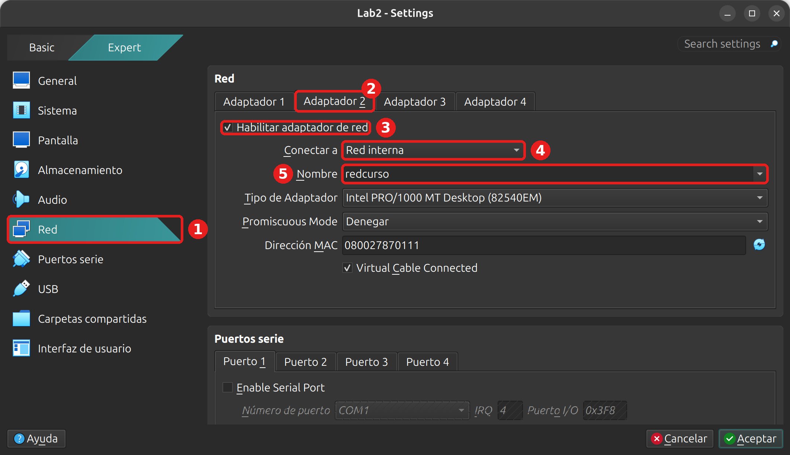

# Laboratorio 20.2 - Samba

## Objetivo

- Armar la red interna entre la VM Debian y la VM Rocky.
- Publicar un directorio de la Debian con Samba y crear el usuario que puede entrar.
- Listar y copiar archivos desde la Rocky con `smbclient`.
- Montar el recurso en la Rocky con `mount -t cifs` y ver de quién son los archivos que se crean.
- Dejar las dos VM como estaban.

### Punto de partida

- La VM Debian del curso, con la cuenta administradora (por ejemplo `cristian`) y el acceso por SSH del [Laboratorio 3](../lab3/lab3.md) (puerto 2222).
- La VM Rocky Linux, con la cuenta `usuario` (contraseña `linux410`) y acceso por SSH en el puerto 2223.

No hace falta haber hecho otros laboratorios, ni el 20.1: todo lo que se instala y se configura acá se crea en el laboratorio y se deshace al final. La teoría está en la [clase 21](https://linux.idepba.com.ar/clase21.html).

> [!IMPORTANT]
> **¿No tenés la VM de Rocky?** Descargá `Lab_Rocky.ova` y `Lab_Rocky.ova.sha256` de [linux-files.idep.atepba.org.ar](https://linux-files.idep.atepba.org.ar/) y seguí los pasos 2 a 4 del [Laboratorio 10.2](../lab10/lab10.2.md): comprobar la descarga, importar la VM e iniciarla. Hacen falta unos 6 GB libres en la anfitriona. Si la VM Rocky ya tiene reglas de reenvío de otros laboratorios, no las toques.

> [!WARNING]
> En la limpieza se desinstala Samba de la Debian y se borran `/etc/samba` y `/var/lib/samba`. Si en tu Debian ya usás Samba para otra cosa, no hagas este laboratorio en esa VM.

> [!NOTE]
> Reemplazá `cristian` por tu usuario. Las fechas, los tiempos de respuesta, los identificadores y los tamaños de tus salidas van a ser otros. Las salidas de `apt` y `dnf` están recortadas: se muestra lo que se instala y se omite el progreso. Las contraseñas no se ven cuando las escribís.

### Qué vamos a armar

La Debian va a ser el servidor Samba y la Rocky, el cliente:

| VM | Papel | Placa | Dirección | Nombre |
| :--- | :--- | :--- | :--- | :--- |
| Debian | servidor Samba | `enp0s8` (red `redcurso`) | `192.168.50.10/24` | `debian` |
| Rocky | cliente | `enp0s8` (red `redcurso`) | `192.168.50.20/24` | `rocky` |

Cada paso dice dónde se trabaja:

- **En la Debian.** Una terminal con `ssh -p 2222 cristian@localhost`. El prompt dice `cristian@lab2-vm`.
- **En la Rocky.** Una terminal con `ssh -p 2223 usuario@localhost`. El prompt dice `[usuario@localhost ~]$`.
- **En la anfitriona.** La terminal de tu equipo (PowerShell en Windows), solo para VirtualBox.

## 0. Preparación: la red interna

> [!TIP]
> **¿Hiciste el [Laboratorio 20.1](lab20.1.md) y dejaste la red armada?** No tenés que conectarla de nuevo: andá directo a «Comprobar». La dirección de la Debian se pierde si reiniciaste la VM; si `ip -br -4 a show enp0s8` no muestra `192.168.50.10/24`, repetí los dos primeros comandos de «La dirección de cada VM».

La segunda placa se agrega igual que en el paso 1 del [Laboratorio 17](../lab17/lab17.md#1-la-red-interna). Si todavía tenés el Adaptador 2 en las dos VM, salteá la parte de VirtualBox y andá a «La dirección de cada VM».

### La segunda placa en VirtualBox

Con las dos VM **apagadas** (`sudo poweroff` desde cada una), hacé esto con cada VM. Con la Debian primero:

1. En VirtualBox, seleccioná la VM y abrí **Configuración**. Si ves el modo **Basic**, pasá a **Expert**.
2. Entrá en **Red** (1).
3. Elegí la pestaña **Adaptador 2** (2).
4. Tildá **Habilitar adaptador de red** (3).
5. En **Conectar a**, elegí **Red interna** (4).
6. En **Nombre**, escribí `redcurso` (5). Tiene que ser el mismo nombre en las dos VM.



Aceptá y repetí lo mismo en la VM Rocky (`Lab_Rocky`). No toques el **Adaptador 1**: ahí están las reglas de reenvío de puertos.

Si preferís la línea de comandos, con las VM apagadas se hace en la anfitriona (cambiá `Lab2` y `Lab_Rocky` por los nombres de tus VM):

```bash
VBoxManage modifyvm Lab2 --nic2 intnet --intnet2 redcurso
VBoxManage modifyvm Lab_Rocky --nic2 intnet --intnet2 redcurso
```

Encendé las dos VM y entrá a cada una por SSH, en dos terminales de la anfitriona:

```bash
ssh -p 2222 cristian@localhost
```

```bash
ssh -p 2223 usuario@localhost
```

### La dirección de cada VM

**En la Debian.** Ponemos la dirección fija en `enp0s8` y levantamos la placa:

```bash
sudo ip addr add 192.168.50.10/24 dev enp0s8
sudo ip link set enp0s8 up
ip -br -4 a show enp0s8
```

```text
enp0s8           UP             192.168.50.10/24 
```

Si la primera vez dice `DOWN`, esperá un segundo y repetí el último comando.

> [!NOTE]
> Con `ip` la dirección se pierde al reiniciar la VM. Si reiniciás en medio del laboratorio, repetí los dos primeros comandos.

**En la Rocky.** La dirección va en una conexión de NetworkManager que llamamos `redcurso`:

```bash
sudo nmcli con add type ethernet ifname enp0s8 con-name redcurso ipv4.method manual ipv4.addresses 192.168.50.20/24 ipv6.method disabled
sudo nmcli con up redcurso
ip -br -4 a show enp0s8
```

```text
Conexión «redcurso» (3a824de4-cef9-42f9-ab5f-4559f3292626) añadida con éxito.
Conexión activada con éxito (ruta activa D-Bus: /org/freedesktop/NetworkManager/ActiveConnection/4)
enp0s8           UP             192.168.50.20/24 
```

### Los nombres `debian` y `rocky`

Para escribir `debian` y `rocky` en lugar de las direcciones, los agregamos a `/etc/hosts`, el archivo donde cada VM anota nombres a mano. Es lo mismo que hace un DNS, pero en un archivo local.

**En las dos.** Primero mirá que no estén ya:

```bash
grep "^192.168.50." /etc/hosts
```

Si no imprime nada, seguí. Si aparecen líneas de otro laboratorio, borralas con `sudo sed -i '/^192.168.50.[12]0 /d' /etc/hosts` y volvé a mirar. Después agregá las dos líneas, en las dos VM:

```bash
printf '192.168.50.10 debian\n192.168.50.20 rocky\n' | sudo tee -a /etc/hosts
```

```text
192.168.50.10 debian
192.168.50.20 rocky
```

`tee -a` muestra lo que agrega al final del archivo.

### Comprobar

**En la Debian:**

```bash
ping -c 2 rocky
```

```text
PING rocky (192.168.50.20) 56(84) bytes of data.
64 bytes from rocky (192.168.50.20): icmp_seq=1 ttl=64 time=0.561 ms
64 bytes from rocky (192.168.50.20): icmp_seq=2 ttl=64 time=1.24 ms

--- rocky ping statistics ---
2 packets transmitted, 2 received, 0% packet loss, time 1003ms
rtt min/avg/max/mdev = 0.561/0.901/1.241/0.340 ms
```

**En la Rocky:**

```bash
ping -c 2 debian
```

```text
PING debian (192.168.50.10) 56(84) bytes of data.
64 bytes from debian (192.168.50.10): icmp_seq=1 ttl=64 time=0.317 ms
64 bytes from debian (192.168.50.10): icmp_seq=2 ttl=64 time=1.02 ms

--- debian ping statistics ---
2 packets transmitted, 2 received, 0% packet loss, time 1004ms
rtt min/avg/max/mdev = 0.317/0.667/1.017/0.350 ms
```

Se ve el nombre entre paréntesis junto a la dirección: el `ping` usó `/etc/hosts`. Si no responde, revisá con `ip -br -4 a` que `enp0s8` tenga su dirección en las dos VM y que la red interna se llame `redcurso` en las dos.

## 1. El servidor Samba en la Debian

Samba publica directorios con el protocolo SMB, el de las redes Windows. A cada recurso compartido se le da un nombre y se lo declara en `/etc/samba/smb.conf`. Además, Samba tiene su propia lista de usuarios con contraseña (paso 3).

**En la Debian.** Instalamos Samba:

```bash
sudo apt install -y samba
```

```text
Installing:
  samba

Installing dependencies:
  attr                  libncurses6           python3-httpx
  dirmngr               libnpth0t64           python3-hyperframe
  gnupg                 libnss-winbind        python3-ldb
  ...
  libyaml-0-2           python3-yaml
  samba-ad-dc           samba-ad-provision
  samba-common          samba-common-bin
  samba-dsdb-modules    samba-libs
  tdb-tools             winbind

Summary:
  Upgrading: 0, Installing: 70, Removing: 0, Not Upgrading: 8
  Download size: 35,2 MB
  Space needed: 164 MB / 16,7 GB available
```

Son 70 paquetes nuevos: en Debian, `samba` trae también `winbind` y `samba-ad-dc`, piezas para dominios que no vamos a usar. Se quitan en la limpieza. Comprobá que el servicio quedó activo:

```bash
systemctl status smbd --no-pager
sudo ss -4tuln | grep -E ":(139|445) "
```

```text
● smbd.service - Samba SMB Daemon
     Loaded: loaded (/usr/lib/systemd/system/smbd.service; enabled; preset: enabled)
     Active: active (running) since Fri 2026-11-20 00:07:08 -03; 9s ago
 Invocation: e2be74e3d4414c518d332048ca1a6807
       Docs: man:smbd(8)
             man:samba(7)
             man:smb.conf(5)
   Main PID: 2295 (smbd)
     Status: "smbd: ready to serve connections..."
      Tasks: 3 (limit: 1041)
     Memory: 13.2M (peak: 13.5M)
        CPU: 109ms
     CGroup: /system.slice/smbd.service
             ├─2295 /usr/sbin/smbd --foreground --no-process-group
             ├─2298 "smbd: notifyd" .
             └─2299 "smbd: cleanupd "
tcp   LISTEN 0      50            0.0.0.0:139       0.0.0.0:*   
tcp   LISTEN 0      50            0.0.0.0:445       0.0.0.0:*   
```

El servicio de archivos se llama `smbd`, está `enabled` (arranca con la VM) y `active (running)`. Escucha en los puertos 445 (SMB) y 139 (SMB sobre NetBIOS, el protocolo viejo). Todavía no comparte nada nuestro.

Creamos el directorio, que va a ser de tu usuario, con un archivo de prueba:

```bash
sudo mkdir -p /srv/samba/compartido
sudo chown $USER: /srv/samba/compartido
echo "hola desde Debian" > /srv/samba/compartido/hola.txt
ls -ld /srv/samba/compartido
ls -l /srv/samba/compartido
```

```text
drwxr-xr-x 2 cristian cristian 4096 nov 20 00:07 /srv/samba/compartido
total 4
-rw-rw-r-- 1 cristian cristian 18 nov 20 00:07 hola.txt
```

Ahora declaramos el recurso. Agregamos un bloque al final de `/etc/samba/smb.conf`. El nombre entre corchetes es el del recurso. `path` es el directorio, `read only = no` permite escribir y `valid users` limita quién entra. Como el `EOF` del comando no lleva comillas, el shell reemplaza `$USER` por tu usuario:

```bash
sudo tee -a /etc/samba/smb.conf > /dev/null << EOF

[compartido]
   path = /srv/samba/compartido
   read only = no
   valid users = $USER
EOF
tail -5 /etc/samba/smb.conf
```

```text

[compartido]
   path = /srv/samba/compartido
   read only = no
   valid users = cristian
```

`testparm` revisa `smb.conf` y muestra cómo lo entendió Samba. Con `-s` imprime la configuración completa sin esperar una tecla. Es larga, así que nos quedamos con nuestro bloque:

```bash
testparm -s 2>/dev/null | grep -A3 '^\[compartido\]'
```

```text
[compartido]
	path = /srv/samba/compartido
	read only = No
	valid users = cristian
```

Está bien: `testparm` normalizó lo que escribimos (`read only = No`). Samba relee el archivo con un `reload`, sin cortar a nadie:

```bash
sudo systemctl reload smbd
systemctl is-active smbd
```

```text
active
```

## 2. El cliente en la Rocky

**En la Rocky.** La OVA no trae las herramientas de cliente de Samba. Instalamos `samba-client` (que trae `smbclient`) y `cifs-utils` (el comando para montar):

```bash
sudo dnf install -y samba-client cifs-utils
```

```text
Instalando:
 cifs-utils              x86_64       7.7-1.el9           baseos          114 k
 samba-client            x86_64       4.24.5-2.el9        appstream       736 k
Actualizando:
 libldb                  x86_64       4.24.5-2.el9        baseos          181 k
 libtalloc               x86_64       2.4.4-1.el9         baseos           33 k
 libtdb                  x86_64       1.4.15-1.el9        baseos           53 k
Instalando dependencias:
 libicu                  x86_64       67.1-10.el9_6       baseos          9.6 M
 libsmbclient            x86_64       4.24.5-2.el9        baseos           75 k
 libwbclient             x86_64       4.24.5-2.el9        baseos           43 k
 samba-client-libs       x86_64       4.24.5-2.el9        baseos          3.1 M
 samba-common            noarch       4.24.5-2.el9        baseos          180 k
 samba-core-libs         x86_64       4.24.5-2.el9        baseos          483 k
 samba-ndr-libs          x86_64       4.24.5-2.el9        baseos          1.2 M

Resumen de la transacción
================================================================================
Instalar    9 Paquetes
Actualizar  3 Paquetes
```

Son dos paquetes pedidos, siete dependencias y tres bibliotecas que se actualizan (esas no se deshacen al final).

Probemos entrar al recurso con el usuario `cristian`. `smbclient //servidor/recurso` abre una sesión, `-U` dice con qué usuario y `-c` pasa un comando, acá `ls`. Pide una contraseña: escribí cualquiera.

```bash
smbclient //debian/compartido -U cristian -c 'ls'
```

```text
tree connect failed: NT_STATUS_ACCESS_DENIED
```

Acceso denegado. En Linux `cristian` tiene la contraseña de la VM, pero Samba no la usa: guarda las suyas en otra lista, y `cristian` todavía no está en ella. Lo arreglamos en el paso siguiente.

## 3. El usuario de Samba

**En la Debian.** `smbpasswd -a` agrega al usuario a la lista de Samba y le pone una contraseña. El usuario tiene que existir también en el sistema, y `cristian` ya existe. Pide la contraseña dos veces: usá `linux410`, que es la que vamos a usar en el resto del laboratorio. Puede ser otra, pero acordate de cuál.

```bash
sudo smbpasswd -a $USER
```

```text
New SMB password:
Retype new SMB password:
Added user cristian.
```

```bash
sudo pdbedit -L
```

```text
cristian:1000:cristian
```

`pdbedit -L` lista los usuarios de Samba: el nombre, el UID y el nombre completo.

**En la Rocky.** Probamos de nuevo. Primero la lista de recursos del servidor, con `-L`. Cuando pida la contraseña, escribí la de Samba:

```bash
smbclient -L //debian -U cristian
```

```text
	Sharename       Type      Comment
	---------       ----      -------
	print$          Disk      Printer Drivers
	compartido      Disk      
	IPC$            IPC       IPC Service (Samba 4.22.11-Debian-4.22.11+dfsg-0+deb13u1)
	cristian        Disk      Home Directories
SMB1 disabled -- no workgroup available
```

Aparece `compartido`, nuestro recurso. `print$`, `IPC$` y `cristian` vienen con la configuración de fábrica. La última línea avisa que SMB1, el protocolo viejo, está apagado, y es lo que corresponde.

Ahora entramos al recurso: listamos, copiamos un archivo de la Rocky al servidor con `put` y listamos otra vez.

```bash
smbclient //debian/compartido -U cristian -c 'ls; put /etc/os-release desde-rocky.txt; ls'
```

```text
  .                                   D        0  Fri Nov 20 00:07:18 2026
  ..                                  D        0  Fri Nov 20 00:07:18 2026
  hola.txt                            N       18  Fri Nov 20 00:07:18 2026

		19490008 blocks of size 1024. 16083024 blocks available
putting file /etc/os-release as \desde-rocky.txt (282,7 kB/s) (average 282,7 kB/s)
  .                                   D        0  Fri Nov 20 00:07:45 2026
  ..                                  D        0  Fri Nov 20 00:07:45 2026
  desde-rocky.txt                     A      579  Fri Nov 20 00:07:52 2026
  hola.txt                            N       18  Fri Nov 20 00:07:18 2026

		19490008 blocks of size 1024. 16083020 blocks available
```

La primera lista solo tiene `hola.txt`; la segunda ya muestra `desde-rocky.txt`. Veamos cómo quedó del lado de la Debian:

**En la Debian:**

```bash
ls -l /srv/samba/compartido
head -3 /srv/samba/compartido/desde-rocky.txt
```

```text
total 8
-rwxr--r-- 1 cristian cristian 579 nov 20 00:07 desde-rocky.txt
-rw-rw-r-- 1 cristian cristian  18 nov 20 00:07 hola.txt
NAME="Rocky Linux"
VERSION="9.8 (Blue Onyx)"
RELEASE_TYPE="stable"
```

El archivo es de `cristian`: Samba crea los archivos a nombre del usuario con el que se entró, no del usuario del cliente. La `x` de `desde-rocky.txt` sale de una opción de Samba (`map archive`, que viene activada) que marca con ese bit los archivos nuevos.

## 4. Montar el recurso con `mount -t cifs`

Con `smbclient` hay que entrar y salir cada vez. `mount -t cifs` monta el recurso en un directorio, como si fuera un disco, y desde ahí se usan los comandos de siempre. CIFS es el nombre del cliente SMB del kernel.

**En la Rocky.** Creamos el directorio de montaje y montamos. `username` es el usuario de Samba. Con `uid=` y `gid=` el cliente muestra todo a nombre de `usuario`: sin esas opciones los archivos se verían de `root` y `usuario` no podría escribir. Pide la contraseña de Samba:

```bash
sudo mkdir -p /mnt/samba
sudo mount -t cifs //debian/compartido /mnt/samba -o username=cristian,uid=usuario,gid=usuario
```

```text
Password for cristian@//debian/compartido:
```

Escribí la contraseña de Samba. Si te equivocás, el montaje termina con `mount error(13): Permission denied`. Comprobamos:

```bash
findmnt /mnt/samba
ls -l /mnt/samba
```

```text
TARGET     SOURCE              FSTYPE OPTIONS
/mnt/samba //debian/compartido cifs   rw,relatime,vers=3.1.1,cache=strict,upcall_target=app,username=cristian,uid=1000,forceuid,gid=1000,forcegid,addr=192.168.50.10,file_mode=0755,dir_mode=0755,soft,nounix,serverino,mapposix,reparse=nfs,nativesocket,symlink=native,rsize=4194304,wsize=4194304,bsize=1048576,echo_interval=60,actimeo=1,closetimeo=1
total 8
-rwxr-xr-x. 1 usuario usuario 579 nov 20 00:07 desde-rocky.txt
-rwxr-xr-x. 1 usuario usuario  18 nov 20 00:07 hola.txt
```

En `findmnt` mirá `cifs`, `vers=3.1.1` (la versión de SMB que se negoció), `uid=1000` y `gid=1000` (los de `usuario`). Los permisos `rwxr-xr-x` también los pone el cliente (`file_mode` y `dir_mode`), no el servidor.

Ahora creamos un archivo como `usuario`:

```bash
echo "escrito desde Rocky por cifs" > /mnt/samba/montado.txt
ls -l /mnt/samba
```

```text
total 9
-rwxr-xr-x. 1 usuario usuario 579 nov 20 00:07 desde-rocky.txt
-rwxr-xr-x. 1 usuario usuario  18 nov 20 00:07 hola.txt
-rwxr-xr-x. 1 usuario usuario  29 nov 20 00:07 montado.txt
```

**En la Debian:**

```bash
ls -l /srv/samba/compartido
ls -ln /srv/samba/compartido/montado.txt
```

```text
total 12
-rwxr--r-- 1 cristian cristian 579 nov 20 00:07 desde-rocky.txt
-rw-rw-r-- 1 cristian cristian  18 nov 20 00:07 hola.txt
-rwxr--r-- 1 cristian cristian  29 nov 20 00:07 montado.txt
-rwxr--r-- 1 1000 1000 29 nov 20 00:07 /srv/samba/compartido/montado.txt
```

En la Rocky los tres archivos figuran de `usuario` y en la Debian, de `cristian`. Cada lado lo ve a su manera: el servidor, como el usuario de Samba; el cliente, como lo dicen `uid=` y `gid=`.

## 5. Limpieza

Deshacemos todo en orden: primero el cliente, después el servidor y al final la red. Trabajá en cada VM desde su propia terminal, la del puerto 2222 o 2223.

### La Rocky

**En la Rocky.** Desmontamos, borramos el directorio de montaje y los paquetes:

```bash
sudo umount /mnt/samba
sudo rmdir /mnt/samba
sudo dnf remove -y samba-client cifs-utils
```

```text
Eliminando:
 cifs-utils             x86_64      7.7-1.el9             @baseos         269 k
 samba-client           x86_64      4.24.5-2.el9          @appstream      2.7 M
Eliminando dependencias sin uso:
 libicu                 x86_64      67.1-10.el9_6         @baseos          33 M
 libsmbclient           x86_64      4.24.5-2.el9          @baseos         178 k
 libwbclient            x86_64      4.24.5-2.el9          @baseos          73 k
 samba-client-libs      x86_64      4.24.5-2.el9          @baseos          12 M
 samba-common           noarch      4.24.5-2.el9          @baseos         218 k
 samba-core-libs        x86_64      4.24.5-2.el9          @baseos         1.8 M
 samba-ndr-libs         x86_64      4.24.5-2.el9          @baseos         4.8 M
```

`dnf remove` quita los dos paquetes y las siete dependencias que se instalaron solo para ellos. No corras `dnf autoremove`: en la OVA quita además paquetes que no tienen que ver con este laboratorio. Las tres bibliotecas que se actualizaron en el paso 2 (`libldb`, `libtalloc`, `libtdb`) quedan en la versión nueva.

Después quitamos las líneas de `/etc/hosts` y la conexión de la red interna:

```bash
sudo sed -i '/^192.168.50.[12]0 /d' /etc/hosts
grep "^192.168.50." /etc/hosts; echo "grep rc=$?"
sudo nmcli con delete redcurso
```

```text
grep rc=1
La conexión «redcurso» (ddd733dd-76fa-4c0c-bc0f-c08c6e66edca) se ha borrado correctamente.
```

El `sed` borra las líneas que empiezan con `192.168.50.10 ` o `192.168.50.20 `. `grep` ya no encuentra nada (código 1).

### Samba en la Debian

**En la Debian.** Desinstalamos Samba con `purge`, que borra también su configuración y la lista de usuarios de Samba, y `gnupg`: lo trajo Samba, pero `apt` no lo da por sobrante y no se va con el resto. Después, `autoremove --purge` quita las dependencias que quedaron sin uso:

```bash
sudo apt purge -y samba gnupg
sudo apt autoremove -y --purge
```

```text
REMOVING:
  gnupg*  samba*  samba-ad-dc*
...
REMOVING:
  attr*                  libnss-winbind*      python3-ldb*
  dirmngr*               libpam-winbind*      python3-linkify-it*
  gnupg-l10n*            libpython3.13*       python3-markdown*
  ...
Summary:
  Upgrading: 0, Installing: 0, Removing: 60, Not Upgrading: 8
  Freed space: 149 MB
...
```

Se van 63 paquetes en total. Quedan siete paquetes chicos de criptografía que `autoremove` no quita y los grupos `sambashare` y `winbindd_priv`; no molestan. Borramos el directorio compartido:

```bash
sudo rm -r /srv/samba
```

Por último, los nombres de `/etc/hosts`:

```bash
sudo sed -i '/^192.168.50.[12]0 /d' /etc/hosts
grep "^192.168.50." /etc/hosts; echo "grep rc=$?"
```

```text
grep rc=1
```

### La dirección de la Debian

**En la Debian:**

```bash
sudo ip addr del 192.168.50.10/24 dev enp0s8
ip -br -4 a show enp0s8
```

Los dos comandos no imprimen nada: `enp0s8` ya no tiene dirección IPv4.

### La segunda placa

Quitá el Adaptador 2 solo si no lo vas a usar en los próximos laboratorios. Con las VM apagadas, en **Configuración → Red → Adaptador 2** destildá **Habilitar adaptador de red**, o en la anfitriona:

```bash
VBoxManage modifyvm Lab2 --nic2 none
VBoxManage modifyvm Lab_Rocky --nic2 none
```

## Resumen del laboratorio

- Samba (`samba`) publica recursos con el protocolo SMB. Cada recurso es un bloque `[nombre]` de `/etc/samba/smb.conf`, con `path`, `read only` y `valid users`. `testparm -s` revisa el archivo y `systemctl reload smbd` lo aplica.
- Samba tiene su propia lista de usuarios: `smbpasswd -a` agrega uno (que ya existe en el sistema) con su contraseña de Samba y `pdbedit -L` los lista. Sin eso, el acceso da `NT_STATUS_ACCESS_DENIED`.
- Desde la Rocky, `smbclient -L //servidor` lista los recursos y `smbclient //servidor/recurso -c 'comandos'` entra y copia. Hacen falta `samba-client` y `cifs-utils`.
- `mount -t cifs //servidor/recurso /punto -o username=...,uid=...,gid=...` monta el recurso. Con `uid=` y `gid=` el cliente muestra los archivos a nombre de ese usuario y puede escribir.
- Lo que se crea desde el cliente queda en el servidor a nombre del usuario de Samba.
- `apt purge` y `dnf remove` no deshacen todo: quedan los grupos `sambashare` y `winbindd_priv`, siete paquetes de criptografía en la Debian y las bibliotecas que `dnf` actualizó en la Rocky.

## Enlaces útiles y referencias

- Ayuda: `man smb.conf`, `man smbclient`, `man smbpasswd`, `man testparm`, `man mount.cifs`. En línea (en inglés): [`smb.conf`](https://manpages.debian.org/trixie/samba/smb.conf.5.en.html), [`smbclient`](https://manpages.debian.org/trixie/smbclient/smbclient.1.en.html) y [`mount.cifs`](https://manpages.debian.org/trixie/cifs-utils/mount.cifs.8.en.html).
- Samba: [documentación oficial](https://www.samba.org/samba/docs/), en inglés.
- Clase 21: [presentación](https://linux.idepba.com.ar/clase21.html).
- Anterior: [Laboratorio 20.1 - NFS y SSHFS](lab20.1.md).

-----

<p align="center">

</p>
